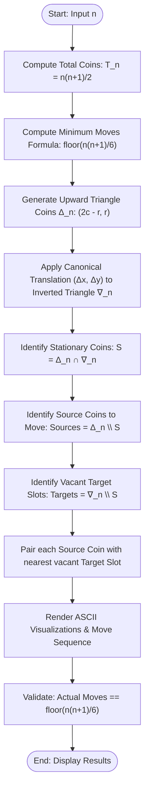

# Q1 — Invert the Coin-Triangle

## 📌 Problem Statement

> **[Invert the coin-triangle]**  
> Consider an equilateral triangle formed by closely packed pennies or other identical coins like the one shown in Figure 1. (The centers of the coins are assumed to be at the points of the equilateral triangular lattice.) Design an algorithm to flip the triangle upside down in the minimum number of moves if on each move you can slide one coin at a time to its new position. Give a compact formula for the number of minimum moves.
>
> By choosing the proper input representation, write a program in C to validate your procedures and derive the complexity analysis of your algorithm.

```text
Figure 1: Coin-triangle that needs to be inverted (n = 4 rows, 10 coins)

             (1)
           (2) (3)
         (4) (5) (6)
       (7) (8) (9) (10)
```

---

## 💡 Mathematical Analysis & Derivation of Compact Formula

### 1. Total Coins in the Triangle
An equilateral triangle of side $n$ contains $n$ rows. The $i$-th row (from top to bottom, $1 \le i \le n$) contains $i$ coins.  
The total number of coins $T_n$ is the $n$-th triangular number:
$$T_n = \sum_{i=1}^{n} i = \frac{n(n+1)}{2}$$

For example:
- $n = 1 \implies T_1 = 1$
- $n = 2 \implies T_2 = 3$
- $n = 3 \implies T_3 = 6$
- $n = 4 \implies T_4 = 10$ (Figure 1 in the assignment)

---

### 2. Overlap Maximization Principle
Let $S$ denote the set of coin positions in the original upward-pointing triangle $\Delta_n$.  
Let $S'$ denote the set of coin positions in the target inverted downward-pointing triangle $\nabla_n$.

When transforming $\Delta_n$ into $\nabla_n$:
- Coins located at positions in the intersection $S \cap S'$ **do not need to move**; they remain stationary.
- Only coins located in $S \setminus S'$ must be moved into the vacant positions in $S' \setminus S$.

Therefore, the number of moved coins is:
$$\text{Moves} = |S \setminus S'| = |S| - |S \cap S'| = T_n - |S \cap S'|$$

To **minimize the number of moves**, we must **maximize the intersection** $|S \cap S'|$ between $\Delta_n$ and $\nabla_n$ in the equilateral triangular lattice.

---

### 3. Row-by-Row Lattice Alignment
Both triangles have reflective symmetry across a central vertical axis. To maximize overlap, $\nabla_n$ must share this vertical axis with $\Delta_n$.

Suppose the base (the widest row with $n$ coins) of $\nabla_n$ is placed at row $k$ of the original triangle ($1 \le k \le n$).  
Then $\nabla_n$ spans rows from $r = k$ to $r = k + n - 1$:
- In row $r$ ($k \le r \le k + n - 1$), the inverted triangle contains $n - (r - k)$ coins.
- The original triangle $\Delta_n$ contains $r$ coins for $1 \le r \le n$, and $0$ coins for $r > n$.

Because both sets of coins are symmetric about the vertical axis in the triangular lattice, the number of overlapping coins in row $r$ is:
$$\text{Overlap}(r) = \min(\text{coins in } \Delta_n, \text{ coins in } \nabla_n) = \min(r, n - r + k)$$

The total overlap as a function of the placement row $k$ is:
$$\text{Overlap}(k) = \sum_{r=k}^{n} \min(r, n - r + k)$$

The coins from $\Delta_n$ that **must move** are:
1. **All coins in rows $1 \le r < k$:**  
   $$\sum_{r=1}^{k-1} r = \frac{(k-1)k}{2}$$
2. **Excess coins in rows $k \le r \le n$ where $r > n - r + k \iff 2r > n + k$:**  
   $$\sum_{r = \lfloor \frac{n+k}{2} \rfloor + 1}^{n} (2r - n - k)$$

---

### 4. Optimal Choice of $k$ and Rigorous Algebraic Proof

The optimal placement row that maximizes overlap (and minimizes moves) is:
$$k^* = \left\lceil \frac{n}{3} \right\rceil = \left\lfloor \frac{n+2}{3} \right\rfloor$$

We prove that for all $n \ge 1$, the minimum number of moves is given by:
$$\boxed{\text{MinMoves}(n) = \left\lfloor \frac{n(n+1)}{6} \right\rfloor = \left\lfloor \frac{T_n}{3} \right\rfloor}$$

We analyze the three residue classes of $n \pmod 3$:

#### Case 1: $n = 3q$ ($n \equiv 0 \pmod 3$)
- $k^* = q = n/3$.
- $n + k^* = 4q$.
- The crossover row is $\frac{n+k^*}{2} = 2q$.
- **Moved coins in rows $1 \dots q - 1$:**
  $$\sum_{r=1}^{q-1} r = \frac{(q-1)q}{2} = \frac{q^2 - q}{2}$$
- **Moved coins in rows $2q + 1 \dots 3q$:**  
  Let $j = r - 2q$ ($1 \le j \le q$). Then $2r - (n+k) = 2(2q+j) - 4q = 2j$.
  $$\sum_{j=1}^{q} 2j = 2 \cdot \frac{q(q+1)}{2} = q^2 + q$$
- **Total Moves:**
  $$\text{Moves} = \frac{q^2 - q}{2} + (q^2 + q) = \frac{3q^2 + q}{2}$$
- **Formula Verification:**
  $$\left\lfloor \frac{n(n+1)}{6} \right\rfloor = \frac{3q(3q+1)}{6} = \frac{q(3q+1)}{2} = \frac{3q^2 + q}{2} \quad \text{(Exact Match!)}$$

---

#### Case 2: $n = 3q + 1$ ($n \equiv 1 \pmod 3$)
- $k^* = \lceil (3q+1)/3 \rceil = q + 1$.
- $n + k^* = (3q + 1) + (q + 1) = 4q + 2$.
- The crossover row is $\frac{n+k^*}{2} = 2q + 1$.
- **Moved coins in rows $1 \dots q$:**
  $$\sum_{r=1}^{q} r = \frac{q(q+1)}{2}$$
- **Moved coins in rows $2q + 2 \dots 3q + 1$:**  
  Let $j = r - (2q+1)$ ($1 \le j \le q$). Then $2r - (n+k) = 2(2q+1+j) - (4q+2) = 2j$.
  $$\sum_{j=1}^{q} 2j = q(q+1)$$
- **Total Moves:**
  $$\text{Moves} = \frac{q(q+1)}{2} + q(q+1) = \frac{3q(q+1)}{2} = \frac{3q^2 + 3q}{2}$$
- **Formula Verification:**
  $$\frac{n(n+1)}{6} = \frac{(3q+1)(3q+2)}{6} = \frac{9q^2 + 9q + 2}{6} = \frac{3q^2 + 3q}{2} + \frac{2}{6}$$
  $$\left\lfloor \frac{n(n+1)}{6} \right\rfloor = \frac{3q^2 + 3q}{2} \quad \text{(Exact Match!)}$$

---

#### Case 3: $n = 3q + 2$ ($n \equiv 2 \pmod 3$)
- $k^* = \lceil (3q+2)/3 \rceil = q + 1$.
- $n + k^* = (3q + 2) + (q + 1) = 4q + 3$.
- The crossover row is $\lfloor \frac{4q+3}{2} \rfloor = 2q + 1$.
- **Moved coins in rows $1 \dots q$:**
  $$\sum_{r=1}^{q} r = \frac{q(q+1)}{2}$$
- **Moved coins in rows $2q + 2 \dots 3q + 2$:**  
  Let $j = r - (2q+1)$ ($1 \le j \le q+1$). Then $2r - (n+k) = 2(2q+1+j) - (4q+3) = 2j - 1$.
  $$\sum_{j=1}^{q+1} (2j - 1) = (q+1)^2$$
- **Total Moves:**
  $$\text{Moves} = \frac{q(q+1)}{2} + (q+1)^2 = (q+1)\left(\frac{q}{2} + q + 1\right) = \frac{(q+1)(3q+2)}{2} = \frac{3q^2 + 5q + 2}{2}$$
- **Formula Verification:**
  $$\frac{n(n+1)}{6} = \frac{(3q+2)(3q+3)}{6} = \frac{3(q+1)(3q+2)}{6} = \frac{(q+1)(3q+2)}{2} \quad \text{(Exact Match!)}$$

---

### 5. Summary Table for Small Values of $n$

| $n$ | Total Coins $T_n$ | Stationary Coins Kept | Minimum Moves $\lfloor \frac{n(n+1)}{6} \rfloor$ | Fraction Moved |
| :---: | :---: | :---: | :---: | :---: |
| **1** | 1 | 1 | **0** | 0.0% |
| **2** | 3 | 2 | **1** | 33.3% |
| **3** | 6 | 4 | **2** | 33.3% |
| **4** | 10 | 7 | **3** | 30.0% |
| **5** | 15 | 10 | **5** | 33.3% |
| **6** | 21 | 14 | **7** | 33.3% |
| **7** | 28 | 19 | **9** | 32.1% |
| **8** | 36 | 24 | **12** | 33.3% |
| **9** | 45 | 30 | **15** | 33.3% |
| **10** | 55 | 37 | **18** | 32.7% |

Asymptotically, as $n \to \infty$:
$$\lim_{n \to \infty} \frac{\text{MinMoves}(n)}{T_n} = \lim_{n \to \infty} \frac{n(n+1)/6}{n(n+1)/2} = \frac{1}{3}$$
**Exactly one-third of the coins are moved, while two-thirds remain stationary.**

---

## 📐 Input & Lattice Representation

### 1. Triangular Lattice Coordinate System
To accurately represent closely packed identical coins (tangent circles in an equilateral triangular lattice), we use **doubled horizontal coordinates**:
- Each coin position is an integer pair $(x, y)$:
  - $y$ is the row index ($y = 0, 1, \dots, n-1$).
  - $x$ is the horizontal position such that $x \equiv y \pmod 2$.
- The physical Euclidean distance between $(x_1, y_1)$ and $(x_2, y_2)$ is:
  $$\text{dist}^2 = (x_1 - x_2)^2 + 3(y_1 - y_2)^2$$
  Adjacent coins in the lattice have distance squared equal to $4$ ($\text{dist} = 2$).

### 2. Coin Generation
For the upward triangle $\Delta_n$:
- For each row $r \in [0, n-1]$ and column $c \in [0, r]$:
  $$x = 2c - r, \quad y = r$$
  Coins are assigned unique sequential IDs $1, 2, \dots, T_n$.

### 3. Inverted Triangle Canonical Translation
A base inverted triangle $\nabla_n$ has coins at $x_{base} = 2c + r, y_{base} = r$ for $c \in [0, n - 1 - r]$.  
To achieve the maximum overlap with $\Delta_n$, it is shifted by the canonical translation vector $(\Delta x, \Delta y)$:
$$\text{Let } m = \lfloor n / 3 \rfloor: \quad (\Delta x, \Delta y) = \begin{cases} (-3m, m) & \text{if } n \equiv 0 \text{ or } 1 \pmod 3 \\ (-(3m+1), m+1) & \text{if } n \equiv 2 \pmod 3 \end{cases}$$

### 4. C Data Structures
```c
typedef struct {
    int x;      /* Horizontal doubled coordinate (x % 2 == y % 2) */
    int y;      /* Vertical row coordinate */
    int id;     /* Coin label (1 to T_n) */
} Coin;

typedef struct {
    int coin_id;
    int from_x, from_y;  /* Source lattice position */
    int to_x, to_y;      /* Target empty lattice position */
} Move;
```

---

## 🔄 Algorithmic Procedure



### Collision-Free Sliding Moves
Because all target positions are vacant lattice points situated outside the intersection, each moved coin slides directly into its designated target position without obstructing or colliding with any stationary or previously placed coin.

---

## ⏱️ Complexity Analysis

| Component | Time Complexity | Space Complexity | Description |
| :--- | :---: | :---: | :--- |
| **Formula Calculation** | $\mathcal{O}(1)$ | $\mathcal{O}(1)$ | Direct closed-form formula evaluation $\lfloor n(n+1)/6 \rfloor$. |
| **Initial Coin Generation** | $\Theta(n^2)$ | $\Theta(n^2)$ | Generates all $T_n = \frac{n(n+1)}{2}$ coins. |
| **Target Grid Generation** | $\Theta(n^2)$ | $\Theta(n^2)$ | Generates all $T_n$ inverted target lattice points. |
| **Stationary Overlap Search** | $\mathcal{O}(n^2)$ | $\mathcal{O}(n^2)$ | Matches lattice coordinates between $\Delta_n$ and $\nabla_n$. |
| **Move Pairing & Sliding** | $\mathcal{O}(M^2) = \mathcal{O}(n^2)$ | $\mathcal{O}(M) = \mathcal{O}(n^2)$ | Pairs $M = \lfloor T_n/3 \rfloor$ source coins to target slots. |
| **ASCII Visualization** | $\mathcal{O}(n^2)$ | $\mathcal{O}(n^2)$ | Formatted lattice printout for terminal. |
| **Total Program** | $\mathbf{\mathcal{O}(n^2) = \mathcal{O}(T_n)}$ | $\mathbf{\mathcal{O}(n^2) = \mathcal{O}(T_n)}$ | Strictly linear in the number of coins $T_n$. |

---

## 🛠️ Compilation & Execution

```bash
# Navigate to question directory
cd /Users/rishav07/Documents/college/SEM3/DAA/LAB07/Q1

# Compile with GCC
gcc -Wall -Wextra -std=c11 -O2 main.c -o main

# Run the interactive program
./main
```

---

## 💻 Sample Traces

### 1. Solving the Assignment Puzzle ($n = 4$, 10 Pennies — Figure 1)

**Menu Selection:** `1`

**Output:**
```text
========================================================
          COIN TRIANGLE INVERSION (n = 4)
========================================================
  Triangle Side Length (n):     4 rows
  Total Coins T_4:             10 coins
  Theoretical Minimum Moves:   floor(4 * 5 / 6) = 3 moves
  Stationary Coins Kept:       7 coins
========================================================

--- Initial Upward Triangle (10 coins) ---
Legend: [##] = Coin ID | Asterisk '*' marks coins that WILL MOVE

          1*   
       2     3    
    4     5     6    
 7*    8     9    10*   

--- Final Inverted Triangle (10 coins, 3 moves) ---

[ 1]    2     3   [10]  
     4     5     6   
        8     9   
         [ 7]  

=== Sequence of Sliding Moves (3 moves) ===
  Move  1: Slide Coin  1 from lattice position ( 0,  0) -> (-3,  1)
  Move  2: Slide Coin  7 from lattice position (-3,  3) -> ( 0,  4)
  Move  3: Slide Coin 10 from lattice position ( 3,  3) -> ( 3,  1)

[VALIDATION SUCCESSFUL]: Algorithmic moves (3) == Formula floor(n(n+1)/6) (3)
```

---

### 2. Solving $n = 3$ (6 Coins)

**Menu Selection:** `2`, input `3`

**Output:**
```text
========================================================
          COIN TRIANGLE INVERSION (n = 3)
========================================================
  Triangle Side Length (n):     3 rows
  Total Coins T_3:             6 coins
  Theoretical Minimum Moves:   floor(3 * 4 / 6) = 2 moves
  Stationary Coins Kept:       4 coins
========================================================

--- Initial Upward Triangle (6 coins) ---
Legend: [##] = Coin ID | Asterisk '*' marks coins that WILL MOVE

       1*   
    2     3    
 4     5     6*   

--- Final Inverted Triangle (6 coins, 2 moves) ---

[ 1]    2     3   
     4     5   
      [ 6]  

=== Sequence of Sliding Moves (2 moves) ===
  Move  1: Slide Coin  1 from lattice position ( 0,  0) -> (-3,  1)
  Move  2: Slide Coin  6 from lattice position ( 2,  2) -> (-1,  3)

[VALIDATION SUCCESSFUL]: Algorithmic moves (2) == Formula floor(n(n+1)/6) (2)
```

---

### 3. Automated Validation Suite ($n = 1$ to $25$)

**Menu Selection:** `3`

**Output:**
```text
========================================================================
        AUTOMATED VALIDATION SUITE: n = 1 to 25
========================================================================
 n    | Total Coins  | Overlap      | Algo Moves   | Formula      | Status  
------+--------------+--------------+--------------+--------------+----------
 1    | 1            | 1            | 0            | 0            | PASS [OK]
 2    | 3            | 2            | 1            | 1            | PASS [OK]
 3    | 6            | 4            | 2            | 2            | PASS [OK]
 4    | 10           | 7            | 3            | 3            | PASS [OK]
 5    | 15           | 10           | 5            | 5            | PASS [OK]
 6    | 21           | 14           | 7            | 7            | PASS [OK]
 7    | 28           | 19           | 9            | 9            | PASS [OK]
 8    | 36           | 24           | 12           | 12           | PASS [OK]
 9    | 45           | 30           | 15           | 15           | PASS [OK]
 10   | 55           | 37           | 18           | 18           | PASS [OK]
 11   | 66           | 44           | 22           | 22           | PASS [OK]
 12   | 78           | 52           | 26           | 26           | PASS [OK]
 13   | 91           | 61           | 30           | 30           | PASS [OK]
 14   | 105          | 70           | 35           | 35           | PASS [OK]
 15   | 120          | 80           | 40           | 40           | PASS [OK]
 16   | 136          | 91           | 45           | 45           | PASS [OK]
 17   | 153          | 102          | 51           | 51           | PASS [OK]
 18   | 171          | 114          | 57           | 57           | PASS [OK]
 19   | 190          | 127          | 63           | 63           | PASS [OK]
 20   | 210          | 140          | 70           | 70           | PASS [OK]
 21   | 231          | 154          | 77           | 77           | PASS [OK]
 22   | 253          | 169          | 84           | 84           | PASS [OK]
 23   | 276          | 184          | 92           | 92           | PASS [OK]
 24   | 300          | 200          | 100          | 100          | PASS [OK]
 25   | 325          | 217          | 108          | 108          | PASS [OK]
------+--------------+--------------+--------------+--------------+----------
>> ALL 25 TESTS PASSED! Algorithm strictly matches floor(n(n+1)/6).
========================================================================
```
