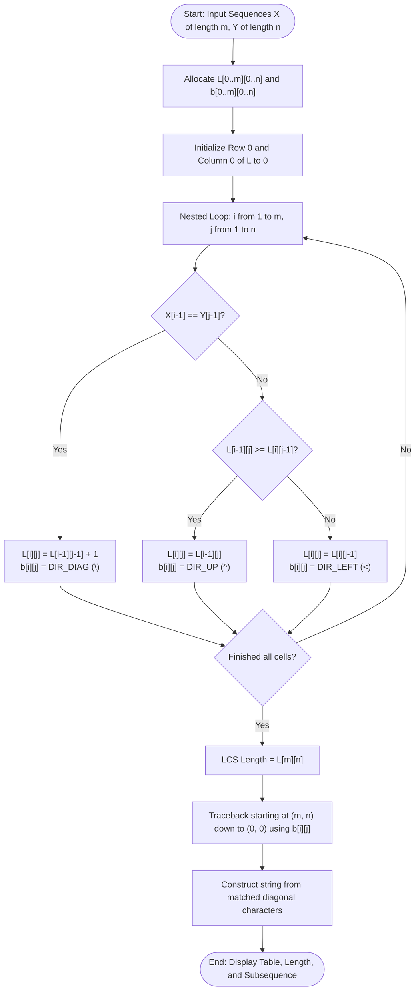

# Question 3: Longest Common Subsequence (LCS)

<div align="center">


</div>

---

## 📌 Problem Statement

> Given two sequences $X = \langle x_1, x_2, \dots, x_m \rangle$ and $Y = \langle y_1, y_2, \dots, y_n \rangle$, compute the length of their longest common subsequence and reconstruct the actual subsequence string.
>
> By choosing the proper input representation, write a program in C to validate your algorithm and derive the complexity analysis of your algorithm.

---

## 🧠 Theoretical Formulation

### 1. Subsequence Definition
A subsequence of sequence $X$ is obtained by deleting zero or more elements without changing the relative order of the remaining elements. A common subsequence of $X$ and $Y$ is a sequence that is a subsequence of both $X$ and $Y$.

### 2. Optimal Substructure (CLRS Theorem 15.1)
Let $X = \langle x_1, \dots, x_m \rangle$ and $Y = \langle y_1, \dots, y_n \rangle$, and let $Z = \langle z_1, \dots, z_k \rangle$ be any LCS of $X$ and $Y$:
1. If $x_m = y_n$, then $z_k = x_m = y_n$ and $Z_{k-1}$ is an LCS of $X_{m-1}$ and $Y_{n-1}$.
2. If $x_m \neq y_n$, then $z_k \neq x_m \implies Z$ is an LCS of $X_{m-1}$ and $Y$.
3. If $x_m \neq y_n$, then $z_k \neq y_n \implies Z$ is an LCS of $X$ and $Y_{n-1}$.

### 3. Recurrence Relation
Let $L[i][j]$ be the length of an LCS of prefixes $X_i = \langle x_1, \dots, x_i \rangle$ and $Y_j = \langle y_1, \dots, y_j \rangle$:

$$L[i][j] = \begin{cases}
0 & \text{if } i = 0 \text{ or } j = 0 \\
L[i-1][j-1] + 1 & \text{if } i, j > 0 \text{ and } x_i = y_j \\
\max(L[i-1][j], L[i][j-1]) & \text{if } i, j > 0 \text{ and } x_i \neq y_j
\end{cases}$$

### 4. Traceback Direction Matrix
To reconstruct the optimal subsequence, maintain table $b[i][j]$:
- $\nwarrow$ (`DIR_DIAG`): Match encountered ($x_i = y_j$), take character $x_i$ and move to $(i-1, j-1)$.
- $\uparrow$ (`DIR_UP`): $L[i-1][j] \ge L[i][j-1]$, move up to $(i-1, j)$.
- $\leftarrow$ (`DIR_LEFT`): $L[i][j-1] > L[i-1][j]$, move left to $(i, j-1)$.

---

## 📊 Data Structures & Input Representation

- **Input Sequences:** `char X[]`, `char Y[]` — null-terminated C-strings representing characters over alphabet $\Sigma$.
- **DP Table:** `int **L` — dynamically allocated $(m+1) \times (n+1)$ matrix of integers.
- **Direction Table:** `Direction **b` — $(m+1) \times (n+1)$ matrix storing enumeration values `{DIR_NONE, DIR_DIAG, DIR_UP, DIR_LEFT}`.
- **Reconstruction Output:** `char *result` — dynamically allocated buffer of size $L[m][n] + 1$.

```c
typedef enum {
    DIR_NONE = 0,
    DIR_DIAG = 1,
    DIR_UP   = 2,
    DIR_LEFT = 3
} Direction;

int computeLCS(const char *X, const char *Y, int m, int n, int **L, Direction **b);
char *reconstructLCS(const char *X, int m, int n, Direction **b, int lcs_len);
void printLCSTable(const char *X, const char *Y, int m, int n, int **L, Direction **b);
```

---

## 🔄 Algorithmic Procedure



---

## ⏱️ Complexity Analysis

| Component | Time Complexity | Space Complexity | Description |
| :--- | :---: | :---: | :--- |
| **Table Allocation** | $\Theta(m \cdot n)$ | $\Theta(m \cdot n)$ | Allocates 2D dynamic arrays for lengths and directions. |
| **DP Matrix Fill** | $\Theta(m \cdot n)$ | $\Theta(1)$ aux | Computes each of the $(m+1)(n+1)$ subproblems in $\mathcal{O}(1)$ time. |
| **Traceback Reconstruction** | $\mathcal{O}(m + n)$ | $\mathcal{O}(L[m][n])$ | Each step decreases $i$ or $j$ or both; at most $m+n$ steps taken. |
| **Total Program** | $\mathbf{\Theta(m \cdot n)}$ | $\mathbf{\Theta(m \cdot n)}$ | Optimal polynomial time dynamic programming. |

---

## 🛠️ Compilation & Execution

```bash
# Navigate to question directory
cd /Users/rishav07/Documents/college/SEM3/DAA/LAB08/Q3

# Compile with GCC
gcc -Wall -Wextra -std=c11 -O2 main.c -o main

# Run interactive binary
./main
```

---

## 💻 Sample Traces

### Trace 1: Canonical CLRS Instance ($X = \text{"ABCBDAB"}$, $Y = \text{"BDCABA"}$)

```text
========================================================
 Demo 1: Canonical CLRS Textbook Instance
========================================================
  Sequence X (len 7): "ABCBDAB"
  Sequence Y (len 6): "BDCABA"

  LCS Tabulation Matrix L[i][j] (with traceback arrows):
        j   0    B    D    C    A    B    A 
    i       y    1    2    3    4    5    6 
    ------------------------------------------------
    0   x |   0   0   0   0   0   0   0 
    1   A |   0 ^ 0 ^ 0 ^ 0 \ 1 < 1 \ 1 
    2   B |   0 \ 1 < 1 < 1 ^ 1 \ 2 < 2 
    3   C |   0 ^ 1 ^ 1 \ 2 < 2 ^ 2 ^ 2 
    4   B |   0 \ 1 ^ 1 ^ 2 ^ 2 \ 3 < 3 
    5   D |   0 ^ 1 \ 2 ^ 2 ^ 2 ^ 3 ^ 3 
    6   A |   0 ^ 1 ^ 2 ^ 2 \ 3 ^ 3 \ 4 
    7   B |   0 \ 1 ^ 2 ^ 2 ^ 3 \ 4 ^ 4 
    Legend: '\' = Match (Diagonal), '^' = Up, '<' = Left

  ----------------- RESULT -----------------
  Longest Common Subsequence Length : 4
  Reconstructed Subsequence String  : "BCBA"
========================================================
```

---

### Trace 2: Bioinformatics Alignment ($X = \text{"AGGTAB"}$, $Y = \text{"GXTXAYB"}$)

```text
========================================================
 Demo 2: DNA Bioinformatics Sequence Alignment
========================================================
  Sequence X (len 6): "AGGTAB"
  Sequence Y (len 7): "GXTXAYB"

  ----------------- RESULT -----------------
  Longest Common Subsequence Length : 4
  Reconstructed Subsequence String  : "GTAB"
========================================================
```
