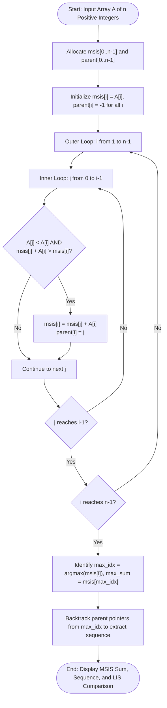

# Question 5: Maximum Sum Increasing Subsequence (MSIS)

<div align="center">


</div>

---

## 📌 Problem Statement

> Given an array of $n$ positive integers $A = [a_0, a_1, \dots, a_{n-1}]$, find the maximum possible sum of a strictly increasing subsequence.
>
> By choosing the proper input representation, write a program in C to validate your algorithm and derive the complexity analysis of your algorithm.

---

## 🧠 Theoretical Formulation

### 1. MSIS vs. LIS (Crucial Distinction)
While both problems require selecting a strictly increasing sequence $\langle a_{i_1}, a_{i_2}, \dots, a_{i_k} \rangle$ ($a_{i_1} < a_{i_2} < \dots < a_{i_k}$), their objective functions differ drastically:
- **LIS (Longest Increasing Subsequence):** Maximizes the number of elements $k$.
- **MSIS (Maximum Sum Increasing Subsequence):** Maximizes the cumulative sum $\sum_{j=1}^k a_{i_j}$.

#### Illustrative Counterexample
Consider $A = [1, 101, 2, 3, 100, 4, 5]$:
- **LIS:** $\langle 1, 2, 3, 4, 5 \rangle$ (Length = $5$, Sum = $15$).
- **MSIS:** $\langle 1, 2, 3, 100 \rangle$ (Length = $4$, Sum = $\mathbf{106}$).
Because a longer sequence may have tiny numbers while a shorter sequence may hold huge numbers, algorithms cannot simply optimize sequence length.

### 2. State Definition & Recurrence Relation
Let $msis[i]$ denote the maximum possible sum of any strictly increasing subsequence ending at index $i$ (such that $A[i]$ is the last element included).

#### Base Condition
Every element $A[i]$ can independently start an increasing subsequence of length 1:
$$msis[i] = A[i], \quad \text{parent}[i] = -1 \quad \forall 0 \le i < n$$

#### Recurrence Relation
For each $i \in [1, n-1]$, we scan all preceding elements $j \in [0, i-1]$:
$$msis[i] = A[i] + \max \left( \{0\} \cup \{ msis[j] \mid 0 \le j < i \text{ and } A[j] < A[i] \} \right)$$

If $msis[j] + A[i] > msis[i]$, we update:
$$\text{parent}[i] = j$$

#### Global Optimum
$$\text{Max Sum} = \max_{0 \le i < n} msis[i]$$

---

## 📊 Data Structures & Input Representation

- **Input Array:** `int arr[n]` — dynamically allocated array of positive integers.
- **DP Sum Array:** `long long msis[n]` — 64-bit integers to prevent accumulator overflow for large sums.
- **Predecessor Array:** `int parent[n]` — index links tracking preceding elements in optimal sum chains.
- **Reconstruction Output:** `int *subseq` — dynamic array holding the exact elements in ascending order.

```c
int solveMSIS(const int arr[], int n, ll msis[], int parent[]);
int *reconstructMSIS(const int arr[], const int parent[], int max_idx, int *out_len);
int computeLISLength(const int arr[], int n);
void printMSISTable(const int arr[], int n, const ll msis[], const int parent[]);
```

---

## 🔄 Algorithmic Procedure



---

## ⏱️ Complexity Analysis

| Component | Time Complexity | Space Complexity | Description |
| :--- | :---: | :---: | :--- |
| **Table Initialization** | $\Theta(n)$ | $\Theta(n)$ | Sets base values $msis[i] = A[i]$. |
| **DP Double Loop** | $\Theta(n^2)$ | $\mathcal{O}(1)$ aux | Evaluates $\frac{n(n-1)}{2}$ subproblem transitions. |
| **Sequence Traceback** | $\mathcal{O}(n)$ | $\mathcal{O}(n)$ | Follows linked chain from $\text{max\_idx}$ to root. |
| **Total Program** | $\mathbf{\Theta(n^2)}$ | $\mathbf{\Theta(n)}$ | Optimal dynamic programming solution with exact reconstruction. |

---

## 🛠️ Compilation & Execution

```bash
# Navigate to question directory
cd /Users/rishav07/Documents/college/SEM3/DAA/LAB08/Q5

# Compile with GCC
gcc -Wall -Wextra -std=c11 -O2 main.c -o main

# Run interactive binary
./main
```

---

## 💻 Sample Traces

### Trace 1: Classic MSIS vs LIS Divergence ($A = [1, 101, 2, 3, 100, 4, 5]$)

```text
========================================================
 Demo 1: Classic MSIS vs LIS Divergence
========================================================
  Input Array A (n = 7): [ 1, 101, 2, 3, 100, 4, 5 ]

  Index i   :      0      1      2      3      4      5      6 
  Array A[i]:      1    101      2      3    100      4      5 
  msis[i]   :      1    102      3      6    106     10     15 
  parent[i] :      -      0      0      2      3      3      5 

  ----------------- RESULT -----------------
  Maximum Sum Increasing Subsequence : 106
  Subsequence Elements (4 items)    : [ 1 + 2 + 3 + 100  ] = 106
  Note: LIS length on this array is 5 (shows MSIS != LIS)
========================================================
```

---

### Trace 2: Strictly Decreasing Sequence ($A = [10, 5, 4, 3]$)

```text
========================================================
 Demo 2: Strictly Decreasing Sequence
========================================================
  Input Array A (n = 4): [ 10, 5, 4, 3 ]

  Index i   :      0      1      2      3 
  Array A[i]:     10      5      4      3 
  msis[i]   :     10      5      4      3 
  parent[i] :      -      -      -      - 

  ----------------- RESULT -----------------
  Maximum Sum Increasing Subsequence : 10
  Subsequence Elements (1 items)    : [ 10  ] = 10
  Note: LIS length on this array is 1 (shows MSIS != LIS)
========================================================
```
