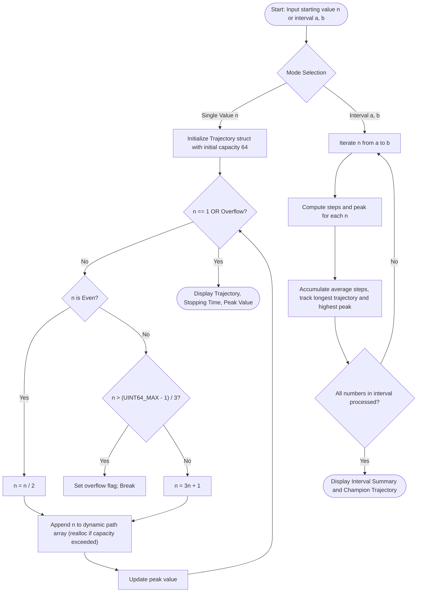

# Question 9: Collatz Conjecture (Open Unsolved Problem)

<div align="center">


</div>

---

## 📌 Problem Statement

> The Collatz Conjecture (also known as the $3n+1$ problem or Ulam conjecture) defines a recurrence relation for any strictly positive integer $n$:
>
> $$T(n) = \begin{cases} 
> \frac{n}{2} & \text{if } n \text{ is even} \\
> 3n + 1 & \text{if } n \text{ is odd}
> \end{cases}$$
>
> The sequence repeatedly applies this function until $n = 1$. Although unproven and still an open problem, it is conjectured that the sequence reaches 1 for all positive integers.
> 
> Write a modular C program to analyse the trajectory of a user-provided starting value $n \ge 1$ and across an interval $[a, b]$.
>
> **Objective of this problem:** To implement iterative control structures, functional decomposition, dynamic memory allocation/pointers, and integer overflow handling in C by simulating and analysing arithmetic trajectories defined by the Collatz Conjecture.

---

## 🧠 Theoretical Formulation

### 1. The $3n + 1$ Dynamical System
Starting from an integer $n \in \mathbb{N}^+$, iterating $T$ generates a sequence $(n, T(n), T^2(n), \dots)$.
- **Total Stopping Time:** The minimum number of steps $k$ such that $T^k(n) = 1$.
- **Peak / Maximum Height:** $\max_{k \ge 0} T^k(n)$.

Despite its apparent simplicity, Paul Erdős famously stated: *"Mathematics may not be ready for such problems."* In 2019, Terence Tao proved that almost all Collatz orbits attain almost bounded values (logarithmic bounds), but the general conjecture remains unproven.

### 2. Computational Challenges in C
1. **Dynamic Orbit Lengths:** The trajectory length cannot be predicted a priori. For instance, $n = 27$ requires $111$ steps and reaches a peak of $9,232$, while $n = 26$ requires only $10$ steps. Therefore, trajectories require dynamically resizable arrays (`malloc` / `realloc`).
2. **Integer Overflow Guard:** When $n$ is odd, the operation $3n + 1$ can easily overflow standard 32-bit and 64-bit integer ranges:
   $$\text{Safe condition for } \texttt{uint64\_t}: \quad n \le \frac{\text{UINT64\_MAX} - 1}{3}$$
   The algorithm must detect potential overflow before performing the multiplication to prevent undefined behaviour.

---

## 📊 Data Structures & Input Representation

- **Dynamic Trajectory Buffer:**
  ```c
  typedef struct {
      uint64_t start_n;
      uint64_t peak_val;
      size_t steps;
      uint64_t *path;     /* Dynamically allocated array of trajectory points */
      size_t capacity;
      int overflow_occurred;
  } Trajectory;
  ```
- **Interval Statistics:** Computes global maximum trajectory length, maximum peak value, and average stopping time over $[a, b]$.

```c
uint64_t getNextCollatz(uint64_t n, int *overflow_flag);
Trajectory initTrajectory(uint64_t start_val);
void appendTrajectoryPoint(Trajectory *traj, uint64_t val);
Trajectory simulateTrajectory(uint64_t start_val);
void freeTrajectory(Trajectory *traj);
void quickCollatzStats(uint64_t n, size_t *out_steps, uint64_t *out_peak);
void analyzeInterval(uint64_t a, uint64_t b);
```

---

## 🔄 Algorithmic Procedure



---

## ⏱️ Complexity Analysis

| Component | Time Complexity | Space Complexity | Description |
| :--- | :---: | :---: | :--- |
| **Next Step Evaluation** | $\mathcal{O}(1)$ | $\mathcal{O}(1)$ | Bitwise parity test `n & 1` and arithmetic shift/multiplication. |
| **Dynamic Array Growth** | $\mathcal{O}(1)$ amortized | $\mathcal{O}(\text{steps})$ | Geometric resizing doubling buffer capacity upon exhaustion. |
| **Single Trajectory Simulation** | $\mathcal{O}(\text{steps}(n))$ | $\mathcal{O}(\text{steps}(n))$ | Proportional to the total stopping time of $n$. |
| **Interval Analysis $[a, b]$** | $\mathcal{O}\left(\sum_{k=a}^b \text{steps}(k)\right)$ | $\mathcal{O}(1)$ aux | Scans all elements in range without holding all paths in memory. |
| **Total Program** | $\mathbf{\mathcal{O}(\text{Trajectory Size})}$ | $\mathbf{\mathcal{O}(\text{Trajectory Size})}$ | Memory safely allocated and freed with zero memory leaks. |

---

## 🛠️ Compilation & Execution

```bash
# Navigate to question directory
cd /Users/rishav07/Documents/college/SEM3/DAA/LAB08/Q9

# Compile with GCC
gcc -Wall -Wextra -std=c11 -O2 main.c -o main

# Run interactive binary
./main

# Or run with CLI arguments directly:
# Single value:
./main 27

# Interval range:
./main 1 20
```

---

## 💻 Sample Traces

### Trace 1: The Famous Starting Value $n = 27$

```text
--- Test 1: Single Famous Starting Point n = 27 ---

  Starting Value (n): 27
  Stopping Time     : 111 steps
  Peak Value Reached: 9232
  Trajectory Path   : 27 -> 82 -> 41 -> 124 -> 62 -> 31 -> 94 -> 47 -> 142 -> 71 -> 214 -> 107 -> 322 -> 161 -> 484 -> 242 -> 121 -> 364 -> 182 -> 91 -> ... [72 intermediate values] ... -> 61 -> 184 -> 92 -> 46 -> 23 -> 70 -> 35 -> 106 -> 53 -> 160 -> 80 -> 40 -> 20 -> 10 -> 5 -> 16 -> 8 -> 4 -> 2 -> 1
```

---

### Trace 2: Interval Analysis $[1, 20]$

```text
========================================================================
   COLLATZ CONJECTURE INTERVAL ANALYSIS: [1, 20]
========================================================================
  Total integers in range: 20

    n       | Stopping Time (steps) | Peak Trajectory Value
 -----------+-----------------------+-----------------------
          1 |                     0 |                     1
          2 |                     1 |                     2
          3 |                     7 |                    16
          4 |                     2 |                     4
          5 |                     5 |                    16
          6 |                     8 |                    16
          7 |                    16 |                    52
          8 |                     3 |                     8
          9 |                    19 |                    52
         10 |                     6 |                    16
         11 |                    14 |                    52
         12 |                     9 |                    16
         13 |                     9 |                    40
         14 |                    17 |                    52
         15 |                    17 |                   160
         16 |                     4 |                    16
         17 |                    12 |                    52
         18 |                    20 |                    52
         19 |                    20 |                    88
         20 |                     7 |                    20

  ----------------- INTERVAL STATISTICS -----------------
  Longest Trajectory in Range : n = 18 (with 20 steps)
  Highest Peak in Range       : n = 15 (peak value = 160)
  Average Stopping Time       : 9.80 steps

  Detailed Trajectory for Champion n = 18:

  Starting Value (n): 18
  Stopping Time     : 20 steps
  Peak Value Reached: 52
  Trajectory Path   : 18 -> 9 -> 28 -> 14 -> 7 -> 22 -> 11 -> 34 -> 17 -> 52 -> 26 -> 13 -> 40 -> 20 -> 10 -> 5 -> 16 -> 8 -> 4 -> 2 -> 1
========================================================
```

---

### Trace 3: Interval Benchmark $[900, 1000]$

```text
========================================================================
   COLLATZ CONJECTURE INTERVAL ANALYSIS: [900, 1000]
========================================================================
  Total integers in range: 101

  ----------------- INTERVAL STATISTICS -----------------
  Longest Trajectory in Range : n = 937 (with 173 steps)
  Highest Peak in Range       : n = 937 (peak value = 250504)
  Average Stopping Time       : 67.23 steps
========================================================================
```
