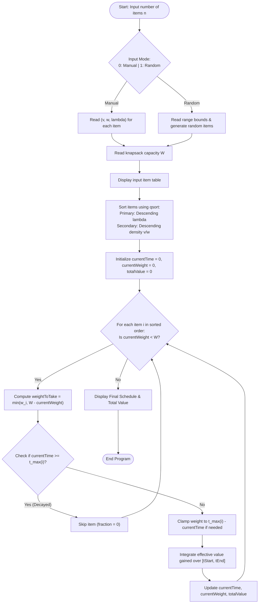

# Question 1: Fractional Knapsack with Deterioration Rate

<div align="center">


</div>

---

## 📌 Problem Statement

> You have $n$ items with base values $v_i$, weights $w_i$, and decay rates $\lambda_i > 0$. If an item is consumed at time $t$, its effective value density decays to $(v_i / w_i) - \lambda_i \cdot t$. Knapsack capacity is $W$. Determine the optimal scheduling order and fractional choices to maximise total value.
> 
> By choosing the proper input representation, write a program in C to validate your algorithm and derive the complexity analysis of your algorithm.

---

## 🧠 Theoretical Formulation & Greedy Paradigm

### 1. Mathematical Formulation

Let the candidate items be indexed by $i \in \{1, 2, \dots, n\}$. Each item is defined by the triple $(v_i, w_i, \lambda_i)$ where:
- $v_i > 0$: Initial base value
- $w_i > 0$: Total weight
- $\lambda_i > 0$: Deterioration/decay rate per unit time
- $\rho_i = \frac{v_i}{w_i}$: Base value density (value per unit weight at time $t = 0$)

When consuming item $i$ over continuous time interval $[\tau_1, \tau_2]$ at a constant consumption rate of $1$ unit weight per unit time, the instantaneous value density at time $t$ is:
$$\rho_i(t) = \frac{v_i}{w_i} - \lambda_i \cdot t$$

The cumulative value earned from consuming a weight $w'_i \le w_i$ of item $i$ starting at time $t_{start}$ until $t_{end} = t_{start} + w'_i$ is:
$$V_i(t_{start}, w'_i) = \int_{t_{start}}^{t_{start} + w'_i} \left(\frac{v_i}{w_i} - \lambda_i \tau\right) d\tau = w'_i \left[ \rho_i - \lambda_i \left(t_{start} + \frac{w'_i}{2}\right) \right]$$

### 2. Constraints & Boundary Conditions
1. **Capacity Bound:** The total weight consumed cannot exceed knapsack capacity $W$:
   $$\sum_{i=1}^n w'_i \le W, \quad 0 \le w'_i \le w_i$$
2. **Non-Negativity (Economic Rationality):** If at any time $\rho_i(t) \le 0$, consuming further weight from item $i$ diminishes the total accumulated value. Hence, consumption of item $i$ must cease no later than its cutoff horizon:
   $$t_{max}(i) = \frac{\rho_i}{\lambda_i} = \frac{v_i}{\lambda_i w_i}$$
   $$w'_i \le \max\left(0, \; \min\left(w_i, \; W - \sum_{k < i} w'_k, \; t_{max}(i) - t_{start}\right)\right)$$

---

### 3. Proof of Greedy Scheduling Priority (Adjacent Exchange Argument)

Suppose we have decided to fully process two items $A$ and $B$ consecutively starting at time $t$. We compare the two possible execution sequences: $A \to B$ versus $B \to A$.

#### **Sequence 1: Schedule $A$ then $B$**
- Item $A$ is processed in $[t, t + w_A]$.
- Item $B$ is processed in $[t + w_A, t + w_A + w_B]$.
- Total value accrued:
  $$V(A \to B) = w_A\left[\rho_A - \lambda_A\left(t + \frac{w_A}{2}\right)\right] + w_B\left[\rho_B - \lambda_B\left(t + w_A + \frac{w_B}{2}\right)\right]$$

#### **Sequence 2: Schedule $B$ then $A$**
- Item $B$ is processed in $[t, t + w_B]$.
- Item $A$ is processed in $[t + w_B, t + w_B + w_A]$.
- Total value accrued:
  $$V(B \to A) = w_B\left[\rho_B - \lambda_B\left(t + \frac{w_B}{2}\right)\right] + w_A\left[\rho_A - \lambda_A\left(t + w_B + \frac{w_A}{2}\right)\right]$$

#### **Subtracting the Two Yields:**
$$V(A \to B) - V(B \to A) = - w_B \lambda_B w_A + w_A \lambda_A w_B = w_A w_B (\lambda_A - \lambda_B)$$

> [!IMPORTANT]
> **Greedy Choice Invariant:**
> Since $w_A > 0$ and $w_B > 0$, the sign of the difference is governed strictly by the decay rates:
> $$V(A \to B) > V(B \to A) \iff \lambda_A > \lambda_B$$
> This proves that the item with the **higher deterioration rate $\lambda$ must strictly precede** the item with the lower deterioration rate to minimize waiting penalties. When decay rates are equal ($\lambda_A = \lambda_B$), sorting by base density $\rho_i = v_i / w_i$ descending maximizes early gains.

---

## 📊 Data Structures & Input Representation

The implementation represents each item as an encapsulated structure:

| Structure Field | Type | Description |
| :--- | :--- | :--- |
| `id` | `int` | Original 1-based identifier of the item. |
| `v` | `double` | Base initial value $v_i$. |
| `w` | `double` | Total available weight $w_i$. |
| `lambda` | `double` | Decay rate coefficient $\lambda_i > 0$. |
| `density` | `double` | Base density $\rho_i = v_i / w_i$. |
| `fraction` | `double` | Computed fraction $x_i \in [0, 1]$ placed in knapsack. |
| `valGained` | `double` | Effective value contribution after accounting for deterioration. |
| `startTime`, `finishTime` | `double` | Time interval $[t_{start}, t_{finish}]$ during which the item is consumed. |

### Functional Decomposition
- **`main()`**: Validates input parameters, invokes sorting, executes fractional greedy allocation with cutoff clamping, and presents formatted reports.
- **`compareItems(a, b)`**: Three-way comparator prioritizing descending $\lambda_i$, breaking ties by descending base density $\rho_i$.
- **`fillItemsRandomly(...)`**: Seeds RNG and generates uniformly distributed realistic item values.
- **`displayItems(...)`**: Renders tabular preview of unselected items.
- **`displaySchedule(...)`**: Renders execution timeline, fractional weights, and net value totals.

---

## 🔄 Algorithmic Procedure



---

## ⏱️ Complexity Analysis

| Phase / Operation | Time Complexity | Auxiliary Space | Description |
| :--- | :---: | :---: | :--- |
| **Input Parsing / Generation** | $\Theta(n)$ | $\mathcal{O}(1)$ | Single pass over $n$ items. |
| **Density Computation** | $\Theta(n)$ | $\mathcal{O}(1)$ | Simple division $v_i / w_i$ per item. |
| **Greedy Priority Sorting** | $\mathcal{O}(n \log n)$ | $\mathcal{O}(\log n)$ | QuickSort / Introsort (`qsort`) using two-tiered comparator. |
| **Fractional Allocation & Clamping** | $\mathcal{O}(n)$ | $\mathcal{O}(1)$ | Single linear traversal filling knapsack and calculating integral value. |
| **Result Formatting & Display** | $\Theta(n)$ | $\mathcal{O}(1)$ | Tabular printing of scheduled items. |
| **Total Algorithm** | $\mathbf{\mathcal{O}(n \log n)}$ | $\mathbf{\mathcal{O}(n)}$ | **Optimal greedy time complexity**, dominated by sorting. |

---

## 🛠️ Compilation & Execution

```bash
# Navigate to the Q1 directory
cd /Users/rishav07/Documents/college/SEM3/DAA/LAB09/Q1

# Compile with GCC
gcc -Wall -Wextra -std=c11 -O2 main.c -o main

# Execute program
./main
```

---

## 💻 Sample Traces & Validation Cases

### Trace 1: Three Competing Deteriorating Items
**Input Data:**
- Item 1: $v = 60, w = 10 \implies \rho = 6.0, \lambda = 0.5 \implies t_{max} = 12.0$
- Item 2: $v = 100, w = 20 \implies \rho = 5.0, \lambda = 0.8 \implies t_{max} = 6.25$
- Item 3: $v = 120, w = 30 \implies \rho = 4.0, \lambda = 0.2 \implies t_{max} = 20.0$
- Capacity: $W = 50$

```text
Enter the number of items: 3
Do you wanna: 	(0) Enter item details manually or
		(1) Have them randomly filled?
Choice: 0
For each item, enter base value (v), weight (w), and decay rate (lambda):
Item 1 (v w lambda): 60 10 0.5
Item 2 (v w lambda): 100 20 0.8
Item 3 (v w lambda): 120 30 0.2
Enter knapsack capacity (W): 50

--- Available Items Before Scheduling ---
+------+------------+------------+---------------+----------------+
| Item | Base Value |   Weight   | Decay Rate λ  | Density (v/w)  |
+------+------------+------------+---------------+----------------+
|    1 |      60.00 |      10.00 |        0.5000 |         6.0000 |
|    2 |     100.00 |      20.00 |        0.8000 |         5.0000 |
|    3 |     120.00 |      30.00 |        0.2000 |         4.0000 |
+------+------------+------------+---------------+----------------+

======================= OPTIMAL GREEDY SCHEDULE =======================
+------+----------+-------------+------------+------------+--------------+
| Item | Fraction | Weight Used | Start Time |  End Time  | Value Gained |
+------+----------+-------------+------------+------------+--------------+
|    2 |   31.25% |        6.25 |       0.00 |       6.25 |      15.6250 |
|    1 |   57.50% |        5.75 |       6.25 |      12.00 |       8.2656 |
|    3 |   26.67% |        8.00 |      12.00 |      20.00 |       6.4000 |
+------+----------+-------------+------------+------------+--------------+
Total Knapsack Capacity : 50.00
Total Weight Consumed   : 20.00 / 50.00
Maximum Total Value     : 30.2906
========================================================================
```

#### Step-by-Step State Evolution
| Step | Item Selected | Start Time | Weight Taken | End Time | Marginal Value Density | Effective Value Gained |
| :---: | :---: | :---: | :---: | :---: | :---: | :---: |
| 1 | **Item 2** ($\lambda = 0.8$) | $0.00$ | $6.25$ (clamped by $t_{max} = 6.25$) | $6.25$ | $5.0 - 0.8 \times 3.125 = 2.50$ | $6.25 \times 2.5 = 15.625$ |
| 2 | **Item 1** ($\lambda = 0.5$) | $6.25$ | $5.75$ (clamped by $t_{max} = 12.0$) | $12.00$ | $6.0 - 0.5 \times 9.125 = 1.4375$ | $5.75 \times 1.4375 = 8.2656$ |
| 3 | **Item 3** ($\lambda = 0.2$) | $12.00$ | $8.00$ (clamped by $t_{max} = 20.0$) | $20.00$ | $4.0 - 0.2 \times 16.0 = 0.80$ | $8.00 \times 0.80 = 6.4000$ |

---

### Trace 2: Knapsack Capacity Constraint Active
**Input:** Capacity $W = 10$.
- Item 2 is taken partially up to weight $6.25$ (clamped by its deterioration horizon).
- Item 1 takes remaining capacity $10 - 6.25 = 3.75$ weight in $[6.25, 10.00]$.
- Total weight consumed: $10.00 / 10.00$, leaving no capacity for Item 3.
