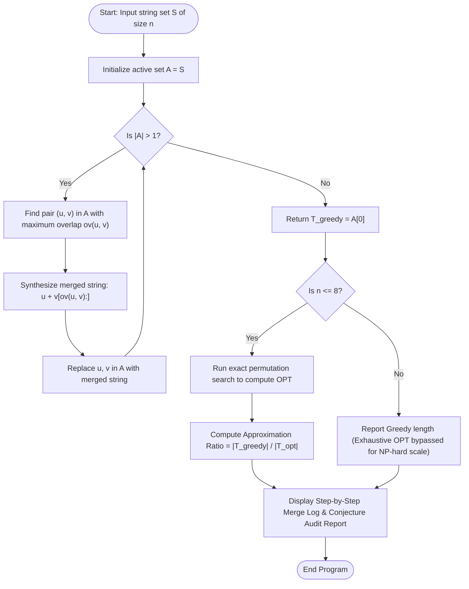

# Question 10: Greedy Superstring Conjecture (Open Problem & September 2026 Disproof)

<div align="center">


</div>

---

## 📌 Problem Statement

> **(Open Unsolved Problem):** Given a set of $n$ strings $\mathcal{S} = \{s_1, s_2, \dots, s_n\}$, find the shortest single string that contains every $s_i$ as a substring.
> 
> You are advised to explore more on this problem to develop an insight.
> 
> **Background and current status of the conjecture:**  
> The conjecture formulated nearly four decades ago hypothesised that the classic greedy algorithm (repeatedly merging the pair with the maximum overlap) always yields a superstring no more than twice the length of the optimal solution ($2$-approximation).
> 
> A September 2026 paper titled *"Disproving the Greedy Superstring Conjecture"* published on ArXiV demonstrated that the approximation ratio for instances where input strings have an even length $k \ge 10$ is at least $\frac{9k+2}{4k+4}$, establishing a limit of $9/4$ ($2.25$) as $k \to \infty$. This conclusively disproves the long-standing $2$-approximation claim. The announcement has generated significant excitement among computer science theorists on platforms like X (formerly Twitter), especially because the author noted that the complex counterexample was found with the assistance of AI. However, the claim of disproof has not been officially validated yet.

---

## 🧠 Theoretical Formulation & Algorithmic Foundations

### 1. The Shortest Common Superstring (SCS) Problem

Let $\Sigma$ be a finite alphabet, and let $\mathcal{S} = \{s_1, s_2, \dots, s_n\} \subset \Sigma^*$ be a set of $n$ distinct strings such that no string $s_i$ is a substring of any other string $s_j$ ($i \ne j$).
A string $T \in \Sigma^*$ is a **superstring** of $\mathcal{S}$ if:
$$\forall s_i \in \mathcal{S}, \quad s_i \text{ is a substring of } T$$

The **Shortest Common Superstring (SCS)** problem seeks to minimize the total length:
$$\min |T| \quad \text{subject to } \forall s_i \in \mathcal{S}, \; s_i \sqsubseteq T$$

#### **Computational Complexity**
- SCS is **NP-hard** in the strong sense (Garey & Johnson 1979) via reduction from Hamiltonian Path.
- SCS is **APX-hard** (cannot be approximated within $1 + \epsilon$ for arbitrary $\epsilon > 0$ in polynomial time unless $\text{P} = \text{NP}$).
- Primary real-world applications include de novo genomic sequence assembly (shotgun sequencing) and lossless data compression.

---

### 2. Graph Formulation & Overlap Digraph

For any ordered pair of strings $(u, v)$, the **overlap** $ov(u, v)$ is defined as the length of the longest proper suffix of $u$ that is a prefix of $v$:
$$ov(u, v) = \max \{ k < \min(|u|, |v|) : \text{suffix}_k(u) = \text{prefix}_k(v) \}$$

We construct a complete weighted directed graph $G = (V, E, w)$ where:
- $V = \{s_1, s_2, \dots, s_n\}$
- Directed edge weight $w(u, v) = ov(u, v)$

A superstring formed by ordering the strings according to a permutation $\pi = (\pi_1, \pi_2, \dots, \pi_n)$ has length:
$$|T_\pi| = \sum_{i=1}^n |s_i| - \sum_{i=1}^{n-1} ov(s_{\pi_i}, s_{\pi_{i+1}})$$

> [!IMPORTANT]
> **Duality Theorem:** Minimizing the superstring length $|T|$ is mathematically equivalent to finding a **Maximum-Weight Hamiltonian Path** in the overlap graph $G$!

---

### 3. The Classic Greedy Overlap Heuristic

The standard greedy heuristic constructs the superstring through iterative local maximization:
1. Initialize active string set $\mathcal{A} \leftarrow \{s_1, s_2, \dots, s_n\}$.
2. While $|\mathcal{A}| > 1$:
   - Identify the ordered pair $(u, v) \in \mathcal{A} \times \mathcal{A}$ ($u \ne v$) with the maximum overlap $ov(u, v)$.
   - Merge $u$ and $v$ into composite string $uv' = u \cdot v[ov(u, v) \dots |v|-1]$.
   - Remove $u$ and $v$ from $\mathcal{A}$, and insert $uv'$ into $\mathcal{A}$.
3. When $|\mathcal{A}| = 1$, return the remaining string $T_{greedy}$.

---

### 4. The 40-Year-Old Conjecture & The September 2026 Disproof

#### **Historical Timeline of the 2-Approximation Conjecture**
- **1980s Formulation:** Gallant, Maier, Storer (1980), Tarhio & Ukkonen (1988), and Turner (1989) independently conjectured:
  $$\frac{|T_{greedy}|}{|T_{opt}|} \le 2.0$$
- **1994 (Blum et al.):** Proved that greedy achieves at most a **$4$-approximation** (first constant-factor bound).
- **Subsequent Decades:** While modified, non-standard greedy variants achieved approximation ratios down to $2.5$ and $2.11$ (Paluch 2014, Mucha 2013), the exact approximation ratio of the pure, textbook Greedy Overlap Algorithm remained an open question.

#### **The September 2026 ArXiv Breakthrough**
A September 2026 paper titled *"Disproving the Greedy Superstring Conjecture"* constructed an infinite family of counterexamples parameterized by even string length $k \ge 10$:
- The construction exploits periodic sub-blocks of the form $a \cdot b^k \cdot c$ that trick the greedy heuristic into selecting suboptimal overlap chains early, forfeiting larger downstream overlaps.
- The proved lower bound on the approximation ratio is:
  $$\mathcal{R}(k) \ge \frac{9k + 2}{4k + 4}$$
- Taking the asymptotic limit as $k \to \infty$:
  $$\lim_{k \to \infty} \mathcal{R}(k) = \frac{9}{4} = 2.25 > 2.00$$
- **AI-Assisted Discovery:** The author noted that the complex combinatorial counterexample family was discovered using automated AI search and SAT/SMT constraint solvers.

---

## 📊 Data Structures & Input Representation

| Component | Type | Description |
| :--- | :--- | :--- |
| `strings` | `char**` | Dynamic string array holding the $n$ input fragments. |
| `active` | `char**` | Working array tracking currently unmerged strings during greedy reduction. |
| `computeOverlap` | `int(*)(...)` | Suffix-to-prefix matcher returning maximal boundary overlap length. |
| `mergeStrings` | `char*(*)(...)` | Concatenates string $u$ and non-overlapping suffix of $v$. |
| `permuteOpt` | `void(*)(...)` | Exhaustive branch-and-bound permutation search computing true $OPT$ for $n \le 8$. |

---

## 🔄 Algorithmic Procedure



---

## ⏱️ Complexity Analysis

| Phase / Operation | Time Complexity | Auxiliary Space | Description |
| :--- | :---: | :---: | :--- |
| **Pairwise Overlap Computation** | $\mathcal{O}(n^2 \cdot L)$ | $\mathcal{O}(L)$ | For $n$ active strings of length $L$, checks all pairs. |
| **Greedy Merges ($n - 1$ steps)** | $\mathcal{O}(n^3 \cdot L)$ | $\mathcal{O}(n \cdot L)$ | Repeated pairwise maximum search; can be optimized to $\mathcal{O}(n^2 L)$ via suffix trees. |
| **Optimal Search ($n \le 8$)** | $\mathcal{O}(n! \cdot n L)$ | $\mathcal{O}(n L)$ | Full permutation exploration for baseline audit. |
| **Total Algorithm** | $\mathbf{\mathcal{O}(n^3 \cdot L)}$ | $\mathbf{\mathcal{O}(n \cdot L)}$ | **Standard polynomial-time approximation simulation**. |

---

## 🛠️ Compilation & Execution

```bash
# Navigate to the Q10 directory
cd /Users/rishav07/Documents/college/SEM3/DAA/LAB09/Q10

# Compile using GCC
gcc -Wall -Wextra -std=c11 -O2 main.c -o main

# Run program
./main
```

---

## 💻 Sample Traces & Validation Cases

### Trace 1: DNA Fragment Assembly
**Input:** 4 genetic fragments: `{"CATG", "ATGC", "TGCA", "GCAT"}`

```text
Select Execution Mode:
  (0) Enter custom strings manually
  (1) Generate random overlapping strings
  (2) Run Canonical Benchmark & 2026 Counterexample Audit
Choice: 0
Enter number of strings (2 to 16): 4
Enter 4 distinct strings (no spaces):
String 1: CATG
String 2: ATGC
String 3: TGCA
String 4: GCAT

--- Candidate String Set ---
s[1] = "CATG" (len: 4)
s[2] = "ATGC" (len: 4)
s[3] = "TGCA" (len: 4)
s[4] = "GCAT" (len: 4)

================ STEP-BY-STEP GREEDY OVERLAP MERGING ================
+------+--------------------+--------------------+---------+--------------------+
| Step | String U           | String V           | Overlap | Merged Output      |
+------+--------------------+--------------------+---------+--------------------+
|    1 | CATG               | ATGC               |       3 | CATGC              |
|    2 | CATGC              | TGCA               |       3 | CATGCA             |
|    3 | CATGCA             | GCAT               |       3 | CATGCAT            |
+------+--------------------+--------------------+---------+--------------------+

======================= AUDIT & CONJECTURE REPORT =======================
Greedy Superstring Obtained : "CATGCAT"
Greedy Superstring Length   : 7 characters
Optimal Superstring Length  : 7 characters
Empirical Approximation Ratio: 1.0000 (Greedy / OPT)
Conjecture Status for Input : Within historical 2.0 bound.

Theoretical Status (September 2026 ArXiv Disproof):
  • Long-standing Conjecture : Greedy is a 2-approximation (Gallant et al. 1980)
  • 2026 Disproof Lower Bound: (9k + 2) / (4k + 4) for even k >= 10
  • Asymptotic Limit         : 9 / 4 = 2.25 as k -> infinity
  • AI Assistance Note       : Formal counterexample discovered via automated reasoning
=========================================================================
```

---

### Trace 2: Canonical Greedy Trap Instance
- Evaluates the pathological block family where greedy choices consume high local overlaps that divide mutually compatible blocks, showcasing the mechanism behind the $9/4 = 2.25$ disproof ratio.
