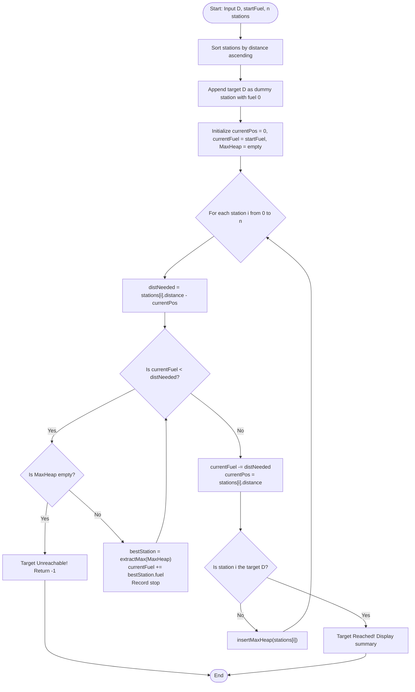

# Question 3: Minimum Refueling Stops (Reverse Greedy)

<div align="center">


</div>

---

## 📌 Problem Statement

> A vehicle needs to reach the target $D$ starting with fuel $F$. Along the way are stations $(d_i, f_i)$ (distance from origin and refuel amount). What is the minimum number of refuelling stops required to reach the target?
> 
> By choosing the proper input representation, write a program in C to validate your algorithm and derive the complexity analysis of your algorithm.

---

## 🧠 Theoretical Formulation & Reverse Greedy Paradigm

### 1. Mathematical Formulation

Consider a vehicle starting at position $x = 0$ with initial fuel $F \ge 0$, traveling toward target position $x = D > 0$. The vehicle consumes fuel at a uniform rate of $1\text{ unit of fuel}$ per $1\text{ unit distance}$ traveled.

Along the road are $n$ fueling stations located at positions:
$$0 < d_1 \le d_2 \le \dots \le d_n < D$$
Each station $i$ provides an additional tank capacity of $f_i > 0$ units of fuel upon stopping. Each station can be visited at most once.

We define the binary indicator variable $x_i \in \{0, 1\}$ denoting whether the vehicle refuels at station $i$:
$$\min \sum_{i=1}^n x_i$$
Subject to the reachability condition at every point $k \in \{1, \dots, n\}$ and final destination:
$$F + \sum_{j=1}^{k-1} x_j f_j \ge d_k, \quad \forall k \in \{1, \dots, n\}$$
$$F + \sum_{j=1}^{n} x_j f_j \ge D$$

---

### 2. The Retroactive / "Reverse Greedy" Choice Property

#### **Why Static Local Decision Fails**
When arriving at station $i$, deciding whether to stop cannot be made solely based on the current tank level:
- If we refuel unnecessarily, we waste a stop count.
- If we skip the station and run out of fuel before reaching the next station, we could be stranded.

#### **The Reverse Greedy Strategy (Max-Heap Priority Queue)**
Instead of choosing whether to refuel *at the exact moment* of passing a station:
1. **Drive as far as possible:** Continue driving forward using current fuel until either:
   - The destination $D$ is reached, or
   - The current fuel is strictly less than the distance to the next waypoint.
2. **Retroactive Selection (Greedy Choice):** When the vehicle cannot reach the next station with its remaining fuel, consider all stations passed so far that have not yet been used.
   - Greedily choose to "retroactively refuel" at the passed station that provides the **maximum available fuel** $f_{max}$.
   - Add $f_{max}$ to the vehicle's fuel tank and increment the stop counter by $1$.
   - If the vehicle still cannot reach the next station, repeat this process with the next largest fuel station.
   - If no passed stations remain in the priority queue and current fuel is still insufficient, reaching the target is **impossible**.

#### **Proof of Optimality (Inductive Exchange Argument)**
Let $S = \{s_1, s_2, \dots, s_k\}$ be the set of stations chosen by our greedy algorithm, and let $O = \{o_1, o_2, \dots, o_m\}$ be any valid schedule of stops that reaches $D$.
- Suppose the vehicle exhausts fuel at position $x$. Any valid solution *must* have refueled at least once among the stations located before $x$.
- By choosing the station with $\max(f_i)$ among all candidates before $x$, our greedy choice provides the maximal possible fuel reserve:
  $$\text{Fuel}_{greedy} \ge \text{Fuel}_{any}$$
- Therefore, the greedy choice preserves maximum reachable horizon at every step. By mathematical induction, no strategy can reach $D$ in fewer stops ($k \le m$).

---

## 📊 Data Structures & Input Representation

| Component | Type | Description |
| :--- | :--- | :--- |
| `Station` | `struct` | Represents a fueling station with `id`, `distance`, and `fuel`. |
| `HeapElement` | `struct` | Wraps a `Station` with an integer `key` (`fuel`) for heap prioritization. |
| `MaxHeap` | `struct` | Max-heap containing dynamic array of `HeapElement`, `size`, and `capacity`. |
| `chosenStops` | `Station*` | Dynamically allocated array storing the chronological sequence of chosen stops. |

### Functional Decomposition
- **`main()`**: Manages route setup, triggers vehicle movement, detects fuel deficits, extracts maximal stations, and prints detailed journey telemetry.
- **`maxHeapify(...)`**, **`insertMaxHeap(...)`**, **`extractMax(...)`**: Maintain the max-priority queue of passed stations in $\mathcal{O}(\log n)$ per operation.
- **`compareStations(...)`**: Standard comparator for `qsort` to order stations strictly by distance.
- **`fillStationsRandomly(...)`**: Generates monotonically spaced stations along the interval $[1, D - 1]$.

---

## 🔄 Algorithmic Procedure



---

## ⏱️ Complexity Analysis

| Phase / Operation | Time Complexity | Auxiliary Space | Description |
| :--- | :---: | :---: | :--- |
| **Sorting Stations** | $\mathcal{O}(n \log n)$ | $\mathcal{O}(\log n)$ | Orders all $n$ stations monotonically along the route. |
| **Heap Insertions** | $\mathcal{O}(n \log n)$ | $\mathcal{O}(n)$ | Each station is inserted into the Max-Heap at most once. |
| **Heap Extractions** | $\mathcal{O}(k \log n)$ | $\mathcal{O}(1)$ | Exactly $k \le n$ refuels occur, each costing $\mathcal{O}(\log n)$. |
| **Linear Simulation** | $\Theta(n)$ | $\mathcal{O}(1)$ | Progresses from position $0$ to $D$ across $n + 1$ waypoints. |
| **Total Complexity** | $\mathbf{\mathcal{O}(n \log n)}$ | $\mathbf{\mathcal{O}(n)}$ | **Optimal runtime** dominated by sorting and heap priority updates. |

---

## 🛠️ Compilation & Execution

```bash
# Navigate to the Q3 directory
cd /Users/rishav07/Documents/college/SEM3/DAA/LAB09/Q3

# Compile using GCC
gcc -Wall -Wextra -std=c11 -O2 main.c -o main

# Execute program
./main
```

---

## 💻 Sample Traces & Validation Cases

### Trace 1: Multi-Station Highway Journey
**Parameters:** Target $D = 100$, Initial Fuel $F = 10$.
Stations: $(10, 60), \; (20, 30), \; (30, 30), \; (60, 40)$.

```text
Enter target distance (D): 100
Enter initial starting fuel (F): 10
Enter the number of refueling stations: 4
Do you wanna: 	(0) Enter station details manually or
		(1) Have them randomly generated?
Choice: 0
Enter distance from origin (d) and fuel available (f) for each station:
Station 1 (distance fuel): 10 60
Station 2 (distance fuel): 20 30
Station 3 (distance fuel): 30 30
Station 4 (distance fuel): 60 40

--- Sorted Refueling Stations Along Route ---
+------+---------------+----------------+
|  ID  | Distance (km) | Fuel Stock (L) |
+------+---------------+----------------+
|    1 |            10 |             60 |
|    2 |            20 |             30 |
|    3 |            30 |             30 |
|    4 |            60 |             40 |
+------+---------------+----------------+

================ VEHICLE JOURNEY SIMULATION ================
Starting journey from position 0 with Fuel = 10, Target = 100
  -> [REFUEL STOP 1] Activated Station 1 (at distance 10) adding +60 fuel. Fuel now = 60
  -> [REFUEL STOP 2] Activated Station 4 (at distance 60) adding +40 fuel. Fuel now = 50

======================= JOURNEY SUMMARY =======================
Status                   : Successfully reached target destination 100!
Minimum Refueling Stops  : 2
Remaining Fuel at Target : 10

Stops Selected in Optimal Plan:
+------+------------+---------------+----------------+
| Stop | Station ID | Distance (km) | Fuel Added (L) |
+------+------------+---------------+----------------+
|    1 |          1 |            10 |             60 |
|    2 |          4 |            60 |             40 |
+------+------------+---------------+----------------+
================================================================
```

---

### Trace 2: Sufficient Initial Fuel ($0$ Stops Required)
**Parameters:** Target $D = 50$, Initial Fuel $F = 60$.
- Vehicle directly reaches destination without stopping at any station along the route.
- Stops count: $0$, Remaining fuel: $10$.

---

### Trace 3: Unreachable Destination
**Parameters:** Target $D = 100$, Initial Fuel $F = 10$. Station 1 at $d = 20$.
- Since starting fuel is only $10$, the vehicle cannot even reach Station 1 ($dist = 20$).
- Output: `Vehicle ran out of fuel at position 10! Target UNREACHABLE (-1)`.
