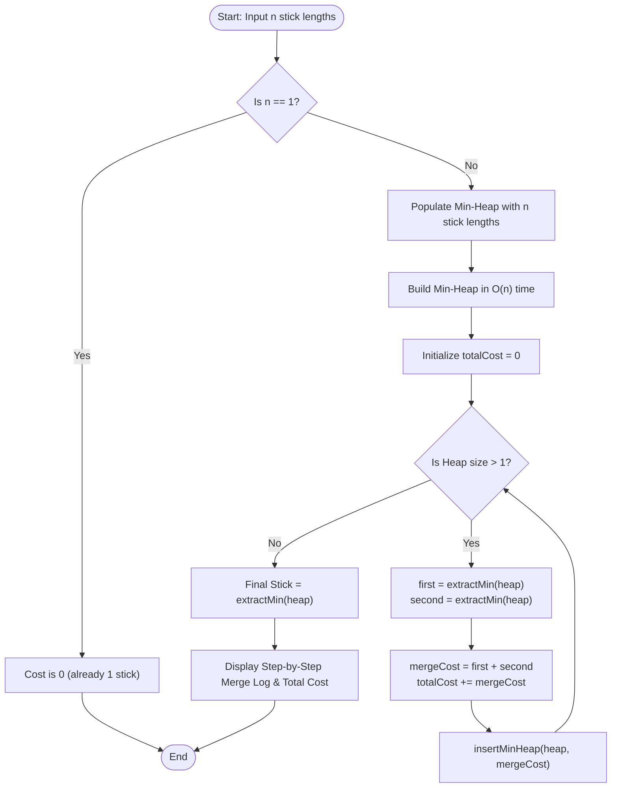

# Question 4: Minimum Cost to Connect Sticks

<div align="center">


</div>

---

## 📌 Problem Statement

> You have sticks of lengths $L_1, L_2, \dots, L_n$. Connecting two sticks of lengths $x$ and $y$ costs $x + y$, resulting in a single stick of length $x + y$. Find the minimum total cost to connect all sticks into one.
> 
> By choosing the proper input representation, write a program in C to validate your algorithm and derive the complexity analysis of your algorithm.

---

## 🧠 Theoretical Formulation & Greedy Paradigm

### 1. Equivalence to Huffman Merge Trees

Let the collection of $n$ sticks be given by initial lengths $\{L_1, L_2, \dots, L_n\}$. Every valid pairwise merging schedule defines a full binary tree $T$ where:
- The $n$ leaves correspond to the original sticks $L_1, \dots, L_n$.
- Each internal node $u$ represents the merger of its two children, with a weight equal to the sum of the stick lengths in its subtree:
  $$W(u) = W(\text{left}(u)) + W(\text{right}(u))$$
- The total connection cost is the sum over all $n - 1$ internal merges:
  $$\text{Total Cost} = \sum_{u \in \text{Internal}(T)} W(u)$$

#### **External Path Length Formulation**
Notice that each initial leaf stick $L_i$ contributes its length to every ancestor merge operation up to the root. Therefore:
$$\text{Total Cost} = \sum_{i=1}^n L_i \cdot d_T(i)$$
where $d_T(i)$ denotes the depth (distance from root) of leaf $i$ in tree $T$.

> [!IMPORTANT]
> This objective function is mathematically identical to the expected codeword length in **Huffman Coding**, where stick lengths act as symbol frequencies! Consequently, the optimal merge structure is obtained by Huffman's greedy tree synthesis.

---

### 2. Greedy Choice Property & Proof of Optimality

#### **Greedy Choice Property**
Let $x$ and $y$ be the two sticks of minimum length in the multiset $\{L_1, L_2, \dots, L_n\}$. There exists an optimal binary merge tree in which $x$ and $y$ are merged together at the deepest level in the very first step.

#### **Exchange Argument Proof**
- Let $T^*$ be an optimal merge tree, and let $a$ and $b$ be two sibling leaves at the maximum depth $d_{max}$ in $T^*$.
- Assume without loss of generality that $L_x \le L_y$ and $L_a \le L_b$. Since $x$ and $y$ are the two smallest sticks in the entire set, $L_x \le L_a$ and $L_y \le L_b$.
- Swap leaf $x$ with leaf $a$, and swap leaf $y$ with leaf $b$ to construct a new merge tree $T'$.
- The difference in total connection cost is:
  $$\Delta \text{Cost} = \text{Cost}(T^*) - \text{Cost}(T') = (L_a - L_x)(d_{max} - d(x)) + (L_b - L_y)(d_{max} - d(y))$$
- Since $d_{max} \ge d(x)$, $d_{max} \ge d(y)$, $L_a \ge L_x$, and $L_b \ge L_y$, every term in the sum is non-negative:
  $$\Delta \text{Cost} \ge 0 \implies \text{Cost}(T') \le \text{Cost}(T^*)$$
- Since $T^*$ was already optimal, $T'$ must also be optimal. Thus, greedily merging the two smallest sticks preserves global optimality.

#### **Optimal Substructure**
Replacing sticks $x$ and $y$ with a single merged stick of length $x + y$ leaves a problem of size $n - 1$ with identical cost structure.

---

## 📊 Data Structures & Input Representation

| Component | Type | Description |
| :--- | :--- | :--- |
| `sticks` | `long long*` | Dynamically allocated array holding the initial $n$ stick lengths. |
| `MinHeap` | `struct` | Priority queue holding active stick lengths during iterative reduction. |
| `array` | `long long*` | Internal heap buffer storing stick lengths in 64-bit integers to prevent arithmetic overflow. |

### Functional Decomposition
- **`main()`**: Validates input, builds the initial min-heap in $\mathcal{O}(n)$, runs the iterative merge loop, and displays the cumulative cost ledger.
- **`minHeapify(...)`**, **`extractMin(...)`**, **`insertMinHeap(...)`**: Maintain the heap invariant in $\mathcal{O}(\log k)$ time.
- **`fillSticksRandomly(...)`**: Seeds RNG and generates sticks within user-specified length bounds.
- **`displaySticks(...)`**: Formats arrays in standard mathematical set notation.

---

## 🔄 Algorithmic Procedure



---

## ⏱️ Complexity Analysis

| Phase / Operation | Time Complexity | Auxiliary Space | Description |
| :--- | :---: | :---: | :--- |
| **Input Reading / Generation** | $\Theta(n)$ | $\mathcal{O}(1)$ | Linear scan over $n$ stick lengths. |
| **Heap Construction** | $\Theta(n)$ | $\mathcal{O}(n)$ | Bottom-up Floyd heapification (`minHeapify` from $(n-1)/2$ down to $0$). |
| **Iterative Merging** | $\mathcal{O}(n \log n)$ | $\mathcal{O}(1)$ | Exactly $n - 1$ iterations; each performs 2 deletions and 1 insertion in $\mathcal{O}(\log n)$. |
| **Display Log** | $\Theta(n)$ | $\mathcal{O}(1)$ | Prints each pairwise merge operation. |
| **Total Algorithm** | $\mathbf{\mathcal{O}(n \log n)}$ | $\mathbf{\mathcal{O}(n)}$ | **Optimal lower bound** identical to comparison sorting and Huffman coding. |

---

## 🛠️ Compilation & Execution

```bash
# Navigate to the Q4 directory
cd /Users/rishav07/Documents/college/SEM3/DAA/LAB09/Q4

# Compile using GCC
gcc -Wall -Wextra -std=c11 -O2 main.c -o main

# Execute program
./main
```

---

## 💻 Sample Traces & Validation Cases

### Trace 1: Four Distinct Sticks
**Input:** Sticks = `[1, 8, 3, 5]`

```text
Enter the number of sticks: 4
Do you wanna: 	(0) Enter stick lengths manually or
		(1) Have them randomly filled?
Choice: 0
Enter 4 positive stick lengths: 1 8 3 5
Initial sticks: {1, 8, 3, 5}

================ STEP-BY-STEP MERGE LOG ================
+------+------------+------------+------------+----------------+
| Step |  Stick A   |  Stick B   | Merge Cost | Cumulative Cost|
+------+------------+------------+------------+----------------+
|    1 |          1 |          3 |          4 |              4 |
|    2 |          4 |          5 |          9 |             13 |
|    3 |          8 |          9 |         17 |             30 |
+------+------------+------------+------------+----------------+
Final Combined Stick Length : 17
Minimum Total Connection Cost: 30
========================================================
```

#### Step-by-Step State Evolution
| Step | Active Sticks in Min-Heap | Extracted Minima | New Stick Created | Cost Added | Running Total Cost |
| :---: | :--- | :---: | :---: | :---: | :---: |
| **Init** | $\{1, 3, 5, 8\}$ | — | — | — | $0$ |
| **1** | $\{5, 8, 4\}$ | $1, 3$ | $4$ | $1 + 3 = 4$ | $4$ |
| **2** | $\{8, 9\}$ | $4, 5$ | $9$ | $4 + 5 = 9$ | $4 + 9 = 13$ |
| **3** | $\{17\}$ | $8, 9$ | $17$ | $8 + 9 = 17$ | $13 + 17 = 30$ |

---

### Trace 2: Single Stick Edge Case
**Input:** Sticks = `[42]`
- Since only 1 stick is present, no connections are required.
- Result: `Minimum Total Connection Cost: 0`.

---

### Trace 3: Large Uniform Random Array
- Automatically verifies random arrays with uniform distribution across arbitrary positive intervals $[l, u]$.
- 64-bit integers (`long long`) prevent arithmetic overflow on large sums.
