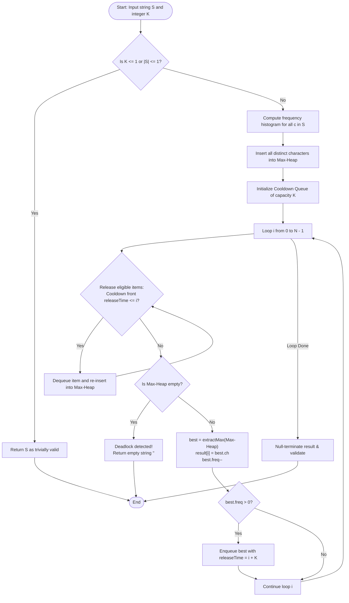

# Question 6: Reorganise String with K-Distance Apart

<div align="center">


</div>

---

## 📌 Problem Statement

> Given a string $S$ and an integer $K$, rearrange $S$ such that the same characters are at least distance $K$ apart. If impossible, return an empty string.
> 
> By choosing the proper input representation, write a program in C to validate your algorithm and derive the complexity analysis of your algorithm.

---

## 🧠 Theoretical Formulation & Greedy Paradigm

### 1. Spacing Constraints & Generalized Pigeonhole Principle

Let $S$ be a string of length $N = |S|$ drawn over an alphabet $\Sigma$. Let $f(c)$ denote the occurrence frequency of character $c \in \Sigma$, and let $f_{max} = \max_{c \in \Sigma} f(c)$.

For any two occurrences of the same character $c$ placed at indices $i$ and $j$ ($i < j$), the separation condition requires:
$$j - i \ge K$$
This implies that between any two identical characters, there must be at least $K - 1$ intervening distinct characters.

#### **Necessary Feasibility Bound (Pigeonhole Condition)**
To accommodate $f(c)$ copies of character $c$ spaced at least $K$ apart:
- The first $f(c) - 1$ copies require $(f(c) - 1)$ blocks of size $K$.
- The final copy occupies at least $1$ slot.
- If $m$ distinct characters tie for the maximum frequency $f_{max}$, the minimum total string length required is:
  $$N \ge (f_{max} - 1) \cdot K + m$$
If this condition is violated, no valid rearrangement exists.

---

### 2. The Greedy Max-Heap with Cooldown Queue Strategy

To construct a valid string, we place characters sequentially from slot $i = 0$ to $N - 1$:

#### **Greedy Choice Invariant**
At each position $i$, among all characters that are **currently eligible** (i.e., not placed within the preceding $K - 1$ positions), greedily select the character with the **highest remaining frequency**.
- *Why Highest Frequency?* High-frequency characters impose the tightest future spacing constraints and have the highest risk of running out of valid slots. Delaying their placement risks clustering them at the tail of the string where insufficient distinct characters remain to buffer them.

#### **Cooldown Mechanism (Sliding Window FIFO Queue)**
To prevent character reuse within distance $K$:
1. When character $c$ is placed at slot $i$, its frequency is decremented ($f(c) \leftarrow f(c) - 1$).
2. If $f(c) > 0$, character $c$ enters a **cooldown queue** with release timestamp $t_{release} = i + K$.
3. At the beginning of each step $i$, all entries in the cooldown queue whose $t_{release} \le i$ are dequeued and returned to the Max-Heap of eligible characters.
4. If at any step $i$ the Max-Heap is empty while unplaced characters remain, a deadlock has occurred (all remaining characters are locked in cooldown), proving that valid rearrangement is **impossible**.

---

## 📊 Data Structures & Input Representation

| Component | Type | Description |
| :--- | :--- | :--- |
| `CharFreq` | `struct` | Encapsulates a character `ch` and its active remaining `freq`. |
| `MaxHeap` | `struct` | Priority queue maintaining eligible characters ordered by highest frequency. |
| `CooldownItem` | `struct` | Pairs a `CharFreq` record with its integer `releaseTime`. |
| `Queue` | `struct` | Circular FIFO buffer of size $K$ enforcing the distance separation barrier. |
| `count` | `int[256]` | ASCII frequency histogram counting character occurrences in $\mathcal{O}(N)$. |

### Functional Decomposition
- **`main()`**: Handles manual or random string generation, manages the greedy placement loop, and coordinates validation.
- **`maxHeapify(...)`**, **`extractMax(...)`**, **`insertMaxHeap(...)`**: Maintain the heap in $\mathcal{O}(\log |\Sigma|)$.
- **`enqueue(...)`**, **`dequeue(...)`**: Circular FIFO operations executing in $\mathcal{O}(1)$.
- **`validateResult(str, k)`**: Post-hoc verification checking $|i - j| \ge K$ for all identical character pairs.

---

## 🔄 Algorithmic Procedure



---

## ⏱️ Complexity Analysis

| Phase / Operation | Time Complexity | Auxiliary Space | Description |
| :--- | :---: | :---: | :--- |
| **Frequency Histogram** | $\Theta(N)$ | $\mathcal{O}(|\Sigma|)$ | Single linear scan over input string of length $N$. |
| **Heap Construction** | $\mathcal{O}(|\Sigma|)$ | $\mathcal{O}(|\Sigma|)$ | Inserts at most $|\Sigma| \le 256$ distinct characters into heap. |
| **Greedy Character Placements** | $\mathcal{O}(N \log |\Sigma|)$ | $\mathcal{O}(N)$ | Exactly $N$ steps; each step performs $\mathcal{O}(1)$ queue ops and $\mathcal{O}(\log |\Sigma|)$ heap ops. |
| **Validation Scan** | $\Theta(N)$ | $\mathcal{O}(|\Sigma|)$ | Traverses output array verifying last seen indices. |
| **Total Algorithm** | $\mathbf{\mathcal{O}(N \log |\Sigma|)}$ | $\mathbf{\mathcal{O}(N + |\Sigma|)}$ | Since $|\Sigma| \le 256$ is constant, runtime is strictly **linear $\mathcal{O}(N)$**. |

---

## 🛠️ Compilation & Execution

```bash
# Navigate to the Q6 directory
cd /Users/rishav07/Documents/college/SEM3/DAA/LAB09/Q6

# Compile with GCC
gcc -Wall -Wextra -std=c11 -O2 main.c -o main

# Run program
./main
```

---

## 💻 Sample Traces & Validation Cases

### Trace 1: Successful Reorganization
**Input:** String $S = \text{"aabbcc"}$, $K = 3$

```text
Enter the input string (no spaces): aabbcc
Enter distance separation constraint (K): 3

Input String  : "aabbcc" (Length: 6)
Constraint K  : 3

================ STEP-BY-STEP GREEDY PLACEMENT ================
+-------+----------+-------------------+----------------------+
| Index | Selected | Remaining In Heap | Cooldown Queue State |
+-------+----------+-------------------+----------------------+
|     0 |    'a'   |                 2 |                    1 |
|     1 |    'c'   |                 1 |                    2 |
|     2 |    'b'   |                 0 |                    3 |
|     3 |    'a'   |                 0 |                    2 |
|     4 |    'c'   |                 0 |                    1 |
|     5 |    'b'   |                 0 |                    0 |
+-------+----------+-------------------+----------------------+

======================= REORGANIZATION SUMMARY =======================
Status            : SUCCESSFUL REORGANIZATION
Reorganized String: "acbacb"
Validation Check  : VERIFIED (Distance condition holds for all pairs)
======================================================================
```

#### Step-by-Step State Evolution
| Slot | Placed Char | Heap State Before Selection | Cooldown Queue Items (Char @ Ready Slot) |
| :---: | :---: | :--- | :--- |
| **0** | `'a'` | $\{('a', 2), ('b', 2), ('c', 2)\}$ | — |
| **1** | `'c'` | $\{('b', 2), ('c', 2)\}$ | `('a', 1) @ 3` |
| **2** | `'b'` | $\{('b', 2)\}$ | `('a', 1) @ 3`, `('c', 1) @ 4` |
| **3** | `'a'` | Re-admitted `('a', 1)` | `('c', 1) @ 4`, `('b', 1) @ 5` |
| **4** | `'c'` | Re-admitted `('c', 1)` | `('b', 1) @ 5` |
| **5** | `'b'` | Re-admitted `('b', 1)` | — |

---

### Trace 2: Impossible Configuration (Pigeonhole Violation)
**Input:** String $S = \text{"aaabc"}$, $K = 3$
- Frequency of `'a'` is $3$.
- Required length: $(3 - 1) \times 3 + 1 = 7$.
- Actual length is $5 < 7$.
- At index $4$, `'a'` is still on cooldown with release time $6$, leaving the Max-Heap empty.
- Program terminates safely and returns `""`.
