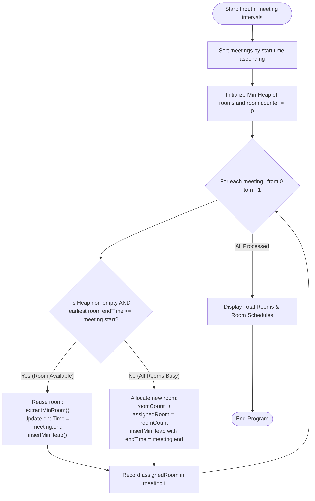

# Question 8: Minimum Number of Meeting Rooms

<div align="center">


</div>

---

## 📌 Problem Statement

> Given an array of meeting time intervals consisting of start and end times $[[s_1, e_1], [s_2, e_2], \dots]$, find the minimum number of conference rooms required.
> 
> By choosing the proper input representation, write a program in C to validate your procedures and derive the complexity analysis of your algorithm.

---

## 🧠 Theoretical Formulation & Greedy Paradigm

### 1. Interval Graph Coloring & Maximum Clique

Let $\mathcal{I} = \{I_1, I_2, \dots, I_n\}$ be a set of $n$ meetings, where meeting $I_i = [s_i, e_i)$ is an open-ended time interval with $s_i < e_i$.
Two meetings $I_i$ and $I_j$ conflict if their intervals intersect:
$$I_i \cap I_j \ne \emptyset \iff \max(s_i, s_j) < \min(e_i, e_j)$$

We define the conflict graph $G = (V, E)$ where vertices represent meetings and edges represent overlapping intervals (an **Interval Graph**).
- Assigning meeting rooms corresponds to a vertex coloring of $G$, where adjacent vertices cannot share the same color (room).
- The minimum number of rooms needed is the **chromatic number** $\chi(G)$.

#### **Interval Graph Perfection Theorem**
Interval graphs are *perfect graphs*. A fundamental property of interval graphs is that their chromatic number strictly equals their maximum clique size:
$$\chi(G) = \omega(G) = d$$
where $d$ is the **depth** of the set of intervals, defined as the maximum number of intervals that contain any common time instant $t$:
$$d = \max_{t \in \mathbb{R}} \big| \{ i \in \{1, \dots, n\} : s_i \le t < e_i \} \big|$$

---

### 2. Greedy Interval Partitioning with Min-Heap

The optimal coloring can be found in $\mathcal{O}(n \log n)$ using a greedy earliest-start-time scan:

#### **Greedy Choice Strategy**
1. Sort all meetings by their start times: $s_1 \le s_2 \le \dots \le s_n$.
2. Maintain a **Min-Heap of Active Rooms**, where each room is keyed by the end time of the most recent meeting scheduled in it.
3. For each meeting $I_i = [s_i, e_i)$:
   - Inspect the room with the earliest departure time: $e_{min} = \text{peekMin}()$.
   - **Case A ($e_{min} \le s_i$):** The room is free! Assign meeting $I_i$ to this existing room, update the room's end time to $e_i$, and restore the heap property.
   - **Case B ($e_{min} > s_i$):** Every existing room is currently occupied at time $s_i$. We are forced to allocate a **new conference room** with end time $e_i$, incrementing total rooms by $1$.

#### **Proof of Optimality (Kleinberg & Tardos Theorem 4.4)**
- Let $k$ be the total number of rooms allocated by the algorithm.
- Room $k$ is opened only when a meeting $I_m$ arrives and finds all existing $k - 1$ rooms busy.
- That means at time $s_m$, there are $k - 1$ meetings currently ongoing in rooms $1, \dots, k - 1$, plus meeting $I_m$ itself.
- Therefore, exactly $k$ mutually overlapping meetings coincide at time $s_m$.
- Hence, the depth $d \ge k$. But no valid room assignment can ever use fewer than $d$ rooms.
- Thus, $k = d = \chi(G)$, proving that the greedy allocation uses the strictly minimal number of rooms.

---

## 📊 Data Structures & Input Representation

| Component | Type | Description |
| :--- | :--- | :--- |
| `Meeting` | `struct` | Represents a meeting with `id`, `start`, `end`, and `assignedRoom`. |
| `Room` | `struct` | Represents an active room tracked in heap by `roomId` and `endTime`. |
| `MinHeap` | `struct` | Priority queue holding active rooms ordered by minimum `endTime`. |

### Functional Decomposition
- **`main()`**: Coordinates meeting ingestion, sorts meetings by start time, executes the greedy allocation loop, and prints room-by-room agendas.
- **`minHeapify(...)`**, **`extractMinRoom(...)`**, **`insertMinHeap(...)`**: Maintain the priority queue of room end times in $\mathcal{O}(\log k)$.
- **`compareMeetings(...)`**: Comparator for `qsort` ordering meetings by start time, breaking ties by end time.
- **`fillMeetingsRandomly(...)`**: Generates uniform meeting intervals $[s_i, s_i + \text{dur}]$.

---

## 🔄 Algorithmic Procedure



---

## ⏱️ Complexity Analysis

| Phase / Operation | Time Complexity | Auxiliary Space | Description |
| :--- | :---: | :---: | :--- |
| **Input Parsing / Generation** | $\Theta(n)$ | $\mathcal{O}(1)$ | Linear reading of $n$ intervals. |
| **Interval Sorting** | $\mathcal{O}(n \log n)$ | $\mathcal{O}(\log n)$ | QuickSort / Introsort by interval start time. |
| **Min-Heap Maintenance** | $\mathcal{O}(n \log k)$ | $\mathcal{O}(k)$ | At most $k \le n$ rooms exist in heap; $n$ extractions and insertions take $\mathcal{O}(n \log k)$. |
| **Schedule Display** | $\Theta(n)$ | $\mathcal{O}(1)$ | Prints meeting breakdowns across all allocated rooms. |
| **Total Algorithm** | $\mathbf{\mathcal{O}(n \log n)}$ | $\mathbf{\mathcal{O}(n)}$ | **Optimal lower bound** for interval graph coloring. |

---

## 🛠️ Compilation & Execution

```bash
# Navigate to the Q8 directory
cd /Users/rishav07/Documents/college/SEM3/DAA/LAB09/Q8

# Compile using GCC
gcc -Wall -Wextra -std=c11 -O2 main.c -o main

# Run program
./main
```

---

## 💻 Sample Traces & Validation Cases

### Trace 1: Three Overlapping Meetings
**Input:** Meetings = `[[0, 30], [5, 10], [15, 20]]`

```text
Enter the number of meetings: 3
Do you wanna: 	(0) Enter meeting intervals manually or
		(1) Have them randomly generated?
Choice: 0
Enter start and end times for 3 meetings:
Meeting 1 (start end): 0 30
Meeting 2 (start end): 5 10
Meeting 3 (start end): 15 20

--- Input Meeting Intervals ---
+------------+------------+----------+
| Meeting ID | Start Time | End Time |
+------------+------------+----------+
|          1 |          0 |       30 |
|          2 |          5 |       10 |
|          3 |         15 |       20 |
+------------+------------+----------+

================ STEP-BY-STEP ROOM ALLOCATION ================
+-------+------------+----------+----------+-----------------------------+
| Order | Meeting ID | Interval | Assigned | Action                      |
+-------+------------+----------+----------+-----------------------------+
|     1 |          1 | [ 0, 30] |  Room 1  | New Room Created            |
|     2 |          2 | [ 5, 10] |  Room 2  | New Room Created            |
|     3 |          3 | [15, 20] |  Room 2  | Reused (Previous ended <= 15) |
+-------+------------+----------+----------+-----------------------------+

======================= ALLOCATION SUMMARY =======================
Total Meetings Processed       : 3
Minimum Conference Rooms Needed: 2
==================================================================

Detailed Schedule by Conference Room:
  Room 1: Meeting 1 [0, 30]
  Room 2: Meeting 2 [5, 10] -> Meeting 3 [15, 20]
==================================================================
```

#### Step-by-Step State Evolution
| Meeting Processed | Interval | Heap State Before Allocation | Action | Resulting Heap |
| :---: | :---: | :--- | :--- | :--- |
| **Meeting 1** | $[0, 30]$ | Empty | Create Room 1 | $\{(\text{Room 1}, 30)\}$ |
| **Meeting 2** | $[5, 10]$ | $\{(\text{Room 1}, 30)\}$ | $30 > 5 \implies$ Create Room 2 | $\{(\text{Room 2}, 10), (\text{Room 1}, 30)\}$ |
| **Meeting 3** | $[15, 20]$ | $\{(\text{Room 2}, 10), (\text{Room 1}, 30)\}$ | $10 \le 15 \implies$ Reuse Room 2 | $\{(\text{Room 2}, 20), (\text{Room 1}, 30)\}$ |

---

### Trace 2: Disjoint Sequential Meetings
**Input:** `[[1, 5], [6, 10], [11, 15]]`
- Since no intervals overlap, Room 1 is continuously reused.
- Minimum conference rooms needed: **1**.
