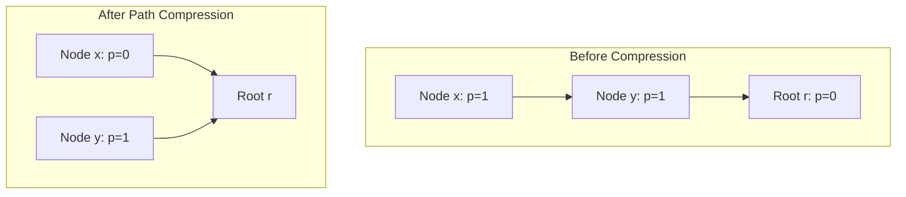
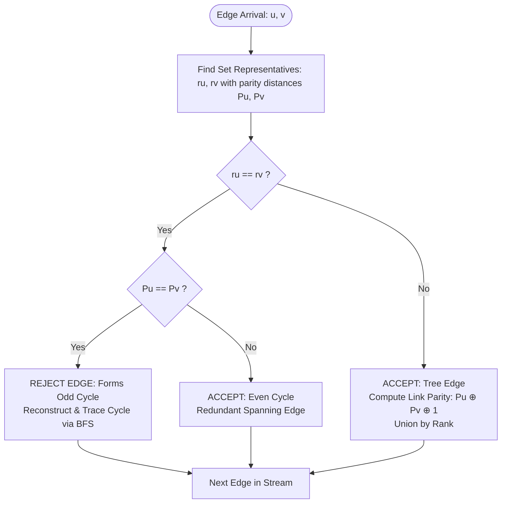

# Question 1: Online Graph-Bipartiteness Testing

<div align="center">


-F59E0B?style=for-the-badge)


</div>

---

## 📌 Problem Statement

> A graph is bipartite if and only if it contains no odd-length cycles. Given an undirected graph with $V$ vertices, edges arrive online one by one. Maintain whether the graph remains bipartite. If adding an edge $(u, v)$ does not introduce an odd cycle, add it; otherwise, report that it violates bipartiteness and skip it.
>
> By choosing the proper input representation, write a program in C to validate your algorithm and derive the complexity analysis of your algorithm.

---

## 🧠 Theoretical Formulation & Mathematical Foundations

### 1. Characterisation of Bipartite Graphs

An undirected graph $G = (V, E)$ is **bipartite** if and only if its vertex set can be partitioned into two disjoint independent sets $V_1$ and $V_2$ such that every edge $e = (u, v) \in E$ has one endpoint in $V_1$ and the other in $V_2$:
$$V = V_1 \cup V_2, \quad V_1 \cap V_2 = \emptyset, \quad \forall (u, v) \in E: u \in V_1 \iff v \in V_2$$

**König's Theorem (1936):**
> A graph $G$ is bipartite if and only if it contains no cycle of odd length.

### 2. Online Parity Potential Model

In an online stream of edges $e_1, e_2, \dots, e_M$, edges arrive sequentially. A naive re-run of Breadth-First Search (BFS) or Depth-First Search (DFS) for each arriving edge would require $\mathcal{O}(M \cdot (V + E)) = \mathcal{O}(M^2)$ time, which is prohibitive for dynamic systems.

Instead, we employ an augmented **Disjoint Set Union (DSU) with Parity Potential**:
- Let each connected component in the spanning forest of accepted edges form a rooted tree.
- For each vertex $x \in V$, define a potential function:
  $$p(x) \in \{0, 1\}$$
  representing the parity of the path length (or color difference) from $x$ to its immediate parent node in the DSU tree:
  $$p(x) = \begin{cases} 0 & \text{if } \text{color}(x) = \text{color}(\text{parent}[x]) \\ 1 & \text{if } \text{color}(x) \neq \text{color}(\text{parent}[x]) \end{cases}$$

### 3. Path Compression with Parity Aggregation

When finding the representative root $r = \text{find}(x)$, the total parity of $x$ relative to the root $r$, denoted $P(x \to r)$, is the XOR-sum of parities along the ancestor path:
$$P(x \to r) = \bigoplus_{w \in \text{path}(x, r)} p(w)$$

During path compression, the recursion collapses intermediate pointers:
$$\text{parent}[x] \leftarrow r, \quad p[x] \leftarrow p[x] \oplus p[\text{parent}_{\text{old}}[x]]$$



### 4. Edge Evaluation & Online Decision Invariant

When an undirected edge $(u, v)$ arrives:
1. Query the DSU:
   $$r_u = \text{find}(u, \&P_u), \quad r_v = \text{find}(v, \&P_v)$$
   where $P_u, P_v \in \{0, 1\}$ are the parity distances of $u$ and $v$ from their respective roots $r_u$ and $r_v$.

2. **Case A: $r_u = r_v$ (Endpoints in Same Component)**
   - The path length between $u$ and $v$ within the existing tree is:
     $$\Delta(u, v) \equiv P_u \oplus P_v \pmod 2$$
   - **Odd Cycle Detection:** If $P_u = P_v$ ($\Delta(u, v) = 0$), then the tree path between $u$ and $v$ has **even length**. Introducing edge $(u, v)$ completes a cycle of length $\text{even} + 1 = \text{odd}$.
     $$\implies \text{VIOLATES BIPARTITENESS} \implies \text{REJECT \& SKIP}$$
   - **Even Cycle / Redundant Edge:** If $P_u \neq P_v$ ($\Delta(u, v) = 1$), the tree path has **odd length**. Introducing edge $(u, v)$ creates an even cycle of length $\text{odd} + 1 = \text{even}$.
     $$\implies \text{MAINTAINS BIPARTITENESS} \implies \text{ACCEPT (Redundant)}$$

3. **Case B: $r_u \neq r_v$ (Endpoints in Different Components)**
   - Adding $(u, v)$ links two disjoint trees into a single tree without closing any cycles.
   - We must orient the parity of the new root-link such that $u$ and $v$ receive opposite colors:
     $$P(u \to r_v) \oplus P_v = 1 \implies (P_u \oplus p(r_u)) \oplus P_v = 1$$
     $$p(r_u) \leftarrow P_u \oplus P_v \oplus 1$$
   - Using **Union by Rank**, attach the shallower root under the deeper root, preserving the $\mathcal{O}(\alpha(V))$ amortised bound.

---

## 🏗️ Algorithm Architecture & Flowchart



---

## 📊 Complexity Analysis

### Time Complexity
- **DSU Operations:** Each edge triggers two `findSet` queries and at most one union. With both path compression and union by rank, each operation executes in $\mathcal{O}(\alpha(V))$ amortised time, where $\alpha$ is the extremely slow-growing inverse Ackermann function ($\alpha(V) \le 4$ for all practical $V \le 10^{80}$).
- **Cycle Tracing:** When an odd cycle is detected, reconstructing the cycle for academic reporting takes $\mathcal{O}(V)$ time via BFS over the accepted tree edges.
- **Overall Time Complexity:**
  $$\mathcal{O}(M \cdot \alpha(V)) \text{ for testing and edge insertion}$$

### Space Complexity
- DSU tables (`parent`, `parity`, `rank`): $3 \times V \times \text{sizeof}(\text{int}) = \Theta(V)$.
- Spanning forest adjacency list for cycle tracing: $\mathcal{O}(V)$ edges.
- **Total Space Complexity:** $\Theta(V + M)$ auxiliary memory.

---

## 🧪 Verification & Step-by-Step Sample Trace

Consider $V = 5$ vertices with edge stream:
$$e_1=(1, 2), \quad e_2=(2, 3), \quad e_3=(3, 4), \quad e_4=(4, 5), \quad e_5=(1, 5), \quad e_6=(2, 4)$$

```text
[Step 1] Edge arrives: (1, 2)
  -> STATUS: ACCEPTED (Connects different components; 2-coloring updated).

[Step 2] Edge arrives: (2, 3)
  -> STATUS: ACCEPTED (Connects different components; 2-coloring updated).

[Step 3] Edge arrives: (3, 4)
  -> STATUS: ACCEPTED (Connects different components; 2-coloring updated).

[Step 4] Edge arrives: (4, 5)
  -> STATUS: ACCEPTED (Connects different components; 2-coloring updated).

[Step 5] Edge arrives: (1, 5)
  -> STATUS: REJECTED! Violates bipartiteness!
  [Odd-Cycle Trace] Length = 5 vertices (odd length cycle of 5 edges):
    1 -> 2 -> 3 -> 4 -> 5 -> 1 [ODD CYCLE!]

[Step 6] Edge arrives: (2, 4)
  -> STATUS: REJECTED! Violates bipartiteness!
  [Odd-Cycle Trace] Length = 3 vertices (odd length cycle of 3 edges):
    2 -> 3 -> 4 -> 2 [ODD CYCLE!]
```

**Final 2-Coloring:**
- **Red ($V_1$):** $\{2, 4\}$
- **Blue ($V_2$):** $\{1, 3, 5\}$

---

## 💻 Compilation & Execution

```bash
# Compile using C11 standard with all warnings enabled
gcc -std=c11 -Wall -Wextra main.c -o program

# Run interactive simulation
./program
```
