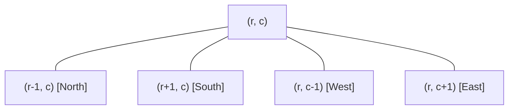

# Question 2: Dynamic Connected Components in a Grid (Number of Islands II)

<div align="center">


-F59E0B?style=for-the-badge)


</div>

---

## 📌 Problem Statement

> Given an $R \times C$ grid initially completely filled with water, land cells are added one by one at positions $(r_1, c_1), (r_2, c_2), \dots, (r_k, c_k)$. After each operation, output the current number of 4-directionally connected land components (islands).
>
> By choosing the proper input representation, write a program in C to validate your algorithm and derive the complexity analysis of your algorithm.
>
> *(Hint: This is the Dynamic Connected Components in a Grid, commonly known as Number of Islands II, which can be solved using a Disjoint Set Union (DSU / Union-Find) data structure with coordinate flattening.)*

---

## 🧠 Theoretical Formulation & Mathematical Foundations

### 1. Grid Discretisation & Coordinate Flattening

Let the spatial environment be modeled as a rectangular lattice graph $G = (V, E)$, where $V = \{ (r, c) \mid 0 \le r < R, \; 0 \le c < C \}$ represents the discrete cells.

To map 2D discrete Cartesian coordinates $(r, c)$ into a continuous 1D addressable memory space for the disjoint-set forest, we define a canonical bijective mapping $\phi: [0, R-1] \times [0, C-1] \to [0, R \cdot C - 1]$:
$$\phi(r, c) = r \cdot C + c$$

The inverse coordinate reconstruction mapping $\phi^{-1}(id) = (r, c)$ is given by:
$$r = \lfloor id / C \rfloor, \quad c = id \pmod C$$

### 2. 4-Directional Adjacency Topology

In a planar 4-connected grid, two land cells $(r, c)$ and $(r', c')$ are incident if and only if their Manhattan distance $\ell_1$ equals $1$:
$$d_1((r, c), (r', c')) = |r - r'| + |c - c'| = 1$$

The 4-neighborhood of cell $(r, c)$ is defined as:
$$\mathcal{N}_4(r, c) = \left\{ (r-1, c), \; (r+1, c), \; (r, c-1), \; (r, c+1) \right\} \cap ([0, R-1] \times [0, C-1])$$



### 3. Dynamic Component Count Invariant

Let $\mathcal{I}_t$ denote the set of connected components (islands) after operation $t$.
1. **Cell Activation:** When a new land cell $u = (r, c)$ is added at step $t$:
   - If cell $u$ is already land, $\mathcal{I}_t = \mathcal{I}_{t-1}$.
   - Otherwise, activating cell $u$ initially introduces a singleton island:
     $$|\mathcal{I}| \leftarrow |\mathcal{I}| + 1$$
2. **Component Merging:**
   For each adjacent neighbor $v \in \mathcal{N}_4(u)$ that is already land:
   - Query the component roots: $r_u = \text{find}(\phi(u))$ and $r_v = \text{find}(\phi(v))$.
   - If $r_u \neq r_v$, cells $u$ and $v$ belong to separate connected components. Adding edge $(u, v)$ bridges these two components into one:
     $$\text{union}(r_u, r_v), \quad |\mathcal{I}| \leftarrow |\mathcal{I}| - 1$$
   - If $r_u = r_v$, they already share a component; no component count modification occurs.

---

## 🏗️ Algorithm Architecture & Flowchart

```mermaid
flowchart TD
    Start([Input: Land Position r, c]) --> CheckLand{Is grid[r][c] == 1 ?}
    CheckLand -- Yes --> Skip[Cell Already Land: Return Current Island Count]
    
    CheckLand -- No --> Activate[Mark grid[r][c] = 1<br>parent[id] = id, rank[id] = 0<br>islands = islands + 1]
    
    Activate --> CheckNeighbors[Iterate over 4-Neighbors: Up, Down, Left, Right]
    CheckNeighbors --> InBounds{Neighbor in Bounds & is Land?}
    
    InBounds -- No --> NextNeighbor[Advance to Next Neighbor]
    InBounds -- Yes --> CheckRoots{find(id) != find(nid)?}
    
    CheckRoots -- Yes --> Merge[union(id, nid)<br>islands = islands - 1]
    CheckRoots -- No --> NextNeighbor
    
    Merge --> NextNeighbor
    NextNeighbor --> DoneNeighbors{All 4 Neighbors Checked?}
    DoneNeighbors -- No --> CheckNeighbors
    DoneNeighbors -- Yes --> Emit[Output Current Island Count]
```

---

## 📊 Complexity Analysis

### Time Complexity
- **Grid Initialization:** $\mathcal{O}(R \cdot C)$ to allocate and initialize the grid and DSU tables.
- **Per-Operation Complexity:**
  For each of the $k$ land additions:
  - Checking and activating cell: $\mathcal{O}(1)$.
  - Inspecting 4 cardinal neighbors: Exactly 4 boundary checks.
  - At most 4 `find` and `union` operations per addition.
  - With union by rank and path compression, each DSU query executes in amortised $\mathcal{O}(\alpha(R \cdot C))$ time.
- **Overall Time Complexity:**
  $$\mathcal{O}(R \cdot C + k \cdot \alpha(R \cdot C))$$
  For dense streams where $k \ge R \cdot C$, this is essentially linear in the number of operations: $\mathcal{O}(k)$.

### Space Complexity
- DSU arrays `parent` and `rank`: $2 \times (R \cdot C) \times \text{sizeof}(\text{int})$.
- State grid `grid[R][C]`: $R \cdot C \times \text{sizeof}(\text{int})$.
- **Total Space Complexity:** $\Theta(R \cdot C)$ auxiliary memory.

---

## 🧪 Verification & Step-by-Step Sample Trace

Consider a $3 \times 3$ grid with $k = 4$ land additions:
$$P_1 = (1, 1), \quad P_2 = (1, 2), \quad P_3 = (2, 3), \quad P_4 = (2, 2)$$

```text
Initial State: 3 x 3 Grid completely submerged in water (0 Islands).

[Step 1] Add Land at (1, 1):
  -> New island created: count = 1.
  -> Grid:
     # . .
     . . .
     . . .

[Step 2] Add Land at (1, 2):
  -> New land created: count = 2.
  -> Adjacent to (1, 1): merges! Islands decrement to 1.
  -> Grid:
     # # .
     . . .
     . . .

[Step 3] Add Land at (2, 3):
  -> New island created (no adjacent land): count = 2.
  -> Grid:
     # # .
     . . #
     . . .

[Step 4] Add Land at (2, 2):
  -> New land created: count = 3.
  -> Adjacent to (1, 2): merges! count = 2.
  -> Adjacent to (2, 3): merges! count = 1.
  -> Grid:
     # # .
     . # #
     . . .

Final Sequence of Island Counts: [ 1, 1, 2, 1 ]
```

---

## 💻 Compilation & Execution

```bash
# Compile using C11 standard with all warnings enabled
gcc -std=c11 -Wall -Wextra main.c -o program

# Run interactive simulation
./program
```
