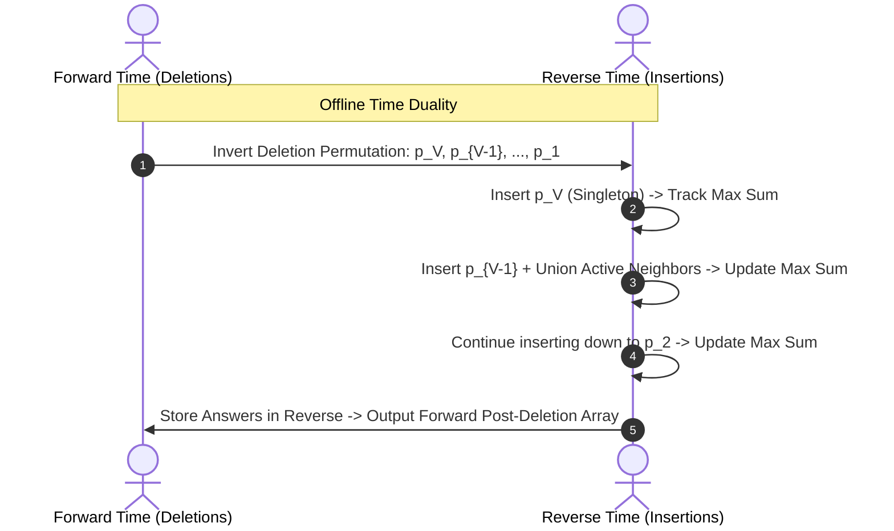

# Question 4: Reverse Time-Step DSU Application

<div align="center">


</div>

---

## 📌 Problem Statement

> Given a vertex-weighted undirected graph, vertices are sequentially deleted one by one in an order $P = [p_1, p_2, \dots, p_V]$. After each vertex deletion, compute the maximum sum of vertex values among all remaining connected components. Note that deleting a vertex in a graph means removing that specific vertex and all edges connected (incident) to it from the graph structure.
>
> By choosing the proper input representation, write a program in C to validate your algorithm and derive the complexity analysis of your algorithm.

---

## 🧠 Theoretical Formulation & Mathematical Foundations

### 1. Forward Destruction vs. Reverse Construction Duality

Let $G = (V, E)$ be an undirected graph equipped with vertex weight function $w: V \to \mathbb{Z}^+$.
A sequential deletion schedule is defined by the permutation:
$$P = [p_1, p_2, \dots, p_V]$$

In the forward temporal process:
- At step $t \in \{1, 2, \dots, V\}$, vertex $p_t$ is deleted along with all its incident edges:
  $$V_t = V \setminus \{ p_1, p_2, \dots, p_t \}, \quad E_t = \{ (u, v) \in E \mid u, v \in V_t \}$$
- We seek the maximum connected component sum:
  $$\Omega_t = \max_{C \in \pi(G[V_t])} \sum_{v \in C} w_v$$
  where $\pi(G[V_t])$ is the set of connected components of the induced subgraph $G[V_t]$, with $\Omega_V = 0$ by definition.

**The Dynamic Connectivity Barrier:**
Deleting vertices splits connected components. In general graphs, maintaining connected components dynamically under edge deletions (fully dynamic graph connectivity) requires non-trivial data structures such as Holm-de Lichtenberg-Thorup (HDT) trees or randomized spanning forests with $\mathcal{O}(\log^2 V)$ amortised time per operation.

### 2. The Time-Reversal Paradigm (Offline DSU)

Because the entire deletion sequence $P$ is known in advance (**offline model**), we can invert the arrow of time:
$$\tau = V - t + 1 \quad \text{for } t = V, V-1, \dots, 1$$

Running the simulation backwards transforms catastrophic vertex destruction into **incremental vertex creation**:
- We start with an empty vertex set $U_0 = \emptyset$.
- At reverse step $\tau \in \{1, \dots, V\}$, we introduce vertex $u = p_{V - \tau + 1}$ and activate it:
  $$U_\tau = U_{\tau-1} \cup \{ u \}$$
- For each incident edge $(u, v) \in E$:
  - If neighbor $v$ is already active ($v \in U_{\tau-1}$), edge $(u, v)$ is restored.
  - Adding edge $(u, v)$ merges the component of $u$ with the component of $v$ using standard Disjoint Set Union (DSU).
- The maximum component sum $\mathcal{M}_\tau = \max_{C \in \pi(G[U_\tau])} W(C)$ satisfies a monotonic accumulation invariant:
  $$\mathcal{M}_\tau = \max(\mathcal{M}_{\tau-1}, \; W(\text{root}(u)))$$

### 3. Answer Mapping

The state of the graph with active vertex set $U_\tau = \{ p_{V - \tau + 1}, \dots, p_V \}$ corresponds precisely to the graph state in the forward process **after** deleting the prefix $\{ p_1, \dots, p_{V - \tau} \}$.
Therefore:
$$\Omega_k = \mathcal{M}_{V - k} \quad \text{for } k \in \{1, 2, \dots, V-1\}, \quad \text{and } \Omega_V = 0$$



---

## 🏗️ Algorithm Architecture & Flowchart

```mermaid
flowchart TD
    Start([Input: Graph G, Weights w, Permutation P]) --> BuildAdj[Build Adjacency List for Graph G]
    BuildAdj --> InitDSU[Initialize DSU with Component Weights<br>isActive array = all FALSE<br>currentMax = 0]
    
    InitDSU --> LoopRev[Iterate step = V-1 down to 0<br>u = P[step]]
    
    LoopRev --> Activate[Mark isActive[u] = TRUE<br>currentMax = max(currentMax, w[u])]
    Activate --> ScanNeighbors[Iterate over neighbors v of u]
    
    ScanNeighbors --> CheckActive{Is neighbor v active?}
    CheckActive -- No --> NextNeighbor[Next Neighbor]
    CheckActive -- Yes --> CheckRoots{find(u) != find(v)?}
    
    CheckRoots -- Yes --> Union[union(u, v)<br>weight[newRoot] += weight[childRoot]<br>currentMax = max(currentMax, weight[newRoot])]
    CheckRoots -- No --> NextNeighbor
    
    Union --> NextNeighbor
    NextNeighbor --> DoneNeighbors{All neighbors checked?}
    DoneNeighbors -- No --> ScanNeighbors
    DoneNeighbors -- Yes --> SaveAns[If step > 0: ans[step - 1] = currentMax]
    
    SaveAns --> LoopDone{step == 0 ?}
    LoopDone -- No --> LoopRev
    LoopDone -- Yes --> SetLast[ans[V - 1] = 0]
    SetLast --> PrintTable[Display Forward Post-Deletion Table]
```

---

## 📊 Complexity Analysis

### Time Complexity
- **Graph Construction:** Building the adjacency list representation takes $\mathcal{O}(V + E)$ time.
- **Reverse Insertion Loop:**
  - Vertices are activated exactly once: $V$ activations.
  - Each undirected edge $(u, v)$ is inspected twice (once from $u$ and once from $v$). If both endpoints are active, `findSet` and `unionSets` are invoked.
  - Total DSU operations: at most $2E$ find operations and $V - 1$ unions.
  - With union by rank and path compression, each operation runs in amortised $\mathcal{O}(\alpha(V))$ time.
- **Overall Time Complexity:**
  $$\mathcal{O}((V + E) \cdot \alpha(V))$$
  This is nearly optimal linear time, contrasting with the intractable $\mathcal{O}(V(V + E))$ forward approach.

### Space Complexity
- Adjacency list representation: $2E$ nodes, requiring $\mathcal{O}(V + E)$ memory.
- DSU arrays (`parent`, `rank`, `compWeight`): $3 \times V \times \text{sizeof}(\text{type}) = \Theta(V)$.
- `isActive` and `maxSumAfterDeletion` buffers: $\Theta(V)$.
- **Total Space Complexity:** $\Theta(V + E)$ memory.

---

## 🧪 Verification & Step-by-Step Sample Trace

Consider a 4-vertex path graph:
$$1 - 2 - 3 - 4, \quad w(1)=1, \; w(2)=2, \; w(3)=3, \; w(4)=4$$
Deletion sequence: $P = [2, 4, 1, 3]$.

```text
Reverse Execution:
[Reverse Step 1] Activate Vertex 3 (Weight = 3):
  Active: {3}
  Components: {3 (wt: 3)}
  Max Sum = 3

[Reverse Step 2] Activate Vertex 1 (Weight = 1):
  Active: {3, 1} (no active edge between 1 and 3)
  Components: {1 (wt: 1)}, {3 (wt: 3)}
  Max Sum = 3

[Reverse Step 3] Activate Vertex 4 (Weight = 4):
  Active: {4, 1, 3}
  Edge (4, 3) connects active vertices 4 and 3 -> Merged!
  Components: {1 (wt: 1)}, {3, 4 (wt: 7)}
  Max Sum = 7

[Reverse Step 4] Activate Vertex 2 (Weight = 2):
  Active: {2, 4, 1, 3}
  Edges (2, 1) and (2, 3) connect to active neighbors -> Full graph restored!
  Components: {1, 2, 3, 4 (wt: 10)}
  Max Sum = 10

Forward Post-Deletion Results:
----------------------------------------------------------------------
  Step            | Deleted Vertex   | Max Component Weight Remaining
----------------------------------------------------------------------
  Deletion 1      | Vertex 2         | 7
  Deletion 2      | Vertex 4         | 3
  Deletion 3      | Vertex 1         | 3
  Deletion 4      | Vertex 3         | 0
----------------------------------------------------------------------
```

---

## 💻 Compilation & Execution

```bash
# Compile using C11 standard with all warnings enabled
gcc -std=c11 -Wall -Wextra main.c -o program

# Run interactive simulation
./program
```
