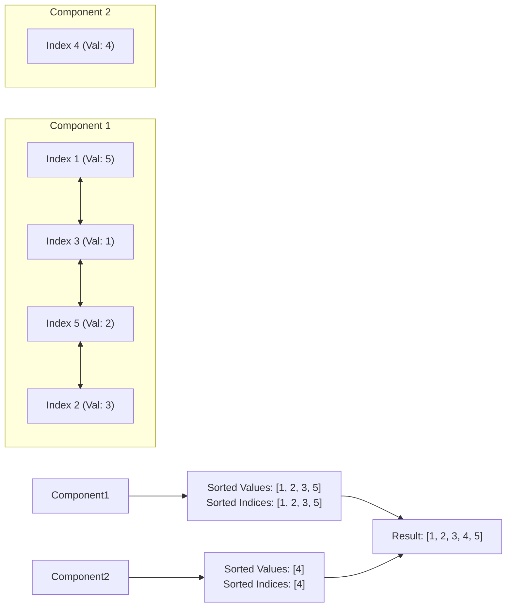

# Question 5: Lexicographically Smallest Connected Component Permutation

<div align="center">


%20%2B%20Greedy-F59E0B?style=for-the-badge)


</div>

---

## 📌 Problem Statement

> Given a permutation $A$ of numbers $1 \dots n$, and a list of allowable pairwise swaps $(u, v)$ forming edges in an undirected graph, find the lexicographically smallest permutation achievable through any number of valid swaps.
>
> By choosing the proper input representation, write a program in C to validate your algorithm and derive the complexity analysis of your algorithm.

---

## 🧠 Theoretical Formulation & Mathematical Foundations

### 1. Algebraic Permutation Group & Reachability Invariant

Let $I = \{1, 2, \dots, n\}$ be the set of index positions of permutation array $A$.
Each allowable pairwise swap between index positions $u$ and $v$ can be modeled as a fundamental transposition $(u \; v)$ in the symmetric group $S_n$.

Let $G = (I, E)$ be an undirected swap graph whose vertex set is the index set $I$ and edge set $E$ comprises all allowable swap pairs:
$$E = \{ (u_k, v_k) \mid k = 1, 2, \dots, M \}$$

**Fundamental Transposition Theorem in Abstract Algebra:**
> If a connected graph $H = (V_H, E_H)$ has $|V_H| = k$ vertices, the transpositions corresponding to the edges $E_H$ generate the full symmetric group $S_{V_H} \cong S_k$.

**Corollary (Arbitrary Transitivity within Components):**
> Any two index positions $i, j \in I$ can exchange their values (either directly or via an intermediate sequence of swaps) if and only if there exists a path between $i$ and $j$ in $G$, i.e., $i$ and $j$ belong to the same connected component $C \subseteq I$.
> Furthermore, any arbitrary permutation of the values currently occupying the indices of component $C$ is reachable through finite allowable swaps.

### 2. Lexicographical Greedy Optimality

A sequence $A = [a_1, a_2, \dots, a_n]$ is **lexicographically strictly smaller** than $B = [b_1, b_2, \dots, b_n]$ if at the first index $k$ where $a_k \neq b_k$, we have $a_k < b_k$.

By the transitivity corollary:
1. Swaps between elements in different connected components are impossible ($E(C_a, C_b) = \emptyset$).
2. Within any connected component $C = \{ i_1 < i_2 < \dots < i_k \}$, any rearrangement of its multiset of values $\mathcal{V}_C = \{ A[i_1], A[i_2], \dots, A[i_k] \}$ is achievable.
3. To minimize the permutation lexicographically, the greedy-choice property dictates that at the earliest available index $i_1$, we must place the absolute minimum element from $\mathcal{V}_C$. At index $i_2$, we must place the second smallest, and so on.

$$\text{Optimal Assignment:} \quad A^*[i_r] = \text{sorted}(\mathcal{V}_C)[r] \quad \forall r \in \{1, 2, \dots, k\}$$



---

## 🏗️ Algorithm Architecture & Flowchart

```mermaid
flowchart TD
    Start([Input: Permutation A, Swap Pairs M]) --> InitDSU[Initialize DSU of size N<br>parent[i] = i, rank[i] = 0]
    
    InitDSU --> ProcessSwaps[For each swap pair u, v:<br>unionSets(u - 1, v - 1)]
    
    ProcessSwaps --> GroupIndices[Partition indices 0..n-1 by findSet root<br>compIndices[root] = list of indices in component]
    
    GroupIndices --> LoopComps[For each connected component root r:]
    
    LoopComps --> ExtractVals[Extract values: values[k] = A[compIndices[r][k]]]
    ExtractVals --> SortVals[Sort values in ascending order via qsort]
    SortVals --> AssignBack[Write sorted values back into sorted index positions:<br>result[compIndices[r][k]] = values[k]]
    
    AssignBack --> NextComp{More Components?}
    NextComp -- Yes --> LoopComps
    NextComp -- No --> Emit[Output Lexicographically Smallest Permutation]
```

---

## 📊 Complexity Analysis

### Time Complexity
- **DSU Initialization:** $\mathcal{O}(n)$.
- **Graph Component Synthesis:** $M$ edge unions with path compression and union by rank run in $\mathcal{O}(M \cdot \alpha(n))$ time.
- **Index Partitioning:** Two passes over $n$ indices take $\mathcal{O}(n \cdot \alpha(n))$ time.
- **Sorting within Components:**
  For each component $C_j$ of size $k_j$, sorting takes $\mathcal{O}(k_j \log k_j)$ time.
  Summing across all disjoint components:
  $$\sum_{j} k_j \log k_j \le \left(\sum_j k_j\right) \log\left(\sum_j k_j\right) = \mathcal{O}(n \log n)$$
- **Overall Time Complexity:**
  $$\mathcal{O}(M \cdot \alpha(n) + n \log n)$$

### Space Complexity
- DSU arrays `parent` and `rank`: $2 \times n \times \text{sizeof}(\text{int}) = \Theta(n)$.
- Component index arrays and value extraction buffers: $\Theta(n)$.
- Swap pair storage: $\mathcal{O}(M)$.
- **Total Space Complexity:** $\Theta(n + M)$ auxiliary memory.

---

## 🧪 Verification & Step-by-Step Sample Trace

Consider array $A = [5, 3, 1, 4, 2]$ of size $n = 5$, with $M = 3$ swaps:
$$(1, 3), \quad (2, 5), \quad (3, 5)$$

```text
1. Swap Graph Disjoint Set Union:
   - Union (1, 3): Component {1, 3}
   - Union (2, 5): Component {2, 5}
   - Union (3, 5): Bridges {1, 3} and {2, 5} into single component {1, 2, 3, 5}
   - Vertex 4 remains in its own isolated component {4}

2. Component Partition:
   - Component Root 4:
     Indices: [ 4 ]
     Values : [ 4 ] -> Sorted: [ 4 ]
     Assigned: A[4] = 4

   - Component Root 5:
     Indices: [ 1, 2, 3, 5 ]
     Values : [ 5, 3, 1, 2 ]
     Sorted : [ 1, 2, 3, 5 ]
     Assigned: A[1]=1, A[2]=2, A[3]=3, A[5]=5

3. Final Verified Output:
   Original: [ 5, 3, 1, 4, 2 ]
   Result  : [ 1, 2, 3, 4, 5 ]
```

---

## 💻 Compilation & Execution

```bash
# Compile using C11 standard with all warnings enabled
gcc -std=c11 -Wall -Wextra main.c -o program

# Run interactive simulation
./program
```
