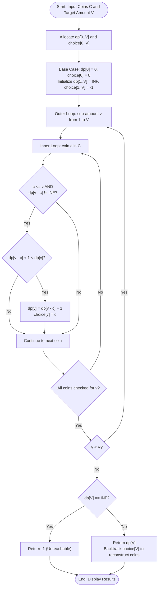

# Question 1: Minimum Coin Change Problem

<div align="center">


</div>

---

## 📌 Problem Statement

> Given an integer array of coin denominations $C = \{c_1, c_2, \dots, c_n\}$ representing coins of different values, and an integer target amount $V$, find the minimum number of coins needed to make up that amount. You may assume an infinite supply of each coin denomination. If that amount of money cannot be made up by any combination of the coins, return $-1$.
>
> By choosing the proper input representation, write a program in C to validate your algorithm and derive the complexity analysis of your algorithm.

---

## 🧠 Theoretical Formulation

### 1. Failure of Greedy Approach
A canonical greedy strategy picks the largest coin $c \le V$ iteratively. However, the greedy method fails for arbitrary denomination systems:
- Let $C = \{1, 5, 6, 9\}$ and target $V = 11$:
  - **Greedy choice:** $9 + 1 + 1 = 11$ (Total: **3 coins**).
  - **Optimal choice:** $5 + 6 = 11$ (Total: **2 coins**).
Because optimal substructure does not obey the greedy-choice property across general denomination systems, dynamic programming is strictly required.

### 2. Optimal Substructure
To form amount $V$ with minimum coins, consider the last coin $c_j \in C$ added to an optimal combination. The remaining amount $V - c_j$ must itself be formed using the minimum possible number of coins.

### 3. Recurrence Relation
Let $dp[v]$ represent the minimum number of coins required to make up amount $v \in [0, V]$:

$$dp[v] = \begin{cases} 
0 & \text{if } v = 0 \\
\min_{\substack{1 \le j \le n \\ c_j \le v}} \{ dp[v - c_j] + 1 \} & \text{if } v > 0 \text{ and } \exists c_j \le v \text{ with } dp[v - c_j] \neq \infty \\
\infty & \text{if amount } v \text{ cannot be formed}
\end{cases}$$

If $dp[V] = \infty$, then amount $V$ is impossible to assemble, and the algorithm returns $-1$.

### 4. Optimal Coin Reconstruction
To retrieve the exact coins picked without adding asymptotic overhead:
- Maintain an auxiliary array $\text{choice}[v]$ storing the coin value $c_j$ that minimized $dp[v]$.
- Backtrack iteratively from $v = V$:
  $$\text{curr} \leftarrow \text{curr} - \text{choice}[\text{curr}]$$
  until $\text{curr} = 0$.

---

## 📊 Data Structures & Input Representation

- **Coin Denominations:** `int coins[n]` — dynamically allocated contiguous array storing the $n$ distinct positive coin values.
- **DP Table:** `int dp[V + 1]` — 1D array where index $v$ represents target sub-amount, initialized to `INT_MAX` for $v \ge 1$ and `dp[0] = 0`.
- **Predecessor / Choice Array:** `int choice[V + 1]` — stores the coin chosen at sub-amount $v$ to allow linear-time traceback.

```c
int solveMinCoins(const int coins[], int n, int V, int dp[], int choice[]);
void printCoinReconstruction(int V, const int choice[]);
void printDPTable(int V, const int dp[], const int choice[]);
```

---

## 🔄 Algorithmic Procedure



---

## ⏱️ Complexity Analysis

| Component | Time Complexity | Space Complexity | Description |
| :--- | :---: | :---: | :--- |
| **Initialization** | $\mathcal{O}(V)$ | $\mathcal{O}(V)$ | Allocating and initializing $dp$ and $choice$ arrays. |
| **DP State Transitions** | $\Theta(n \cdot V)$ | $\mathcal{O}(1)$ aux | Outer loop runs $V$ iterations; inner loop evaluates $n$ coin denominations. |
| **Reconstruction Traceback** | $\mathcal{O}(\text{opt\_coins}) \le \mathcal{O}(V)$ | $\mathcal{O}(1)$ | Backtracking along `choice` array from $V$ to $0$. |
| **Table Display (if $V \le 25$)** | $\mathcal{O}(V)$ | $\mathcal{O}(1)$ | Formats inspection table to stdout. |
| **Total Program** | $\mathbf{\mathcal{O}(n \cdot V)}$ | $\mathbf{\mathcal{O}(V)}$ | Pseudo-polynomial time; strictly linear in state space $V$. |

---

## 🛠️ Compilation & Execution

```bash
# Navigate to question directory
cd /Users/rishav07/Documents/college/SEM3/DAA/LAB8/Q1

# Compile with GCC
gcc -Wall -Wextra -std=c11 -O2 main.c -o main

# Run interactive binary
./main
```

---

## 💻 Sample Traces

### Trace 1: Canonical Non-Greedy Case ($C = \{1, 5, 6, 9\}, V = 11$)

**Input Selection:** Option `1` (Demonstration suite)

**Terminal Output:**
```text
========================================================
       DAA LAB 8 - Q1: MINIMUM COIN CHANGE PROBLEM       
========================================================
1. Run Automated Demonstration Cases
2. Custom User Input
Select option (1 or 2): 1

========================================================
 Demo 1: Canonical Non-Greedy Case
========================================================
  Coin Denominations : { 1, 5, 6, 9 }
  Target Amount (V)  : 11

  Amount v    :    0    1    2    3    4    5    6    7    8    9   10   11 
  Min Coins   :    0    1    2    3    4    1    1    2    3    1    2    2 
  Choice Coin :    0    1    1    1    1    5    6    1    1    9    1    5 

  ----------------- RESULT -----------------
  Minimum coins required: 2
  Optimal coins chosen: [ 5 + 6 ] = 11
========================================================
```

---

### Trace 2: Unreachable Target ($C = \{3, 5\}, V = 7$)

```text
========================================================
 Demo 3: Impossible Amount (No combination sums to 7)
========================================================
  Coin Denominations : { 3, 5 }
  Target Amount (V)  : 7

  Amount v    :    0    1    2    3    4    5    6    7 
  Min Coins   :    0  INF  INF    1  INF    1    2  INF 
  Choice Coin :    0    -    -    3    -    5    3    - 

  ----------------- RESULT -----------------
  Status: IMPOSSIBLE (-1)
  Amount 7 cannot be formed with the given coins.
========================================================
```

---

### Trace 3: Custom Large Denominations ($C = \{186, 419, 83, 408\}, V = 6249$)

```text
========================================================
 Demo 4: Larger Denominations
========================================================
  Coin Denominations : { 186, 419, 83, 408 }
  Target Amount (V)  : 6249

  ----------------- RESULT -----------------
  Minimum coins required: 20
  Optimal coins chosen: [ 186 + 186 + 186 + 419 + 419 + 419 + 419 + 419 + 83 + 83 + 83 + 83 + 408 + 408 + 408 + 408 + 408 + 408 + 408 + 408 ] = 6249
========================================================
```
