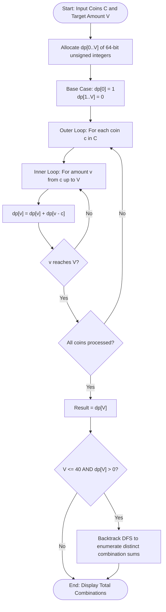

# Question 2: Coin Change — Total Number of Ways

<div align="center">


</div>

---

## 📌 Problem Statement

> Given an array of distinct positive integers representing coin denominations $C = \{c_1, c_2, \dots, c_n\}$ and a target amount $V$, find the total number of distinct combinations of coins that sum up to $V$. You may assume an infinite supply of each coin denomination. The order of coins does not matter (e.g., $1 + 2$ and $2 + 1$ are considered the same combination).
>
> By choosing the proper input representation, write a program in C to validate your algorithm and derive the complexity analysis of your algorithm.

---

## 🧠 Theoretical Formulation

### 1. Combinations vs. Permutations
A fundamental trap in coin change problems is confusing **combinations** (unordered sets) with **permutations** (ordered sequences):
- If the outer loop iterates over the amounts $v$ and the inner loop over coins, ordered partitions are generated (e.g., $1+2$ and $2+1$ counted as 2 separate ways).
- To count **unambiguous combinations**, we adopt the **unbounded knapsack** paradigm: process coin denominations one by one. Once coin $c_i$ is finished being processed, it can never be reintroduced, ensuring coins appear in non-decreasing order of their denomination indices.

### 2. State Definition & Recurrence Relation
Let $dp[i][v]$ denote the number of distinct combinations to form target amount $v$ using only the first $i$ coin denominations $\{c_1, c_2, \dots, c_i\}$.

For each coin $c_i$, we make a binary choice:
1. **Exclude coin $c_i$:** Use only $\{c_1, \dots, c_{i-1}\}$ to form $v \implies dp[i-1][v]$
2. **Include coin $c_i$:** Use coin $c_i$ at least once, leaving remaining amount $v - c_i$ to be formed from the same set $\{c_1, \dots, c_i\}$ (infinite supply) $\implies dp[i][v - c_i]$

$$\therefore \quad dp[i][v] = \begin{cases}
dp[i-1][v] & \text{if } v < c_i \\
dp[i-1][v] + dp[i][v - c_i] & \text{if } v \ge c_i
\end{cases}$$

#### Base Conditions
- $dp[i][0] = 1$ for all $0 \le i \le n$: There is exactly 1 way to form amount $0$ (the empty set $\emptyset$).
- $dp[0][v] = 0$ for all $v > 0$: 0 ways to make a positive amount without any coins.

### 3. Space Optimization to $\mathcal{O}(V)$
Observe that row $i$ depends only on the current row $i$ (for $v - c_i$) and the previous row $i-1$ (for $v$). By iterating amounts $v$ forwards from $c_i$ to $V$, we update the 1D table in place:
$$dp[v] \leftarrow dp[v] + dp[v - c_i]$$
using unsigned 64-bit integers (`unsigned long long`) to guard against arithmetic overflow.

---

## 📊 Data Structures & Input Representation

- **Coin Array:** `int coins[n]` — positive distinct denominations.
- **1D Compressed DP Array:** `ull dp[V + 1]` — 64-bit integer array where $dp[v]$ stores accumulated combinations.
- **2D Demonstration Table:** `ull table[n + 1][V + 1]` — used for pedagogical tabular inspection.
- **Combination Buffer:** `int buffer[V + 1]` — recursion stack buffer for printing explicit combination tuples.

```c
ull countCoinCombinations(const int coins[], int n, int V, ull dp[]);
void computeFull2DTable(const int coins[], int n, int V, ull **table);
void printCombinationsDFS(const int coins[], int n, int coin_idx, int rem, int buffer[], int buf_len, int *comb_count, int max_display);
```

---

## 🔄 Algorithmic Procedure



---

## ⏱️ Complexity Analysis

| Component | Time Complexity | Space Complexity | Description |
| :--- | :---: | :---: | :--- |
| **Space-Optimized DP** | $\Theta(n \cdot V)$ | $\mathcal{O}(V)$ | Single pass over each coin denomination and target range. |
| **Full 2D DP Table (demo)** | $\Theta(n \cdot V)$ | $\Theta(n \cdot V)$ | Evaluates explicit $(n+1) \times (V+1)$ matrix for inspection. |
| **Combination Backtracking** | $\mathcal{O}(\text{Total Ways} \cdot \frac{V}{\min(c)})$ | $\mathcal{O}(V)$ | Recursive tree depth bounded by $V / \min(c)$. |
| **Total Standard Execution** | $\mathbf{\Theta(n \cdot V)}$ | $\mathbf{\mathcal{O}(V)}$ | Highly optimal memory footprint. |

---

## 🛠️ Compilation & Execution

```bash
# Navigate to question directory
cd /Users/rishav07/Documents/college/SEM3/DAA/LAB8/Q2

# Compile with GCC
gcc -Wall -Wextra -std=c11 -O2 main.c -o main

# Run interactive binary
./main
```

---

## 💻 Sample Traces

### Trace 1: Classic Textbook Example ($C = \{1, 2, 5\}, V = 5$)

```text
========================================================
 Demo 1: Classic Textbook Example (C = {1, 2, 5}, V = 5)
========================================================
  Coin Denominations : { 1, 2, 5 }
  Target Amount (V)  : 5

  Full 2D DP Table [Coins Considered vs Target Amount]:
  Coins \ Amount |    0    1    2    3    4    5 
  ---------------+------------------------------
  { }            |    1    0    0    0    0    0 
  <= coin 1      |    1    1    1    1    1    1 
  <= coin 2      |    1    1    2    2    3    3 
  <= coin 5      |    1    1    2    2    3    4 

  ----------------- RESULT -----------------
  Total number of distinct combinations: 4

  Listing combination breakdown (up to first 25):
    ( 1)  [ 1 + 1 + 1 + 1 + 1 ]
    ( 2)  [ 1 + 1 + 1 + 2 ]
    ( 3)  [ 1 + 2 + 2 ]
    ( 4)  [ 5 ]
========================================================
```

---

### Trace 2: Non-Unit Denominations ($C = \{2, 3, 5, 6\}, V = 10$)

```text
========================================================
 Demo 2: Denominations Without Unit Coin (C = {2, 3, 5, 6}, V = 10)
========================================================
  Coin Denominations : { 2, 3, 5, 6 }
  Target Amount (V)  : 10

  Full 2D DP Table [Coins Considered vs Target Amount]:
  Coins \ Amount |    0    1    2    3    4    5    6    7    8    9   10 
  ---------------+-------------------------------------------------------
  { }            |    1    0    0    0    0    0    0    0    0    0    0 
  <= coin 2      |    1    0    1    0    1    0    1    0    1    0    1 
  <= coin 3      |    1    0    1    1    1    1    2    1    2    2    2 
  <= coin 5      |    1    0    1    1    1    2    2    2    3    3    4 
  <= coin 6      |    1    0    1    1    1    2    3    2    4    4    5 

  ----------------- RESULT -----------------
  Total number of distinct combinations: 5

  Listing combination breakdown (up to first 25):
    ( 1)  [ 2 + 2 + 2 + 2 + 2 ]
    ( 2)  [ 2 + 2 + 3 + 3 ]
    ( 3)  [ 2 + 2 + 6 ]
    ( 4)  [ 2 + 3 + 5 ]
    ( 5)  [ 5 + 5 ]
========================================================
```
