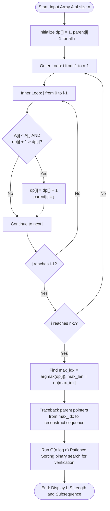

# Question 4: Longest Increasing Subsequence (LIS)

<div align="center">


</div>

---

## 📌 Problem Statement

> Given an integer array $A = [a_0, a_1, \dots, a_{n-1}]$, find the length of the longest subsequence such that all elements of the subsequence are strictly increasing.
>
> By choosing the proper input representation, write a program in C to validate your algorithm and derive the complexity analysis of your algorithm.

---

## 🧠 Theoretical Formulation

### 1. Subsequence Definition
A subsequence is derived by deleting zero or more elements without changing the ordering of the remaining elements. A sequence $\langle a_{i_1}, a_{i_2}, \dots, a_{i_k} \rangle$ is strictly increasing if:
$$i_1 < i_2 < \dots < i_k \quad \text{and} \quad a_{i_1} < a_{i_2} < \dots < a_{i_k}$$

### 2. Method 1: Classical $\mathcal{O}(n^2)$ Dynamic Programming
Let $dp[i]$ be the length of the longest strictly increasing subsequence ending specifically at index $i$ ($a_i$ being the terminal element).

#### Recurrence Relation
$$dp[i] = 1 + \max \left( \{0\} \cup \{ dp[j] \mid 0 \le j < i \text{ and } A[j] < A[i] \} \right)$$

#### Base Case
$$dp[i] = 1, \quad \text{parent}[i] = -1 \quad \forall 0 \le i < n$$

The global maximum length is:
$$L = \max_{0 \le i < n} dp[i]$$

Reconstruction is accomplished by tracking $\text{parent}[i] = \arg\max_{j < i, A[j] < A[i]} dp[j]$ and following predecessor links backward from the index with maximum $dp$.

### 3. Method 2: Patience Sorting & Binary Search $\mathcal{O}(n \log n)$
We maintain an array $\text{tails}[k]$ storing the index of the smallest tail of all increasing subsequences of length $k+1$ found so far. For each element $A[i]$:
- If $A[i] > A[\text{tails}[\text{len}-1]]$, extend the longest sequence: $\text{tails}[\text{len}] = i$ and $\text{parent}[i] = \text{tails}[\text{len}-1]$.
- Otherwise, use binary search (`std::lower_bound` equivalent) to find the smallest index $j$ such that $A[\text{tails}[j]] \ge A[i]$, and update $\text{tails}[j] = i$.

---

## 📊 Data Structures & Input Representation

- **Input Array:** `int arr[n]` — dynamically allocated array of integers.
- **DP Array:** `int dp[n]` — stores optimal LIS length ending at each index $i$.
- **Predecessor Array:** `int parent[n]` — stores index $j$ of previous element in optimal subsequence (or $-1$ if starting element).
- **Subsequence Buffer:** `int *subseq` — dynamic array of size $\max(dp[i])$ holding the reconstructed subsequence in chronological order.

```c
int solveLIS_DP(const int arr[], int n, int dp[], int parent[]);
int solveLIS_Fast(const int arr[], int n, int *out_subseq);
int *reconstructLIS(const int arr[], const int parent[], int max_idx, int max_len);
void printLIS_DPTable(const int arr[], int n, const int dp[], const int parent[]);
```

---

## 🔄 Algorithmic Procedure



---

## ⏱️ Complexity Analysis

| Algorithm Variant | Time Complexity | Space Complexity | Description |
| :--- | :---: | :---: | :--- |
| **Tabulation DP (Implemented)** | $\Theta(n^2)$ | $\Theta(n)$ | Evaluates all pairs $(i, j)$ with $j < i$. Direct and easy to trace. |
| **Patience Sort (Fast check)** | $\Theta(n \log n)$ | $\Theta(n)$ | Uses binary search over tail values. |
| **Reconstruction Traceback** | $\Theta(\text{LIS})$ | $\mathcal{O}(1)$ aux | Linear in the length of the resulting LIS. |
| **Overall Program** | $\mathbf{\mathcal{O}(n^2)}$ | $\mathbf{\Theta(n)}$ | Full verification across both paradigms with full reconstruction. |

---

## 🛠️ Compilation & Execution

```bash
# Navigate to question directory
cd /Users/rishav07/Documents/college/SEM3/DAA/LAB8/Q4

# Compile with GCC
gcc -Wall -Wextra -std=c11 -O2 main.c -o main

# Run interactive binary
./main
```

---

## 💻 Sample Traces

### Trace 1: Classic Textbook Array ($[10, 22, 9, 33, 21, 50, 41, 60, 80]$)

```text
========================================================
 Demo 1: Classic Textbook Array
========================================================
  Input Array A (n = 9): [ 10, 22, 9, 33, 21, 50, 41, 60, 80 ]

  Index i   :    0    1    2    3    4    5    6    7    8 
  Array A[i]:   10   22    9   33   21   50   41   60   80 
  dp[i]     :    1    2    1    3    2    4    4    5    6 
  parent[i] :    -    0    -    1    0    3    3    5    7 

  ----------------- RESULT -----------------
  O(n^2) DP Length     : 6
  Reconstructed LIS    : [ 10, 22, 33, 50, 60, 80 ]
  O(n log n) Fast Check: 6 (Subsequence: [ 10, 22, 33, 41, 60, 80 ])
  Verification Status  : MATCH [OK]
========================================================
```

---

### Trace 2: Strictly Decreasing Sequence ($[50, 40, 30, 20, 10]$)

```text
========================================================
 Demo 2: Strictly Decreasing Sequence
========================================================
  Input Array A (n = 5): [ 50, 40, 30, 20, 10 ]

  Index i   :    0    1    2    3    4 
  Array A[i]:   50   40   30   20   10 
  dp[i]     :    1    1    1    1    1 
  parent[i] :    -    -    -    -    - 

  ----------------- RESULT -----------------
  O(n^2) DP Length     : 1
  Reconstructed LIS    : [ 50 ]
  O(n log n) Fast Check: 1 (Subsequence: [ 10 ])
  Verification Status  : MATCH [OK]
========================================================
```
