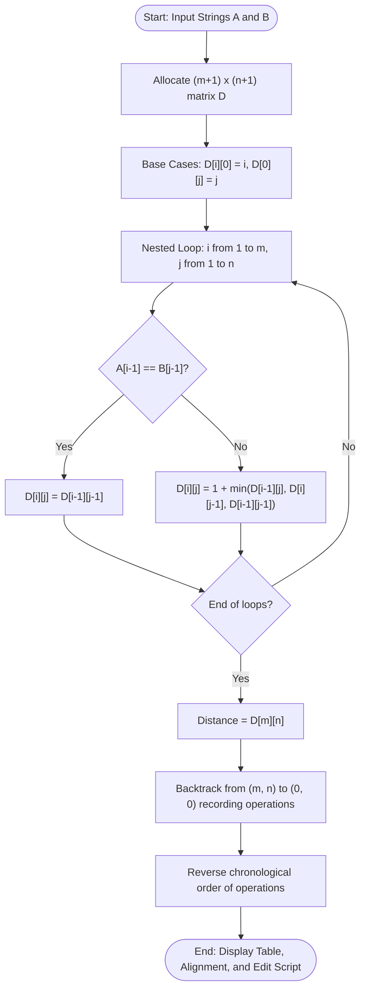

# Question 6: Edit Distance with Traceback Information

<div align="center">


</div>

---

## 📌 Problem Statement

> Given two strings $A$ of length $m$ and $B$ of length $n$, compute the minimum number of operations (insertions, deletions, or substitutions) required to transform $A$ into $B$, and print the traceback result.
>
> By choosing the proper input representation, write a program in C to validate your algorithm and derive the complexity analysis of your algorithm.

---

## 🧠 Theoretical Formulation

### 1. Levenshtein Distance & Unit Costs
The standard Levenshtein distance permits three elementary editing operations, each incurring unit cost:
- **Deletion:** Remove a character from $A$ (cost $1$).
- **Insertion:** Insert a character into $A$ to match $B$ (cost $1$).
- **Substitution:** Replace character in $A$ with character in $B$ (cost $1$ if different, cost $0$ if match).

### 2. State Definition & Recurrence Relation
Let $D[i][j]$ represent the minimum edit distance required to transform prefix $A[0 \dots i-1]$ into prefix $B[0 \dots j-1]$.

#### Base Conditions
- $D[i][0] = i$: Transforming $A[0 \dots i-1]$ to empty string requires $i$ deletions.
- $D[0][j] = j$: Transforming empty string to $B[0 \dots j-1]$ requires $j$ insertions.

#### Recurrence Relation
For $1 \le i \le m$ and $1 \le j \le n$:
$$D[i][j] = \begin{cases}
D[i-1][j-1] & \text{if } A[i-1] = B[j-1] \text{ (Match)} \\
1 + \min \begin{cases}
D[i-1][j] & \text{(Deletion)} \\
D[i][j-1] & \text{(Insertion)} \\
D[i-1][j-1] & \text{(Substitution)}
\end{cases} & \text{if } A[i-1] \neq B[j-1]
\end{cases}$$

### 3. Traceback & Alignment Reconstruction
From cell $(m, n)$, we backtrack to $(0, 0)$ by querying neighboring values:
1. If $A[i-1] = B[j-1]$ and $D[i][j] = D[i-1][j-1]$:
   - Operation: **MATCH** (`|`), decrement $i \leftarrow i-1, j \leftarrow j-1$.
2. Else if $D[i][j] = D[i-1][j-1] + 1$:
   - Operation: **SUBSTITUTE** (`S`), replace $A[i-1]$ with $B[j-1]$, decrement $i \leftarrow i-1, j \leftarrow j-1$.
3. Else if $D[i][j] = D[i-1][j] + 1$:
   - Operation: **DELETE** (`D`), delete $A[i-1]$, decrement $i \leftarrow i-1$.
4. Else:
   - Operation: **INSERT** (`I`), insert $B[j-1]$, decrement $j \leftarrow j-1$.

---

## 📊 Data Structures & Input Representation

- **Input Sequences:** `char A[]`, `char B[]` — null-terminated strings.
- **DP Matrix:** `int **D` — $(m+1) \times (n+1)$ matrix storing subproblem edit distances.
- **Traceback Struct:**
  ```c
  typedef enum { OP_MATCH, OP_SUBSTITUTE, OP_DELETE, OP_INSERT } EditOp;
  typedef struct {
      EditOp op;
      char char_a;
      char char_b;
      int pos_a;
      int pos_b;
  } TraceStep;
  ```

---

## 🔄 Algorithmic Procedure



---

## ⏱️ Complexity Analysis

| Component | Time Complexity | Space Complexity | Description |
| :--- | :---: | :---: | :--- |
| **Matrix Initialization** | $\Theta(m + n)$ | $\Theta(m \cdot n)$ | Sets boundary costs for empty string transformations. |
| **DP Matrix Filling** | $\Theta(m \cdot n)$ | $\Theta(1)$ aux | Computes $(m+1)(n+1)$ cells with constant work per cell. |
| **Traceback Alignment** | $\mathcal{O}(m + n)$ | $\mathcal{O}(m + n)$ | Traceback path length is bounded by $m + n$. |
| **Total Program** | $\mathbf{\Theta(m \cdot n)}$ | $\mathbf{\Theta(m \cdot n)}$ | Standard optimal Levenshtein DP implementation. |

---

## 🛠️ Compilation & Execution

```bash
# Navigate to question directory
cd /Users/rishav07/Documents/college/SEM3/DAA/LAB8/Q6

# Compile with GCC
gcc -Wall -Wextra -std=c11 -O2 main.c -o main

# Run interactive binary
./main
```

---

## 💻 Sample Traces

### Trace 1: Classic NLP Example (`"kitten"` $\to$ `"sitting"`)

```text
========================================================
 Demo 1: Classic NLP Example
========================================================
  Source String A (len 6): "kitten"
  Target String B (len 7): "sitting"

  Edit Distance DP Table D[i][j]:
        j   0    s    i    t    t    i    n    g 
    i       eps   1    2    3    4    5    6    7 
    -----------------------------------------------------
    0 eps |    0    1    2    3    4    5    6    7 
    1   k |    1    1    2    3    4    5    6    7 
    2   i |    2    2    1    2    3    4    5    6 
    3   t |    3    3    2    1    2    3    4    5 
    4   t |    4    4    3    2    1    2    3    4 
    5   e |    5    5    4    3    2    2    3    4 
    6   n |    6    6    5    4    3    3    2    3 

  ----------------- RESULT -----------------
  Minimum Edit Distance (Levenshtein): 3

  ----------------- TRACEBACK ALIGNMENT -----------------
  Alignment Representation:
  Source A:  k  i  t  t  e  n  _ 
             S  |  |  |  S  |  I 
  Target B:  s  i  t  t  i  n  g 

  Step-by-Step Transformation Operations:
    [Step  1] SUBSTITUTE : Replace 'k' with 's' (Cost: 1)
    [Step  2] MATCH      : 'i' == 'i' (Cost: 0)
    [Step  3] MATCH      : 't' == 't' (Cost: 0)
    [Step  4] MATCH      : 't' == 't' (Cost: 0)
    [Step  5] SUBSTITUTE : Replace 'e' with 'i' (Cost: 1)
    [Step  6] MATCH      : 'n' == 'n' (Cost: 0)
    [Step  7] INSERT     : Insert 'g' into source string (Cost: 1)
========================================================
```

---

### Trace 2: High Edit Variance (`"intention"` $\to$ `"execution"`)

```text
========================================================
 Demo 3: High Edit Variance
========================================================
  Source String A (len 9): "intention"
  Target String B (len 9): "execution"

  ----------------- RESULT -----------------
  Minimum Edit Distance (Levenshtein): 5

  ----------------- TRACEBACK ALIGNMENT -----------------
  Alignment Representation:
  Source A:  i  n  t  e  n  t  i  o  n 
             S  S  S  S  S  |  |  |  | 
  Target B:  e  x  e  c  u  t  i  o  n 

  Step-by-Step Transformation Operations:
    [Step  1] SUBSTITUTE : Replace 'i' with 'e' (Cost: 1)
    [Step  2] SUBSTITUTE : Replace 'n' with 'x' (Cost: 1)
    [Step  3] SUBSTITUTE : Replace 't' with 'e' (Cost: 1)
    [Step  4] SUBSTITUTE : Replace 'e' with 'c' (Cost: 1)
    [Step  5] SUBSTITUTE : Replace 'n' with 'u' (Cost: 1)
    [Step  6] MATCH      : 't' == 't' (Cost: 0)
    [Step  7] MATCH      : 'i' == 'i' (Cost: 0)
    [Step  8] MATCH      : 'o' == 'o' (Cost: 0)
    [Step  9] MATCH      : 'n' == 'n' (Cost: 0)
========================================================
```
