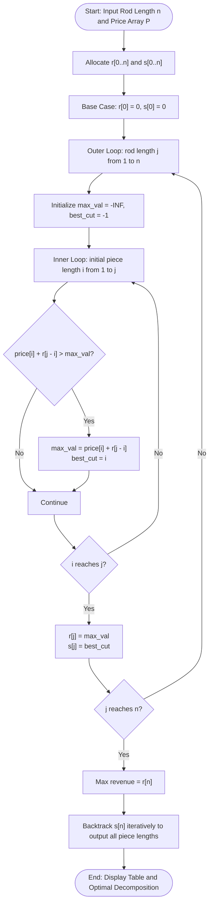

# Question 7: Rod Cutting with Reconstruction

<div align="center">


</div>

---

## 📌 Problem Statement

> Given a rod of length $n$ inches and an array of prices $P = [p_1, p_2, \dots, p_n]$, where $p_i$ denotes the market price of a rod piece of length $i$ inches, determine:
> 1. The maximum revenue obtainable by cutting up the rod and selling the pieces.
> 2. The exact lengths of the pieces that constitute the optimal decomposition (reconstruction).
>
> Cuts are integral and can be made in any combination (including leaving the rod uncut), and the sum of the piece lengths must equal $n$. By choosing the proper input representation, write a program in C to validate your algorithm and derive the complexity analysis of your algorithm.

---

## 🧠 Theoretical Formulation

### 1. Problem Formulation & Substructure
A rod of length $n$ can be cut in $2^{n-1}$ different ways (since each integer boundary $1, 2, \dots, n-1$ may independently be cut or left intact).
In an optimal decomposition, we make an initial cut of length $i \in [1, n]$, yielding revenue $p_i$. The remaining piece has length $n - i$, which must itself be cut to maximize revenue $r[n - i]$.

### 2. Recurrence Relation
Let $r[j]$ denote the maximum revenue obtainable for a rod of length $j \in [0, n]$:

$$r[j] = \begin{cases}
0 & \text{if } j = 0 \\
\max_{1 \le i \le j} \left( p_i + r[j - i] \right) & \text{if } j \ge 1
\end{cases}$$

### 3. Reconstruction with Cut-Choice Array
To reconstruct the decomposition:
- Maintain an auxiliary array $s[j]$ that records the optimal size of the first piece cut from a rod of length $j$:
  $$s[j] = \arg\max_{1 \le i \le j} \left( p_i + r[j - i] \right)$$
- To extract the complete decomposition for length $n$:
  $$\text{curr} \leftarrow n$$
  $$\text{while } \text{curr} > 0: \quad \text{cut piece } s[\text{curr}], \quad \text{curr} \leftarrow \text{curr} - s[\text{curr}]$$

---

## 📊 Data Structures & Input Representation

- **Price Array:** `int price[n + 1]` — 1-indexed array where `price[i]` holds market value $p_i$.
- **Revenue DP Array:** `int r[n + 1]` — holds optimal subproblem revenues $r[0 \dots n]$.
- **Optimal Choice Array:** `int s[n + 1]` — records $s[j]$, the size of the initial piece in optimal cut for length $j$.

```c
void solveRodCutting(int n, const int price[], int r[], int s[]);
void printDecomposition(int rod_len, const int s[], const int price[]);
void printRodCuttingTable(int n, const int price[], const int r[], const int s[]);
```

---

## 🔄 Algorithmic Procedure



---

## ⏱️ Complexity Analysis

| Component | Time Complexity | Space Complexity | Description |
| :--- | :---: | :---: | :--- |
| **Table Initialization** | $\mathcal{O}(1)$ | $\Theta(n)$ | Sets $r[0] = 0, s[0] = 0$. |
| **Nested DP Loops** | $\sum_{j=1}^n j = \frac{n(n+1)}{2} = \Theta(n^2)$ | $\mathcal{O}(1)$ aux | Evaluates all cut options $1 \le i \le j$. |
| **Decomposition Traceback** | $\mathcal{O}(n)$ | $\mathcal{O}(1)$ | Follows $s[j]$ links down to 0; at most $n$ cuts made. |
| **Total Program** | $\mathbf{\Theta(n^2)}$ | $\mathbf{\Theta(n)}$ | Solves exponential $2^{n-1}$ cut space in quadratic time. |

---

## 🛠️ Compilation & Execution

```bash
# Navigate to question directory
cd /Users/rishav07/Documents/college/SEM3/DAA/LAB8/Q7

# Compile with GCC
gcc -Wall -Wextra -std=c11 -O2 main.c -o main

# Run interactive binary
./main
```

---

## 💻 Sample Traces

### Trace 1: Classic CLRS Textbook Pricing ($n = 10$)

```text
========================================================================
 Demo 1: Classic CLRS Textbook Pricing (n = 10)
========================================================================
  Rod Total Length (n): 10 inches
  Market Price Table  : 1"=$1, 2"=$5, 3"=$8, 4"=$9, 5"=$10, 6"=$17, 7"=$17, 8"=$20, 9"=$24, 10"=$30

  Length (j) | Price p[j] | Max Revenue r[j] | First Cut s[j] | Optimal Pieces Decomposition
 ------------+------------+------------------+----------------+--------------------------------
        1    |    $   1   |       $   1      |         1"     | [ 1" ($1) ]
        2    |    $   5   |       $   5      |         2"     | [ 2" ($5) ]
        3    |    $   8   |       $   8      |         3"     | [ 3" ($8) ]
        4    |    $   9   |       $  10      |         2"     | [ 2" ($5) + 2" ($5) ]
        5    |    $  10   |       $  13      |         2"     | [ 2" ($5) + 3" ($8) ]
        6    |    $  17   |       $  17      |         6"     | [ 6" ($17) ]
        7    |    $  17   |       $  18      |         1"     | [ 1" ($1) + 6" ($17) ]
        8    |    $  20   |       $  22      |         2"     | [ 2" ($5) + 6" ($17) ]
        9    |    $  24   |       $  25      |         3"     | [ 3" ($8) + 6" ($17) ]
       10    |    $  30   |       $  30      |        10"     | [ 10" ($30) ]

  ----------------- RESULT FOR LENGTH n = 10 -----------------
  Maximum Revenue Obtainable : $30
  Optimal Pieces Cut         : [ 10" ($30) ]
========================================================================
```

---

### Trace 2: Sub-Additive Pricing ($n = 5$, All 1-inch cuts)

```text
========================================================================
 Demo 3: Sub-Additive Pricing (Optimal: All 1-inch cuts)
========================================================================
  Rod Total Length (n): 5 inches
  Market Price Table  : 1"=$4, 2"=$7, 3"=$10, 4"=$13, 5"=$16

  Length (j) | Price p[j] | Max Revenue r[j] | First Cut s[j] | Optimal Pieces Decomposition
 ------------+------------+------------------+----------------+--------------------------------
        1    |    $   4   |       $   4      |         1"     | [ 1" ($4) ]
        2    |    $   7   |       $   8      |         1"     | [ 1" ($4) + 1" ($4) ]
        3    |    $  10   |       $  12      |         1"     | [ 1" ($4) + 1" ($4) + 1" ($4) ]
        4    |    $  13   |       $  16      |         1"     | [ 1" ($4) + 1" ($4) + 1" ($4) + 1" ($4) ]
        5    |    $  16   |       $  20      |         1"     | [ 1" ($4) + 1" ($4) + 1" ($4) + 1" ($4) + 1" ($4) ]

  ----------------- RESULT FOR LENGTH n = 5 -----------------
  Maximum Revenue Obtainable : $20
  Optimal Pieces Cut         : [ 1" ($4) + 1" ($4) + 1" ($4) + 1" ($4) + 1" ($4) ]
========================================================================
```
