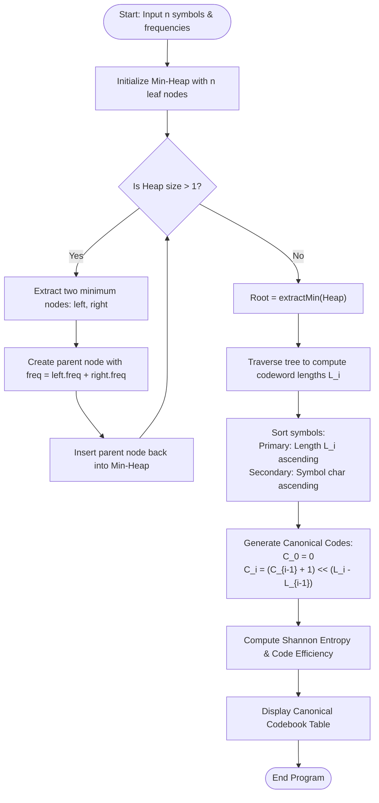

# Question 2: Canonical Huffman Coding

<div align="center">


</div>

---

## 📌 Problem Statement

> Given symbol frequencies, construct a prefix-free binary code of minimum expected length, and output the canonical Huffman codebook (where codes are ordered lexicographically by length).
> 
> By choosing the proper input representation, write a program in C to validate your algorithm and derive the complexity analysis of your algorithm.

---

## 🧠 Theoretical Formulation & Greedy Paradigm

### 1. Information Theory & Prefix Codes

Let $\Sigma = \{s_1, s_2, \dots, s_n\}$ be an alphabet of $n$ distinct symbols with associated frequency distribution $F = [f_1, f_2, \dots, f_n]$, such that total occurrences $N = \sum_{i=1}^n f_i$ and probabilities $p_i = \frac{f_i}{N}$.

A code $C: \Sigma \to \{0, 1\}^*$ maps each symbol $s_i$ to a binary codeword $c_i$ of length $L_i = |c_i|$.
1. **Prefix-Free Property:** No codeword is a prefix of any other codeword:
   $$\forall i \ne j, \quad c_i \text{ is not a prefix of } c_j$$
   This ensures unambiguous real-time stream decoding without lookahead or delimiter tokens.
2. **Kraft-McMillan Inequality:** A prefix-free binary code exists if and only if:
   $$\sum_{i=1}^n 2^{-L_i} \le 1$$
3. **Shannon's Source Coding Theorem:** The expected codeword length $L(C)$ is lower-bounded by the source entropy $H(\Sigma)$:
   $$H(\Sigma) = -\sum_{i=1}^n p_i \log_2 p_i \le L(C) = \sum_{i=1}^n p_i L_i < H(\Sigma) + 1$$

---

### 2. Huffman's Greedy Choice & Optimal Substructure

Huffman's algorithm builds a full binary tree bottom-up:

#### **Greedy Choice Property (CLRS Lemma 16.2)**
Let $x$ and $y$ be two symbols with the lowest frequencies in $\Sigma$. There exists an optimal prefix-free tree in which $x$ and $y$ appear as sibling leaves at the maximum tree depth.
- **Proof:** Suppose an optimal tree $T$ has two deepest siblings $a$ and $b$. Assume without loss of generality $f_x \le f_y$ and $f_a \le f_b$. Since $f_x \le f_a$ and $f_y \le f_b$, swapping $x$ with $a$ and $y$ with $b$ yields a new tree $T'$ whose cost difference satisfies:
  $$B(T) - B(T') = (f_a - f_x)(d_T(a) - d_T(x)) + (f_b - f_y)(d_T(b) - d_T(y)) \ge 0$$
  Since $T$ is optimal, $B(T') \le B(T)$, hence $T'$ is also optimal.

#### **Optimal Substructure (CLRS Lemma 16.3)**
Replacing the pair $\{x, y\}$ with a composite node $z$ of frequency $f_z = f_x + f_y$ reduces the problem of size $n$ to an identical subproblem of size $n - 1$. An optimal tree for the reduced alphabet yields an optimal tree for the original alphabet by expanding $z$ into children $x$ and $y$.

---

### 3. Canonical Huffman Codes

Standard Huffman trees produce variable binary trees whose specific bit representations depend on arbitrary left/right tie-breaking decisions. Transmitting the tree structure itself in compression protocols (like DEFLATE, PNG, gzip, and JPEG) wastes valuable header space.

A **Canonical Huffman Code** standardizes the bit representation using two strict rules:
1. **Length Monotonicity:** Shorter codewords precede longer codewords. Codewords of the same length are ordered lexicographically by their source symbol.
2. **Numerical Generation Formula:**
   - First symbol ($i = 0$): $C_0 = 0$ (formatted to $L_0$ bits).
   - Subsequent symbols ($i > 0$):
     $$C_i = (C_{i-1} + 1) \ll (L_i - L_{i-1})$$

> [!NOTE]
> Under a Canonical Huffman scheme, the decompressor needs only the array of symbol lengths $[L_1, L_2, \dots, L_n]$ to reconstruct the exact codebook with zero ambiguity!

---

## 📊 Data Structures & Input Representation

| Data Structure / Field | Type | Description |
| :--- | :--- | :--- |
| `Node` | `struct` | Binary tree node storing `symbol`, `freq`, and pointers `left`, `right`. |
| `MinHeap` | `struct` | Priority queue containing dynamic array of `Node*`, current `size`, and `capacity`. |
| `SymbolCode` | `struct` | Stores symbol metadata: `symbol`, `freq`, `length`, integer `canonicalCode`, and formatted binary string `codeStr`. |
| `symbols`, `freqs` | `char*`, `int*` | Input arrays storing symbol characters and their associated frequencies. |

### Functional Decomposition
- **`buildHuffmanTree(symbols, freqs, n)`**: Allocates and builds the optimal binary prefix tree in $\mathcal{O}(n \log n)$ using a min-heap.
- **`getCodeLengths(root, depth, ...)`**: Traverses the Huffman tree to record the exact codeword length for each symbol leaf.
- **`buildCanonicalCodes(codes, n)`**: Sorts symbol descriptors by length and ASCII symbol, then computes canonical bit sequences iteratively.
- **`displayCodebook(codes, n, totalFreq)`**: Generates structured table displaying probability, length, canonical code, entropy $H$, average length $L$, and coding efficiency $\eta = H / L$.

---

## 🔄 Algorithmic Procedure



---

## ⏱️ Complexity Analysis

| Phase / Operation | Time Complexity | Auxiliary Space | Description |
| :--- | :---: | :---: | :--- |
| **Min-Heap Construction** | $\mathcal{O}(n)$ | $\mathcal{O}(n)$ | Floyd's bottom-up `buildMinHeap` in linear time. |
| **Huffman Tree Synthesis** | $\mathcal{O}(n \log n)$ | $\mathcal{O}(n)$ | Exactly $n - 1$ rounds; each does 2 `extractMin` and 1 `insert` ($\mathcal{O}(\log n)$). |
| **Depth Extraction Traversal** | $\Theta(n)$ | $\mathcal{O}(n)$ | DFS tree traversal visiting $2n - 1$ total nodes. |
| **Canonical Sorting** | $\mathcal{O}(n \log n)$ | $\mathcal{O}(1)$ | In-place `qsort` on the array of $n$ symbols. |
| **Canonical Bit Assignment** | $\Theta(n)$ | $\mathcal{O}(1)$ | Single linear pass with bitwise shift and increment. |
| **Total Complexity** | $\mathbf{\mathcal{O}(n \log n)}$ | $\mathbf{\mathcal{O}(n)}$ | **Optimal information-theoretic bound** for Huffman prefix coding. |

---

## 🛠️ Compilation & Execution

```bash
# Navigate to the Q2 directory
cd /Users/rishav07/Documents/college/SEM3/DAA/LAB9/Q2

# Compile with GCC including math library (-lm)
gcc -Wall -Wextra -std=c11 -O2 main.c -lm -o main

# Run program
./main
```

---

## 💻 Sample Traces & Validation Cases

### Trace 1: Classical CLRS Textbook Benchmark
**Input:** 6 symbols with frequencies:
$A: 45, \; B: 13, \; C: 12, \; D: 16, \; E: 9, \; F: 5$ ($N = 100$)

```text
Enter the number of symbols (2 to 52): 6
Do you wanna: 	(0) Enter symbols and frequencies manually or
		(1) Have it randomly filled?
Choice: 0
Enter 6 symbol characters and their positive integer frequencies:
Symbol 1 (Char Freq): A 45
Symbol 2 (Char Freq): B 13
Symbol 3 (Char Freq): C 12
Symbol 4 (Char Freq): D 16
Symbol 5 (Char Freq): E 9
Symbol 6 (Char Freq): F 5

==================== CANONICAL HUFFMAN CODEBOOK ====================
+--------+-----------+-------------+-------------+-------------------+
| Symbol | Frequency | Probability | Code Length | Canonical Code    |
+--------+-----------+-------------+-------------+-------------------+
|   'A'  |        45 |      0.4500 |           1 | 0                 |
|   'B'  |        13 |      0.1300 |           3 | 100               |
|   'C'  |        12 |      0.1200 |           3 | 101               |
|   'D'  |        16 |      0.1600 |           3 | 110               |
|   'E'  |         9 |      0.0900 |           4 | 1110              |
|   'F'  |         5 |      0.0500 |           4 | 1111              |
+--------+-----------+-------------+-------------+-------------------+
Total Symbols Processed      : 6
Total Stream Character Count : 100
Total Encoded Bitstream Size : 224 bits (28.00 bytes)
Entropy (Theoretical Limit)  : 2.2199 bits/symbol
Average Codeword Length (L)  : 2.2400 bits/symbol
Coding Efficiency (H / L)    : 99.10%
Redundancy (L - H)           : 0.0201 bits/symbol
====================================================================
```

#### Step-by-Step Canonical Code Assignment
| Symbol | Length $L_i$ | Previous Code | Shift / Increment Operation | Canonical Binary Code |
| :---: | :---: | :---: | :--- | :---: |
| `'A'` | $1$ | Initial | $C_0 = 0$ | `0` |
| `'B'` | $3$ | `0` | $(0 + 1) \ll (3 - 1) = 1 \ll 2 = 4$ (`100`$_2$) | `100` |
| `'C'` | $3$ | `100` | $(4 + 1) = 5$ (`101`$_2$) | `101` |
| `'D'` | $3$ | `101` | $(5 + 1) = 6$ (`110`$_2$) | `110` |
| `'E'` | $4$ | `110` | $(6 + 1) \ll (4 - 3) = 7 \ll 1 = 14$ (`1110`$_2$) | `1110` |
| `'F'` | $4$ | `1110` | $(14 + 1) = 15$ (`1111`$_2$) | `1111` |

---

### Trace 2: Random Distribution Mode
- Automatically samples uniform frequencies across generated alphabet symbols `A`, `B`, `C`, ...
- Validates Kraft inequality and guarantees optimal prefix tree bounds: $H \le L < H + 1$.
