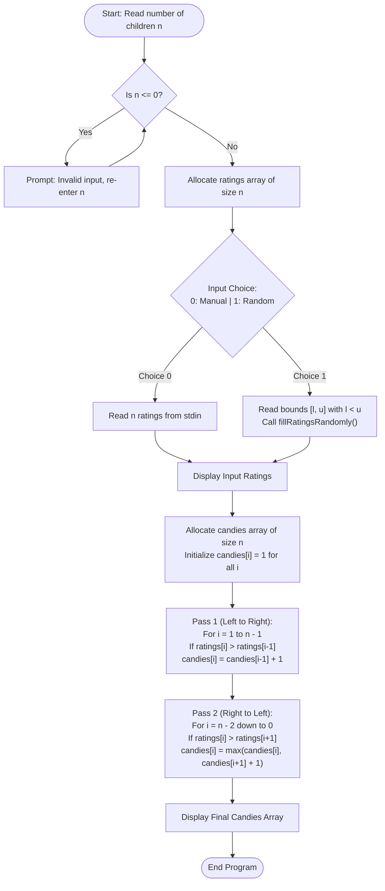

# Question 5: Candy Distribution Problem (Bi-directional Slope Greedy)

<div align="center">


</div>

---

## 📌 Problem Statement

> $n$ children stand in a line, each assigned a rating. Each child must get at least one candy. Children with a higher rating than their immediate neighbours must get more candies than their neighbours. Find the minimum total number of candies needed.
> 
> By choosing the proper input representation, write a program in C to validate your algorithm and derive the complexity analysis of your algorithm.

---

## 🧠 Theoretical Formulation & Greedy Paradigm

### 1. Mathematical Constraints
Let $R = [r_0, r_1, \dots, r_{n-1}]$ be the sequence of ratings assigned to $n$ children, and let $C = [c_0, c_1, \dots, c_{n-1}]$ denote the integer number of candies distributed to each child.

The distribution must satisfy three fundamental properties:
1. **Universal Baseline:** Every child receives at least one candy:
   $$c_i \ge 1, \quad \forall i \in [0, n-1]$$
2. **Left-Neighbor Condition:** A child rated strictly higher than their left peer must receive strictly more candies:
   $$r_i > r_{i-1} \implies c_i > c_{i-1}, \quad \forall i \in [1, n-1]$$
3. **Right-Neighbor Condition:** A child rated strictly higher than their right peer must receive strictly more candies:
   $$r_i > r_{i+1} \implies c_i > c_{i+1}, \quad \forall i \in [0, n-2]$$
4. **Optimization Objective:** Minimize total candies:
   $$\min \sum_{i=0}^{n-1} c_i$$

> [!NOTE]
> **Equal Ratings Policy:** If two adjacent children have equal ratings ($r_i = r_{i-1}$), the problem imposes no constraint that $c_i = c_{i-1}$ or $c_i > c_{i-1}$. A child whose rating equals their neighbor's can receive just $1$ candy if they are not higher than their other neighbor.

---

### 2. Why a Single Pass Fails: The Slope Dependency
A naive single-pass greedy scan fails because the constraints are bi-directional:
- Consider a strictly decreasing subarray: $R = [10, 8, 5, 2]$.
- Looking left-to-right, each element is smaller than its predecessor, so a left-to-right rule would naively give each child $1$ candy.
- However, $10 > 8 > 5 > 2$ forms a descending slope. Child $3$ (rating $2$) needs at least $1$ candy, requiring child $2$ to have $\ge 2$, child $1$ to have $\ge 3$, and child $0$ to have $\ge 4$.
- Because an element's candy requirement can depend on an arbitrarily long descent to its right, a single scan cannot determine the optimal count immediately.

---

### 3. The Bi-Directional Slope Greedy Strategy

The problem exhibits **optimal substructure** and can be decomposed into two monotonic slopes:
1. **Upward Slopes from the Left:** Solved by a forward pass.
2. **Upward Slopes from the Right:** Solved by a backward pass.

#### **Pass 1: Left-to-Right Scan (Forward Slope)**
- Initialize every child with the baseline: $c_i = 1$ for all $0 \le i < n$.
- Scan from $i = 1$ to $n - 1$:
  $$c_i = \begin{cases} c_{i-1} + 1 & \text{if } r_i > r_{i-1} \\ 1 & \text{otherwise} \end{cases}$$
- **Invariant:** After this pass, the Left-Neighbor condition ($r_i > r_{i-1} \implies c_i > c_{i-1}$) is strictly satisfied for all children.

#### **Pass 2: Right-to-Left Scan (Backward Slope)**
- Scan backwards from $i = n - 2$ down to $0$:
  $$\text{If } r_i > r_{i+1}: \quad c_i = \max(c_i, \; c_{i+1} + 1)$$
- **Why $\max$?** Taking $\max(c_i, c_{i+1} + 1)$ guarantees that:
  - The right-neighbor condition is satisfied ($c_i \ge c_{i+1} + 1 > c_{i+1}$).
  - The value $c_i$ is never decreased, preserving the left-neighbor condition already established in Pass 1.

#### **Proof of Optimality (Greedy Choice Property)**
Let $C^*$ be any valid candy allocation.
- By induction along left-increasing runs, $c^*_i \ge c_i^{(L)}$ where $c_i^{(L)}$ is the result of the forward pass.
- By induction along right-increasing runs, $c^*_i \ge c_i^{(R)}$ where $c_i^{(R)}$ is the result of the backward pass.
- Therefore, for any child $i$:
  $$c^*_i \ge \max\left(c_i^{(L)}, c_i^{(R)}\right) = c_i$$
- Since our computed assignment $C$ satisfies all conditions and is component-wise minimal ($c_i \le c^*_i$ for all $i$), the sum $\sum_{i=0}^{n-1} c_i$ is globally optimal and minimal.

---

## 📊 Data Structures & Input Representation

The implementation utilizes compact linear arrays with zero overhead:

| Variable | Type | Description |
| :--- | :--- | :--- |
| `ratings` | `int*` | Dynamically allocated array (`calloc(n, sizeof(int))`) holding the ratings of all $n$ children. |
| `candies` | `int*` | Dynamically allocated array (`calloc(n, sizeof(int))`) tracking the candies assigned to each child. |
| `choice` | `int` | Execution mode selector: `0` for manual input, `1` for uniform pseudo-random generation. |
| `l`, `u` | `int` | Lower and upper bounds for random rating generation, validated such that $l < u$. |

### Functional Decomposition
- **`main()`**: Coordinates input validation, memory allocation, the bi-directional greedy passes, and display.
- **`fillRatingsRandomly(n, ratings, u, l)`**: Seeds the random number generator using `time(NULL)` and populates the ratings array.
- **`randomBtw(u, l)`**: Computes pseudo-random numbers uniformly within $[l, u)$ using `(rand() % (u - l)) + l`.
- **`display(n, array)`**: Formats and prints an integer array in mathematical set notation `{x_0, x_1, ..., x_{n-1}}`.

---

## 🔄 Algorithmic Procedure



---

## ⏱️ Complexity Analysis

| Phase / Operation | Time Complexity | Auxiliary Space | Description |
| :--- | :---: | :---: | :--- |
| **Input Reading / Generation** | $\Theta(n)$ | $\mathcal{O}(1)$ | Single pass to scan or generate $n$ integers. |
| **Base Candy Initialization** | $\Theta(n)$ | $\mathcal{O}(1)$ | Sets every child's candy count to $1$. |
| **Pass 1: Forward Sweep** | $\Theta(n)$ | $\mathcal{O}(1)$ | Exactly $n - 1$ comparisons and conditional increments. |
| **Pass 2: Backward Sweep** | $\Theta(n)$ | $\mathcal{O}(1)$ | Exactly $n - 1$ comparisons and conditional updates. |
| **Array Display** | $\Theta(n)$ | $\mathcal{O}(1)$ | Prints the resulting distributions. |
| **Total Program** | $\mathbf{\Theta(n)}$ | $\mathbf{\Theta(n)}$ | **Optimal linear time** using two linear scans and $\Theta(n)$ memory for arrays. |

### Formal Asymptotic Derivation
- **Time Complexity:** The algorithm executes two disjoint linear loops:
  $$T(n) = \sum_{i=1}^{n-1} \mathcal{O}(1) + \sum_{i=n-2}^{0} \mathcal{O}(1) = (n - 1) + (n - 1) = 2n - 2 = \Theta(n)$$
  No sorting or priority queue operations are required, guaranteeing optimal linear time.
- **Space Complexity:** Two dynamic arrays of size $n$ are allocated (`ratings` and `candies`), requiring $2n \times \text{sizeof(int)}$ bytes:
  $$S(n) = \Theta(n)$$
  The auxiliary memory used by local variables during computation is $\mathcal{O}(1)$.

---

## 🛠️ Compilation & Execution

```bash
# Navigate to the Q5 directory
cd /Users/rishav07/Documents/college/SEM3/DAA/LAB9/Q5

# Compile using GCC with standard C11 flags
gcc -Wall -Wextra -std=c11 -O2 main.c -o main

# Run the program
./main
```

---

## 💻 Sample Traces & Validation Cases

### Trace 1: Peak in the Middle (Valley $\to$ Peak $\to$ Valley)
**Input Ratings:** `[1, 0, 2]`

```text
Enter the number of children: 3
Do you wanna: 	(0) Enter ratings or
		        (1) Have it randomly filled?
Choice: 0
Enter the ratings: 1 0 2
The ratings of the children are: {1, 0, 2}
The candies to each child is: {2, 1, 2}
```

#### Step-by-Step State Evolution
| Step | Child 0 (`1`) | Child 1 (`0`) | Child 2 (`2`) | Explanation |
| :---: | :---: | :---: | :---: | :--- |
| **Init** | `1` | `1` | `1` | Universal minimum of 1 candy each. |
| **Forward Pass** | `1` | `1` | `2` | $r_2 > r_1 \implies c_2 = c_1 + 1 = 2$. |
| **Backward Pass** | `2` | `1` | `2` | $r_0 > r_1 \implies c_0 = \max(1, c_1 + 1) = 2$. |

---

### Trace 2: Strictly Decreasing Sequence
**Input Ratings:** `[12, 8, 5, 2, 1]`

```text
Enter the number of children: 5
Do you wanna: 	(0) Enter ratings or
		        (1) Have it randomly filled?
Choice: 0
Enter the ratings: 12 8 5 2 1
The ratings of the children are: {12, 8, 5, 2, 1}
The candies to each child is: {5, 4, 3, 2, 1}
```

#### Step-by-Step State Evolution
| Step | Child 0 (`12`) | Child 1 (`8`) | Child 2 (`5`) | Child 3 (`2`) | Child 4 (`1`) |
| :---: | :---: | :---: | :---: | :---: | :---: |
| **Init** | `1` | `1` | `1` | `1` | `1` |
| **Forward Pass** | `1` | `1` | `1` | `1` | `1` |
| **Backward Pass** | **5** | **4** | **3** | **2** | **1** |

*(Demonstrates how the backward pass correctly resolves down-slopes that forward pass cannot detect).*

---

### Trace 3: Equal Ratings Behavior
**Input Ratings:** `[1, 2, 2]`

```text
Enter the number of children: 3
Do you wanna: 	(0) Enter ratings or
		        (1) Have it randomly filled?
Choice: 0
Enter the ratings: 1 2 2
The ratings of the children are: {1, 2, 2}
The candies to each child is: {1, 2, 1}
```
*Note: Child 2 has the same rating as Child 1, but is not strictly greater. Therefore Child 2 only requires 1 candy.*

---

### Trace 4: Automated Random Generation Mode
**Parameters:** $n = 8$, Range $[10, 50)$

```text
Enter the number of children: 8
Do you wanna: 	(0) Enter ratings or
		        (1) Have it randomly filled?
Choice: 1
Enter the lower and upper limits for random ratings: 10 50
The ratings of the children are: {14, 28, 45, 12, 33, 41, 41, 19}
The candies to each child is: {1, 2, 3, 1, 2, 3, 2, 1}
```
