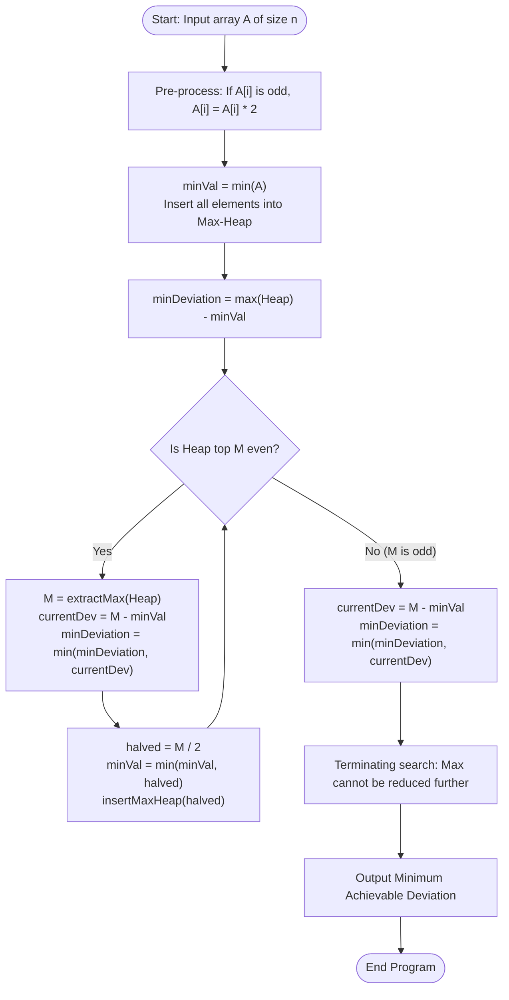

# Question 7: Minimise Deviation in Array (Two-Way Greedy with Max-Heap)

<div align="center">


</div>

---

## 📌 Problem Statement

> Given an array of positive integers, you can perform two operations: multiply any odd element by 2, or divide any even element by 2.
> The deviation is $(\max(A) - \min(A))$. Minimise the deviation after any number of operations.
> 
> By choosing the proper input representation, write a program in C to validate your procedures and derive the complexity analysis of your algorithm.

---

## 🧠 Theoretical Formulation & Two-Way Greedy Paradigm

### 1. Element State Space Analysis

Let $A = [a_1, a_2, \dots, a_n]$ be an array of positive integers. We are allowed two transformations:
1. $x \to 2x$ (if $x$ is odd).
2. $x \to x / 2$ (if $x$ is even).

Notice the structural bounds on the values any individual number $x$ can take:
- **Case 1: $x$ is odd.**
  - Multiplying by 2 yields $2x$ (which is even).
  - An even number can only be divided by 2, which returns it to $x$.
  - Therefore, the candidate set of values for an initial odd $x$ is strictly bipartite:
    $$\mathcal{S}(x) = \{x, \; 2x\}$$
- **Case 2: $x$ is even.**
  - An even number cannot be multiplied by 2 (the operation applies only to odd elements).
  - It can only be repeatedly halved until an odd quotient is reached.
  - Therefore, for $x = 2^k \cdot m$ with $m$ odd:
    $$\mathcal{S}(x) = \{x, \; x/2, \; x/4, \; \dots, \; m\}$$

In both cases, each element has a well-defined **maximum possible value**:
$$x_{max} = \begin{cases} 2x & \text{if } x \text{ is odd} \\ x & \text{if } x \text{ is even} \end{cases}$$

---

### 2. Reducing Two-Way Mobility to Monotonic One-Way Greedy Descent

Because elements can move both upward (odds doubled) and downward (evens halved), simultaneous bi-directional search is complex. 

#### **The Transformation Trick**
1. **Upper-Bound Initialization:** Double every odd element in $A$.
   Now, every element in the array is instantiated at its maximum attainable value $x_{max}$.
2. **Directional Constraint:** Because all elements are at their personal ceiling, **no element can ever be multiplied by 2 again**!
3. **Monotonic Invariant:** The *only* valid operation remaining on any element in the array is:
   $$\text{divide by } 2 \quad (\text{if even})$$

#### **Greedy Choice Property & Stopping Criterion**
To minimize the range deviation $\Delta = \max(A) - \min(A)$, one must either:
- **Increase $\min(A)$:** Impossible, because the only legal operation is division by 2, which strictly decreases numbers!
- **Decrease $\max(A)$:** The only mechanism available to reduce $\Delta$ is to shrink the current maximum element.

Therefore, the greedy choice is uniquely determined:
1. Identify the current maximum element $M = \max(A)$ using a **Max-Heap**.
2. Record the current deviation: $\Delta = M - \min(A)$, updating global minimum deviation $\Delta_{min} \leftarrow \min(\Delta_{min}, \Delta)$.
3. If $M$ is **even**, divide it by 2: $M' = M / 2$.
   - Update the tracked minimum: $\min(A) \leftarrow \min(\min(A), M')$.
   - Push $M'$ back into the Max-Heap.
4. If $M$ is **odd**, $M$ cannot be divided by 2!
   - Can the deviation be reduced any further?
   - **No.** The maximum element $M$ cannot be made smaller. Any operation on other elements in the heap will only decrease them, potentially lowering $\min(A)$ and increasing the deviation.
   - Hence, the algorithm **must terminate immediately**, and the recorded $\Delta_{min}$ is the guaranteed global minimum.

---

## 📊 Data Structures & Input Representation

| Component | Type | Description |
| :--- | :--- | :--- |
| `arr` | `int*` | Input array storing the positive integers. |
| `MaxHeap` | `struct` | Binary max-heap holding all array elements at their current states. |
| `minVal` | `int` | Scalar integer dynamically tracking the minimum value across all elements in the heap. |
| `minDeviation`| `int` | Tracks the running global minimum deviation observed across all states. |

### Functional Decomposition
- **`main()`**: Pre-multiplies odd elements, seeds the heap, executes iterative halving, and prints trace logs.
- **`maxHeapify(...)`**, **`extractMax(...)`**, **`insertMaxHeap(...)`**: Standard $\mathcal{O}(\log n)$ priority queue routines.
- **`fillArrayRandomly(...)`**: Generates uniform positive integer arrays.
- **`displayArray(...)`**: Pretty-prints integer arrays in set notation.

---

## 🔄 Algorithmic Procedure



---

## ⏱️ Complexity Analysis

| Phase / Operation | Time Complexity | Auxiliary Space | Description |
| :--- | :---: | :---: | :--- |
| **Odd Doubling Pre-pass** | $\Theta(n)$ | $\mathcal{O}(1)$ | Single pass over array doubling odd entries. |
| **Max-Heap Construction** | $\Theta(n)$ | $\mathcal{O}(n)$ | Bottom-up linear heap build. |
| **Iterative Halving** | $\mathcal{O}(n \log (\max A) \log n)$ | $\mathcal{O}(1)$ | Each element $x$ can be divided at most $\log_2 x$ times. Total divisions $\le n \log_2(\max A)$, each costing $\mathcal{O}(\log n)$. |
| **Total Algorithm** | $\mathbf{\mathcal{O}(n \log(\max A) \log n)}$ | $\mathbf{\mathcal{O}(n)}$ | **Optimal priority-queue time complexity**, polynomial in bits of input. |

---

## 🛠️ Compilation & Execution

```bash
# Navigate to the Q7 directory
cd /Users/rishav07/Documents/college/SEM3/DAA/LAB9/Q7

# Compile using GCC
gcc -Wall -Wextra -std=c11 -O2 main.c -o main

# Run program
./main
```

---

## 💻 Sample Traces & Validation Cases

### Trace 1: Four Elements Array
**Input:** `[1, 2, 3, 4]`

```text
Enter the number of elements: 4
Do you wanna: 	(0) Enter array elements manually or
		(1) Have it randomly filled?
Choice: 0
Enter 4 positive integers: 1 2 3 4

Initial input array: {1, 2, 3, 4}

After doubling all odds (upper-bound initialization):
Initial Max: 6 | Initial Min: 2 | Starting Deviation: 4

================ STEP-BY-STEP DEVIATION REDUCTION ================
+------+-------------+-------------+-------------------+----------------------------+
| Step | Current Max | Current Min | Current Deviation | Action Taken               |
+------+-------------+-------------+-------------------+----------------------------+
|    1 |           6 |           2 |                 4 | Halved 6 -> 3, reinserted  |
|    2 |           4 |           2 |                 2 | Halved 4 -> 2, reinserted  |
|    3 |           3 |           2 |                 1 | Max is odd; stopping search |
+------+-------------+-------------+-------------------+----------------------------+

======================= FINAL RESULT =======================
Minimum Achievable Deviation: 1
============================================================
```

#### Step-by-Step State Evolution
| Step | Active Max-Heap | Current Max | Tracked Min | Deviation | Operation |
| :---: | :--- | :---: | :---: | :---: | :--- |
| **Init** | $\{6, 4, 2, 2\}$ | $6$ | $2$ | $4$ | $6$ is even $\to$ halved to $3$ |
| **1** | $\{4, 3, 2, 2\}$ | $4$ | $2$ | $2$ | $4$ is even $\to$ halved to $2$ |
| **2** | $\{3, 2, 2, 2\}$ | $3$ | $2$ | $\mathbf{1}$ | $3$ is odd $\to$ stop |

---

### Trace 2: Multi-Scale Benchmark Case
**Input:** `[4, 1, 5, 20, 3]`
- Upper-bound initialization: `[4, 2, 10, 20, 6]`, Min = $2$, Max = $20$, Dev = $18$.
- Halve $20 \to 10$: Max = $10$, Dev = $8$.
- Halve $10 \to 5$: Max = $10$, Dev = $8$.
- Halve $10 \to 5$: Max = $6$, Dev = $4$.
- Halve $6 \to 3$: Max = $5$, Dev = $3$.
- Current Max is $5$ (odd). Search stops.
- Minimum Achievable Deviation: **$3$**.
