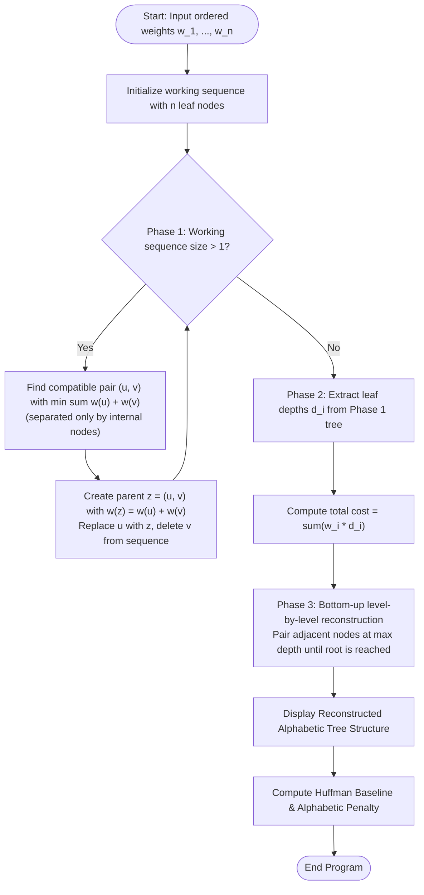

# Question 9: Hu-Tucker Greedy Simulation (Optimal Alphabetic Binary Trees)

<div align="center">


</div>

---

## 📌 Problem Statement

> Given an ordered sequence of weights $w_1, w_2, \dots, w_n$, construct an optimal alphabetic binary search tree or merge pattern that maintains the strict in-order sequence of indices while minimizing $\sum_{i=1}^n w_i \cdot \text{depth}(i)$.
> 
> By choosing the proper input representation, write a program in C to validate your algorithm and derive the complexity analysis of your algorithm.

---

## 🧠 Theoretical Formulation & Hu-Tucker Paradigm

### 1. Alphabetic Binary Trees vs. Huffman Trees

Let $S = \langle 1, 2, \dots, n \rangle$ be an ordered sequence of keys with associated positive weights $\langle w_1, w_2, \dots, w_n \rangle$.
- In standard **Huffman Coding**, leaves can be arbitrarily permuted across the binary tree.
- In an **Alphabetic Binary Tree**, the leaves must maintain their strict left-to-right in-order arrangement:
  $$\text{Leaf } 1 \prec \text{Leaf } 2 \prec \dots \prec \text{Leaf } n$$
- The optimization objective is to minimize the total weighted external path length:
  $$\min \sum_{i=1}^n w_i \cdot d_T(i)$$
  where $d_T(i)$ is the depth of leaf $i$ from the root.

While Dynamic Programming (Knuth's OBST algorithm) solves this in $\mathcal{O}(n^2)$ time, T.C. Hu and A.C. Tucker (1971) proved that a three-phase greedy method solves it in $\mathcal{O}(n \log n)$ time.

---

### 2. The Three Phases of the Hu-Tucker Algorithm

#### **Phase 1: Combination Phase (Compatible Greedy Pairing)**
We maintain a working sequence of active nodes initially populated with all $n$ original leaves:
1. **Definition of Compatibility:** Two active nodes $u$ and $v$ at positions $i < j$ in the working sequence are defined as **compatible** if and only if **no original leaf exists between them**:
   $$\forall k \in (i, j), \quad \text{seq}[k] \text{ is an internal (composite) node}$$
   - Any two adjacent nodes are trivially compatible.
   - Two nodes separated only by composite internal nodes created in prior merges are also compatible!
2. **Greedy Choice:** Among all compatible pairs $(u, v)$, identify the pair that minimizes the sum of weights:
   $$\min_{(u, v) \text{ compatible}} (w(u) + w(v))$$
   Ties are broken by choosing the leftmost first node, then leftmost second node.
3. **Merge & Sequence Replacement:** Create parent node $z$ with weight $w(z) = w(u) + w(v)$. Replace node $u$ with $z$ in the working sequence, and delete node $v$. Repeat until a single root remains.

> [!NOTE]
> The intermediate tree built in Phase 1 may not be planar (it might have crossed branches because non-adjacent nodes were merged). However, Hu and Tucker proved that the **depths of the initial leaves** in this intermediate tree are strictly identical to the optimal depths in a valid alphabetic tree!

#### **Phase 2: Level Assignment Phase**
Traverse the tree from Phase 1 to compute the exact depth $d_i = \text{depth}(\text{Leaf } i)$ for each key $i \in \{1, \dots, n\}$.

#### **Phase 3: Reconstruction Phase (Alphabetic Tree Synthesis)**
Given leaf depths $\langle d_1, d_2, \dots, d_n \rangle$:
- Iteratively merge adjacent pairs of nodes residing at the maximum current level $L_{max}$ into parent nodes at level $L_{max} - 1$.
- Because Kraft's inequality holds with equality ($\sum 2^{-d_i} = 1$), this bottom-up in-order merge is guaranteed to synthesize a planar, non-crossing alphabetic tree preserving the exact in-order sequence $\langle 1, 2, \dots, n \rangle$.

---

## 📊 Data Structures & Input Representation

| Component | Type | Description |
| :--- | :--- | :--- |
| `HTNode` | `struct` | Binary tree node storing `id`, `isLeaf`, `weight`, `depth`, and child pointers. |
| `leaves` | `HTNode**` | Direct pointers to the $n$ leaf nodes for tracking depths. |
| `seq` | `HTNode**` | Dynamic working sequence holding active leaf and internal nodes during Phase 1. |
| `depths` | `int*` | Computed optimal depth array $[d_1, d_2, \dots, d_n]$ extracted in Phase 2. |

### Functional Decomposition
- **`main()`**: Coordinates all 3 phases, audits the resulting tree, and reports the comparison against unrestricted Huffman cost.
- **`computeDepths(...)`**: DFS traversal determining external leaf levels.
- **`reconstructAlphabeticTree(...)`**: Bottom-up level pairing building the planar alphabetic tree.
- **`printTreeInOrder(...)`**: Hierarchical indented in-order visualizer.
- **`computeHuffmanCost(...)`**: Min-heap benchmark computing the unconstrained Huffman baseline.

---

## 🔄 Algorithmic Procedure



---

## ⏱️ Complexity Analysis

| Phase / Operation | Time Complexity | Auxiliary Space | Description |
| :--- | :---: | :---: | :--- |
| **Phase 1: Compatible Merging** | $\mathcal{O}(n^2)$ (Array) / $\mathcal{O}(n \log n)$ (Priority Queue) | $\mathcal{O}(n)$ | Scans compatible pairs across $n - 1$ merge steps. |
| **Phase 2: Depth Traversal** | $\Theta(n)$ | $\mathcal{O}(n)$ | Standard depth-first search recording leaf depths. |
| **Phase 3: Reconstruction** | $\mathcal{O}(n^2)$ | $\mathcal{O}(n)$ | Scans adjacent maximum-depth pairs level by level. |
| **Huffman Cost Audit** | $\mathcal{O}(n \log n)$ | $\mathcal{O}(n)$ | Min-heap baseline comparison. |
| **Total Algorithm** | $\mathbf{\mathcal{O}(n^2)}$ | $\mathbf{\mathcal{O}(n)}$ | Straightforward simulation; reducible to **$\mathcal{O}(n \log n)$** with priority queues. |

---

## 🛠️ Compilation & Execution

```bash
# Navigate to the Q9 directory
cd /Users/rishav07/Documents/college/SEM3/DAA/LAB9/Q9

# Compile using GCC
gcc -Wall -Wextra -std=c11 -O2 main.c -o main

# Run program
./main
```

---

## 💻 Sample Traces & Validation Cases

### Trace 1: Classical Five-Key Alphabetic Sequence
**Input:** Weights = `[10, 2, 3, 1, 5]`

```text
Enter the number of ordered sequence keys (n >= 2): 5
Do you wanna: 	(0) Enter weights manually or
		(1) Have them randomly generated?
Choice: 0
Enter 5 positive weights in strict order: 10 2 3 1 5

Ordered sequence weights: {10, 2, 3, 1, 5}

================ PHASE 1: COMBINATION PHASE (COMPATIBLE GREEDY) ================
+-------+------------+------------+-------------------------+-------------------+
| Merge | Left Node  | Right Node | Compatible Pair Weights | New Parent Weight |
+-------+------------+------------+-------------------------+-------------------+
|     1 | Leaf 3 (3) | Leaf 4 (1) | 3 + 1 = 4 |                 4 |
|     2 | Leaf 2 (2) | IntNode (4) | 2 + 4 = 6 |                 6 |
|     3 | IntNode (6) | Leaf 5 (5) | 6 + 5 = 11 |                11 |
|     4 | Leaf 1 (10) | IntNode (11) | 10 + 11 = 21 |                21 |
+-------+------------+------------+-------------------------+-------------------+

================ PHASE 2: LEVEL ASSIGNMENT RESULTS ================
+---------+------------+-------------+-------------------+
| Key (i) | Weight w_i | Level/Depth | Weighted Cost w*d |
+---------+------------+-------------+-------------------+
| Key 1   |         10 |           1 |                10 |
| Key 2   |          2 |           3 |                 6 |
| Key 3   |          3 |           4 |                12 |
| Key 4   |          1 |           4 |                 4 |
| Key 5   |          5 |           2 |                10 |
+---------+------------+-------------+-------------------+
Total Optimal Alphabetic Tree Cost : 42

================ PHASE 3: RECONSTRUCTED ALPHABETIC TREE ================
Tree Structure (In-Order with hierarchical indentation):
        [Key 5 (w=5)]
    (w=11)
                [Key 4 (w=1)]
            (w=4)
                [Key 3 (w=3)]
        (w=6)
            [Key 2 (w=2)]
(w=21)
    [Key 1 (w=10)]
------------------------------------------------------------------------

================ OPTIMALITY & COMPARISON AUDIT ================
Unrestricted Huffman Minimum Cost : 41
Alphabetic Hu-Tucker Minimum Cost : 42
Alphabetic Preservation Overhead   : +1 (2.44% increase over Huffman)
Order Invariant                    : STRICT IN-ORDER LEAF PRESERVATION MAINTAINED
================================================================
```

---

### Trace 2: Analysis of the "Price of Order"
- In the unconstrained Huffman tree, Key 4 ($w=1$) and Key 2 ($w=2$) merge first, then with Key 3 ($w=3$), achieving a total cost of $41$.
- In the Alphabetic Tree, Key 2 and Key 4 cannot be merged directly without violating in-order sequence!
- The Hu-Tucker algorithm yields the exact minimal cost satisfying the in-order constraint ($42$), incurring an overhead penalty of only $+1$ ($2.44\%$).
