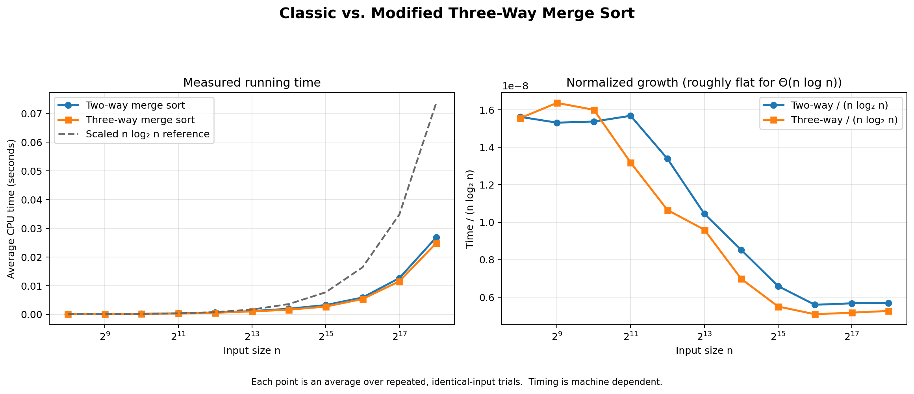
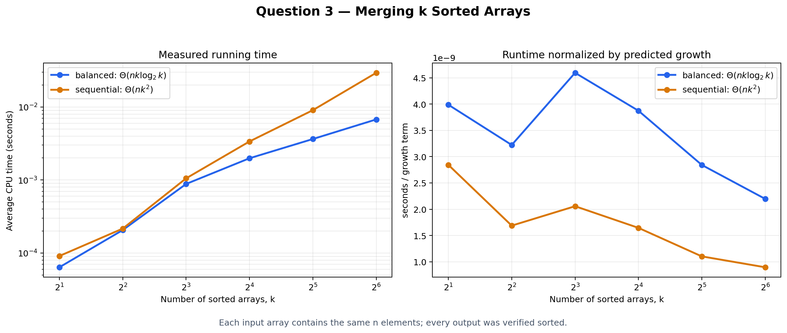

# 🚀 Design and Analysis of Algorithms

<div align="center">


### B.Tech CSE · Semester 3 · DAA Laboratory - 2026
</div>

> A collection of Design and Analysis of Algorithms laboratory work: C implementations, Python benchmark tools, result data, graphs, and detailed explanations for every completed question.
> 
> [📋 **DAA Lab Record Official Index Sheet (PDF)**](DAA_Lab_Index_Sheet.pdf)
****
## 📍 Quick navigation

| Lab | Lab sheet | Topics | Open |
| --- | --- | --- | --- |
| **Lab 01** | [Week 1 assignment PDF](LAB01/2026_Week1_DAA_Lab_01.pdf) | Growth, simulation, sorting, recursion, search | [Lab 01 README](LAB01/README.md) |
| **Lab 02** | [Week 2 assignment PDF](LAB02/2026_Week2_DAA_Lab_02.pdf) | Dictionaries, merge sort, merging sorted arrays | [Lab 02 README](LAB02/README.md) |
| **Lab 03** | [Week 3 assignment PDF](LAB03/2026_Week3_DAA_Lab_03.pdf) | Divide and conquer, searching, matrix multiplication, invariants | [Lab 03 README](LAB03/README.md) |
| **Lab 04** | [Week 4 assignment PDF](LAB04/2026_Week4_DAA_Lab_04.pdf) | Applications of sorting, two pointers, k-sum, sweep line, intervals | [Lab 04 README](LAB04/README.md) |
| **Lab 05** | [Week 5 questions image](LAB05/questions.png) | Selection without sorting, Quickselect, Quick Sort & Heap Sort file I/O | [Lab 05 README](LAB05/README.md) |
| **Lab 06** | [Week 6 assignment PDF](LAB06/2026_Week6_DAA_Lab_06.pdf) | Dynamic Programming, arrays, matrix, FFT, block reversal sort | [Lab 06 README](LAB06/README.md) |
| **Lab 07** | [Assignment PDF](LAB07/2026_Week7_DAA_Lab_07.pdf) | Puzzle algorithms, Frame-Stewart, Gray code switches, moving target, MCM | [Lab 07 README](LAB07/README.md) |
| **Lab 08** | [Week 8 assignment PDF](LAB08/2026_Week8_DAA_Lab_08.pdf) · [Report PDF](LAB08/DAA_Lab_08_Report_Rishav_Kumar.pdf) | Dynamic Programming, coin change, LCS, LIS, MSIS, edit distance, rod cutting, OBST, Collatz | [Lab 08 README](LAB08/README.md) |
| **Lab 09** | [Week 9 assignment PDF](LAB09/2026_Week9_DAA_Lab_09.pdf) · [Report PDF](LAB09/DAA_Lab_09_Report_Rishav_Kumar.pdf) | Greedy Design Paradigm, knapsack decay, Huffman, fuel, sticks, candy, reorganise string, deviation, meeting rooms, Hu-Tucker, superstring | [Lab 09 README](LAB09/README.md) |
| **Lab 10** | [Week 10 assignment PDF](LAB10/2026_Week10_DAA_Lab_10.pdf) · [Report PDF](LAB10/DAA_Lab_10_Report_Rishav_Kumar.pdf) | Graphs, Disjoint Set Union (DSU), bipartiteness, dynamic islands, size-constrained components, reverse deletion, smallest permutation | [Lab 10 README](LAB10/README.md) |

## 📈 Progress

```text
Lab 01  ████████████████████  100%  6 / 6 questions
Lab 02  ████████████████████  100%  3 / 3 questions
Lab 03  ████████████████████  100%  6 / 6 questions
Lab 04  ████████████████████  100%  6 / 6 questions
Lab 05  ████████████████████  100%  4 / 4 questions
Lab 06  ████████████████████  100%  8 / 8 questions
Lab 07  ████████████████████  100%  7 / 7 questions
Lab 08  ████████████████████  100%  9 / 9 questions
Lab 09  ████████████████████  100%  10 / 10 questions
Lab 10  ████████████████████  100%  5 / 5 questions
──────────────────────────────────────────────────────
Current work  ████████████████████  100%  10 completed labs · 64 questions
```

| Area | Status | Evidence |
| --- | :---: | --- |
| C implementations | ✅ Complete | Every completed question has a linked `main.c`. |
| Experimental data | ✅ Available | CSV files accompany benchmark-based questions. |
| Visual analysis | ✅ Available | Complexity and comparison charts are saved as PNG files. |
| Lab sheets | ✅ Linked | All 10 original assignment sheets / PDFs are available above. |

## 🧪 Lab 01 — Foundations

**Lab sheet:** [2026 Week 1 — DAA Lab 01](LAB01/2026_Week1_DAA_Lab_01.pdf) · **Full documentation:** [LAB01/README.md](LAB01/README.md)

| # | Question | Key idea | Files / result |
| :---: | --- | --- | --- |
| 1 | [Order of growth](LAB01/Q1/README.md) | Compare asymptotic growth functions | [C](LAB01/Q1/main.c) · [graph](LAB01/Q1/growth_comparison.png) |
| 2 | [Coin-toss simulation](LAB01/Q2/README.md) | Fair vs. biased probability experiment | [C](LAB01/Q2/main.c) · [graph](LAB01/Q2/coin_toss_comparison.png) |
| 3 | [Bubble-sort analysis](LAB01/Q3/README.md) | Measure sorting behaviour | [C](LAB01/Q3/main.c) · [graph](LAB01/Q3/q3_graph.png) |
| 4 | [Towers of Hanoi](LAB01/Q4/README.md) | Recursive solution and step count | [C](LAB01/Q4/main.c) · [graph](LAB01/Q4/steps_graph.png) |
| 5 | [Partition point](LAB01/Q5/README.md) | Locate a transition efficiently | [C](LAB01/Q5/main.c) |
| 6 | [Element uniqueness](LAB01/Q6/README.md) | Frequency-based analysis | [C](LAB01/Q6/main.c) · [graph](LAB01/Q6/frequency_distribution.png) |

## ⚙️ Lab 02 — Data Structures and Merging

**Lab sheet:** [2026 Week 2 — DAA Lab 02](LAB02/2026_Week2_DAA_Lab_02.pdf) · **Full documentation:** [LAB02/README.md](LAB02/README.md)

| # | Question | Key result | Files / result |
| :---: | --- | --- | --- |
| 1 | [Dictionary implementations](LAB02/Q1/README.md) | Compare array and linked-list dictionary choices | [implementations](LAB02/Q1/README.md) · [graph](LAB02/Q1/dictionary_time_complexity.png) |
| 2 | [Two-way vs. three-way merge sort](LAB02/Q2/README.md) | Both methods are `Θ(n log n)` | [C](LAB02/Q2/main.c) · [data](LAB02/Q2/data/benchmark_results.csv) · [graph](LAB02/Q2/plots/merge_sort_complexity.png) |
| 3 | [Merge `k` sorted arrays](LAB02/Q3/README.md) | Balanced merge: `Θ(nk log k)` vs. sequential: `Θ(nk²)` | [sequential C](LAB02/Q3/01_sequentialMerge/main.c) · [balanced C](LAB02/Q3/02_balancedPairwiseMerge/main.c) · [graph](LAB02/Q3/merge_k_arrays_complexity.png) |

### Featured benchmark results

<table>
  <tr>
    <td align="center"><a href="LAB02/Q2/README.md"><strong>Q2 — Merge sort comparison</strong></a><br><br></td>
    <td align="center"><a href="LAB02/Q3/README.md"><strong>Q3 — k-array merge comparison</strong></a><br><br></td>
  </tr>
</table>

## 🔍 Lab 03 — Divide and Conquer

**Lab sheet:** [2026 Week 3 — DAA Lab 03](LAB03/2026_Week3_DAA_Lab_03.pdf) · **Full documentation:** [LAB03/README.md](LAB03/README.md)

| # | Question | Key result | Files |
| :---: | --- | --- | --- |
| 1 | [Binary vs. ternary search](LAB03/Q1/README.md) | Both are `O(log n)`; binary search needs fewer comparisons on average | [benchmark C](LAB03/Q1/fun.c) · [interactive C](LAB03/Q1/main.c) |
| 2 | [Defective coin search](LAB03/Q2/README.md) | Candidate coins are halved in `O(log n)` balance operations | [C](LAB03/Q2/main.c) |
| 3 | [Maximum and minimum](LAB03/Q3/README.md) | Divide and conquer uses about `3n/2` comparisons | [C](LAB03/Q3/main.c) |
| 4 | [Strassen matrix multiplication](LAB03/Q4/README.md) | Seven subproblems give `O(n^log2(7))` time | [C](LAB03/Q4/main.c) |
| 5 | [Special-pattern matrix multiplication](LAB03/Q5/README.md) | Recursive block symmetry yields `O(n^2)` time | [C](LAB03/Q5/main.c) |
| 6 | [Selection sort and loop invariant](LAB03/Q6/README.md) | Exactly `n(n - 1) / 2` comparisons | [C](LAB03/Q6/main.c) |

Lab 3 setup helper: [folders.py](LAB03/folders.py).

## 🎯 Lab 04 — Applications of Sorting

**Lab sheet:** [2026 Week 4 — DAA Lab 04](LAB04/2026_Week4_DAA_Lab_04.pdf) · **Full documentation:** [LAB04/README.md](LAB04/README.md)

| # | Question | Key result | Files |
| :---: | --- | --- | --- |
| 1 | [Stable Color Sort](LAB04/Q1/README.md) | Counting sort bucket placement preserves numerical stability in `O(n)` | [C](LAB04/Q1/main.c) |
| 2 | [Pair Sum from Two Sets](LAB04/Q2/README.md) | Two-pointer scan on sorted arrays finds target pair in `O(n log n)` | [C](LAB04/Q2/main.c) |
| 3 | [k-Sum Problem](LAB04/Q3/README.md) | Recursive $(k-1)$ selection + binary search verifies $k$-sum in `O(n^(k-1) log n)` | [C](LAB04/Q3/main.c) |
| 4 | [Simultaneous Party Guests](LAB04/Q4/README.md) | Event-driven sweep line finds peak simultaneous attendees in `O(n log n)` | [C](LAB04/Q4/main.c) |
| 5 | [Merge Overlapping Intervals](LAB04/Q5/README.md) | Sorting by start time enables linear `O(n)` interval merging in `O(n log n)` total | [C](LAB04/Q5/main.c) |
| 6 | [Point in Maximum Intervals](LAB04/Q6/README.md) | Event sweep line with inclusive endpoint tie-breaking in `O(n log n)` | [C](LAB04/Q6/main.c) |

Lab 4 setup helper: [folders.py](LAB04/folders.py).

## ⚡ Lab 05 — Selection & Advanced Sorting

**Lab sheet:** [Questions Sheet (Image)](LAB05/questions.png) · **Full documentation:** [LAB05/README.md](LAB05/README.md)

| # | Question | Key result | Files |
| :---: | --- | --- | --- |
| 1 | [Find Median Without Sorting](LAB05/Q1/README.md) | Quickselect finds exact median in expected `O(n)` time | [C](LAB05/Q1/main.c) |
| 2 | [Find K'th Smallest Element](LAB05/Q2/README.md) | Hoare's Selection finds the $K$-th order statistic in expected `O(n)` time | [C](LAB05/Q2/main.c) |
| 3 | [Quick Sort with File I/O](LAB05/Q3/README.md) | Sorts $N$ random integers from file via divide-and-conquer partition in `O(n log n)` | [C](LAB05/Q3/main.c) |
| 4 | [Heap Sort with File I/O](LAB05/Q4/README.md) | Max-heap construction in `O(n)` + extraction guarantees worst-case `O(n log n)` | [C](LAB05/Q4/main.c) |

Lab 5 setup helper: [folders.py](LAB05/folders.py).

## 📚 Lab 06 — Dynamic Programming & Algorithm Analysis

**Lab sheet:** [2026 Week 6 — DAA Lab 06](LAB06/2026_Week6_DAA_Lab_06.pdf) · **Full documentation:** [LAB06/README.md](LAB06/README.md)

| Set / # | Question | Key result | Files |
| :---: | --- | --- | --- |
| S1/1 | [N-th Fibonacci Number](LAB06/Set1/Q1/README.md) | Dynamic Programming (Tabulation) computes $F(n)$ efficiently in `O(n)` time | [C](LAB06/Set1/Q1/main.c) |
| S1/2 | [0/1 Knapsack Problem](LAB06/Set1/Q2/README.md) | Tabulation DP finds optimal items subset in `O(n * W)` time | [C](LAB06/Set1/Q2/main.c) |
| S1/3 | [Longest Common Subsequence](LAB06/Set1/Q3/README.md) | 2D DP grid determines LCS string length & sequence in `O(m * n)` | [C](LAB06/Set1/Q3/main.c) |
| S1/4 | [Matrix Chain Multiplication](LAB06/Set1/Q4/README.md) | DP optimization dictates best parenthesization grouping in `O(N^3)` | [C](LAB06/Set1/Q4/main.c) |
| S2/1 | [1D Array Operations](LAB06/Set2/Q1/README.md) | Implements statistics functions and partitions deriving worst-case `O(n)` to `O(n^2)` | [C](LAB06/Set2/Q1/main.c) |
| S2/2 | [2D Square Matrix Operations](LAB06/Set2/Q2/README.md) | Validates complex matrix algorithms including Gaussian Determinant in `O(n^3)` | [C](LAB06/Set2/Q2/main.c) |
| S2/3 | [FFT Vector Convolution](LAB06/Set2/Q3/README.md) | Divide & Conquer Fast Fourier Transform achieves convolution in `O(n log n)` | [C](LAB06/Set2/Q3/main.c) |
| S2/4 | [Block Reversal Merge Sort](LAB06/Set2/Q4/README.md) | Hybrid Merge Sort sorts arrays solely via sequence flips in `O(n log^2 n)` | [C](LAB06/Set2/Q4/main.c) |

Lab 6 setup helper: [folders.py](LAB06/folders.py).

## 🧩 Lab 07 — Algorithm Application Questions Based on Puzzles

**Lab sheet:** [2026 Week 7 — DAA Lab 07](LAB07/2026_Week7_DAA_Lab_07.pdf) · **Full documentation:** [LAB07/README.md](LAB07/README.md)

| # | Question | Key result | Files |
| :---: | --- | --- | --- |
| 1 | [Invert the Coin-Triangle](LAB07/Q1/README.md) | Equilateral lattice overlap maximization yields minimum $\lfloor \frac{n(n+1)}{6} \rfloor$ moves | [C](LAB07/Q1/main.c) |
| 2 | [Super Egg Testing Experiment](LAB07/Q2/README.md) | Generalized DP finds minimum worst-case drops for $E$ eggs & $F$ floors (14 drops for 2 eggs, 100 floors) | [C](LAB07/Q2/main.c) |
| 3 | [Reve's Puzzle (4-Peg Hanoi)](LAB07/Q3/README.md) | Frame-Stewart algorithm solves 8 disks in 33 moves, generalized to $n$ disks | [C](LAB07/Q3/main.c) |
| 4 | [Security Switches](LAB07/Q4/README.md) | Baguenaudier / Gray code recurrence deactivates $n$ military switches in $\lfloor \frac{2^{n+1}}{3} \rfloor$ moves | [C](LAB07/Q4/main.c) |
| 5 | [Hitting a Moving Target](LAB07/Q5/README.md) | Two-phase parity sweep intercepts hidden target along $n$ spots in $\le 2n - 4$ shots | [C](LAB07/Q5/main.c) |
| 6 | [The Best Time to be Alive](LAB07/Q6/README.md) | Event sweep-line with custom tie-breaking determines peak concurrent prominent scientists in $O(N \log N)$ | [C](LAB07/Q6/main.c) |
| 7 | [Matrix Chain Multiplication (MCM)](LAB07/Q7/README.md) | Tabulation DP computes optimal scalar multiplications and parenthesization ordering in $O(n^3)$ | [C](LAB07/Q7/main.c) |

Lab 7 setup helper: [folders.py](LAB07/folders.py).

## 💡 Lab 08 — Dynamic Programming Design Paradigm

**Lab sheet:** [2026 Week 8 — DAA Lab 08](LAB08/2026_Week8_DAA_Lab_08.pdf) · **Full documentation:** [LAB08/README.md](LAB08/README.md)

| # | Question | Key result | Files |
| :---: | --- | --- | --- |
| 1 | [Minimum Coin Change](LAB08/Q1/README.md) | Tabulation DP finding optimal coin count and chosen coins in $O(n \cdot V)$ | [C](LAB08/Q1/main.c) |
| 2 | [Coin Change: Total Number of Ways](LAB08/Q2/README.md) | Unbounded combination DP counting total distinct partitions in $O(n \cdot V)$ | [C](LAB08/Q2/main.c) |
| 3 | [Longest Common Subsequence (LCS)](LAB08/Q3/README.md) | 2D tabulation DP with directional traceback matrix in $O(m \cdot n)$ | [C](LAB08/Q3/main.c) |
| 4 | [Longest Increasing Subsequence (LIS)](LAB08/Q4/README.md) | Dual $O(n^2)$ tabulation DP + $O(n \log n)$ patience sorting with reconstruction | [C](LAB08/Q4/main.c) |
| 5 | [Maximum Sum Increasing Subsequence (MSIS)](LAB08/Q5/README.md) | Dynamic programming maximizing subsequence sum in $O(n^2)$ with element reconstruction | [C](LAB08/Q5/main.c) |
| 6 | [Edit Distance with Traceback Information](LAB08/Q6/README.md) | Levenshtein distance DP with step-by-step alignment script (Insert, Delete, Replace, Match) | [C](LAB08/Q6/main.c) |
| 7 | [Rod Cutting with Reconstruction](LAB08/Q7/README.md) | Revenue maximization in $O(n^2)$ with complete piece decomposition breakdown | [C](LAB08/Q7/main.c) |
| 8 | [Optimal Binary Search Trees (OBST)](LAB08/Q8/README.md) | CLRS 15.5 tabulation DP computing $e, w, root$ tables and tree hierarchy in $O(n^3)$ | [C](LAB08/Q8/main.c) |
| 9 | [Collatz Conjecture (Open Unsolved Problem)](LAB08/Q9/README.md) | Modular dynamical orbit simulator with overflow protection and interval $[a, b]$ analysis | [C](LAB08/Q9/main.c) |

Lab 8 setup helper: [folders.py](LAB08/folders.py).

## 💎 Lab 09 — Greedy Design Paradigm

**Lab sheet:** [2026 Week 9 — DAA Lab 09](LAB09/2026_Week9_DAA_Lab_09.pdf) · **Full documentation:** [LAB09/README.md](LAB09/README.md)

| # | Question | Key result | Files |
| :---: | --- | --- | :---: |
| 1 | [Fractional Knapsack with Deterioration](LAB09/Q1/README.md) | Adjacent exchange proof shows faster-decaying items ($\lambda$) take strict priority in $O(n \log n)$ | [C](LAB09/Q1/main.c) |
| 2 | [Canonical Huffman Coding](LAB09/Q2/README.md) | Min-heap prefix tree synthesis + canonical codebook ordered by length in $O(n \log n)$ | [C](LAB09/Q2/main.c) |
| 3 | [Minimum Refueling Stops (Reverse Greedy)](LAB09/Q3/README.md) | Retroactive max-heap greedy vehicle simulation minimizing stops to target $D$ in $O(n \log n)$ | [C](LAB09/Q3/main.c) |
| 4 | [Minimum Cost to Connect Sticks](LAB09/Q4/README.md) | Binary merge tree synthesis equivalent to Huffman external path length in $O(n \log n)$ | [C](LAB09/Q4/main.c) |
| 5 | [Candy Distribution Problem](LAB09/Q5/README.md) | Bi-directional slope greedy scan resolving relative neighbor constraints in linear $\Theta(n)$ | [C](LAB09/Q5/main.c) |
| 6 | [Reorganise String with K-Distance Apart](LAB09/Q6/README.md) | Max-heap frequency priority queue + circular FIFO cooldown queue in $O(N \log \|\Sigma\|)$ | [C](LAB09/Q6/main.c) |
| 7 | [Minimise Deviation in Array](LAB09/Q7/README.md) | Two-way greedy reduction to monotonic descent via odd doubling and max-heap in $O(n \log(\max A) \log n)$ | [C](LAB09/Q7/main.c) |
| 8 | [Minimum Number of Meeting Rooms](LAB09/Q8/README.md) | Interval graph coloring / earliest-start scan with min-heap proving $\chi(G) = \omega(G) = d$ in $O(n \log n)$ | [C](LAB09/Q8/main.c) |
| 9 | [Hu-Tucker Greedy Simulation](LAB09/Q9/README.md) | 3-phase optimal alphabetic binary tree construction maintaining strict in-order in $O(n^2)$ | [C](LAB09/Q9/main.c) |
| 10 | [Greedy Superstring Conjecture](LAB09/Q10/README.md) | Exploration of NP-hard SCS, greedy overlap heuristic, and September 2026 ArXiv disproof ($9/4 = 2.25$) | [C](LAB09/Q10/main.c) |

Lab 9 setup helper: [folders.py](LAB09/folders.py).

## 🌐 Lab 10 — Graphs & Disjoint Set Union (DSU)

**Lab sheet:** [2026 Week 10 — DAA Lab 10](LAB10/2026_Week10_DAA_Lab_10.pdf) · **Full documentation:** [LAB10/README.md](LAB10/README.md)

| # | Question | Key result | Files |
| :---: | --- | --- | :---: |
| 1 | [Online Graph-Bipartiteness Testing](LAB10/Q1/README.md) | Parity potential DSU tracking 2-coloring; rejects odd cycles and traces paths via BFS in $O(M \cdot \alpha(V))$ | [C](LAB10/Q1/main.c) |
| 2 | [Dynamic Connected Components in a Grid](LAB10/Q2/README.md) | Number of Islands II using coordinate flattening $\phi(r, c) = r \cdot C + c$ and 4-neighbor DSU in $O(R \cdot C + k \cdot \alpha(R \cdot C))$ | [C](LAB10/Q2/main.c) |
| 3 | [Maximum Weight Component with Size Constraints](LAB10/Q3/README.md) | Augmented DSU tracking sizes, weights, and versioning with lazy max-heap in $O(M \log(V + M))$ | [C](LAB10/Q3/main.c) |
| 4 | [Reverse Time-Step DSU Application](LAB10/Q4/README.md) | Offline time-reversal converting vertex deletions into incremental activations in $O((V + E) \cdot \alpha(V))$ | [C](LAB10/Q4/main.c) |
| 5 | [Lexicographically Smallest Permutation](LAB10/Q5/README.md) | Transposition generation of $S_{|C|}$ on connected components, greedy sorting in $O(M \cdot \alpha(n) + n \log n)$ | [C](LAB10/Q5/main.c) |

Lab 10 setup helper: [folders.py](LAB10/folders.py).

## 📁 Repository structure

```text
DAA/
├── LAB01/
│   ├── 2026_Week1_DAA_Lab_01.pdf   Assignment sheet
│   ├── Q1/ … Q6/                   Programs, data, graphs, and READMEs
│   └── README.md
├── LAB02/
│   ├── 2026_Week2_DAA_Lab_02.pdf   Assignment sheet
│   ├── Q1/                         Dictionary implementations
│   ├── Q2/                         Two-way vs. three-way merge sort
│   ├── Q3/                         Sequential vs. balanced k-array merge
│   └── README.md
├── LAB03/
│   ├── 2026_Week3_DAA_Lab_03.pdf   Assignment sheet
│   ├── Q1/ … Q6/                   Programs and question READMEs
│   ├── folders.py                  Setup script
│   └── README.md
├── LAB04/
│   ├── 2026_Week4_DAA_Lab_04.pdf   Assignment sheet
│   ├── Q1/ … Q6/                   Programs and question READMEs
│   ├── folders.py                  Setup script
│   └── README.md
├── LAB05/
│   ├── questions.png               Assignment sheet
│   ├── Q1/ … Q4/                   Programs and question READMEs
│   ├── folders.py                  Setup script
│   └── README.md
├── LAB06/
│   ├── 2026_Week6_DAA_Lab_06.pdf   Assignment sheet
│   ├── Set1/                       Dynamic Programming
│   ├── Set2/                       Algorithm Analysis & Complexities
│   ├── folders.py                  Setup script
│   └── README.md
├── LAB07/
│   ├── 2026_Week7_DAA_Lab_07.pdf   Assignment sheet
│   ├── Q1/ … Q7/                   Programs and question READMEs
│   ├── folders.py                  Setup script
│   └── README.md
├── LAB08/
│   ├── 2026_Week8_DAA_Lab_08.pdf   Assignment sheet
│   ├── DAA_Lab_08_Report_Rishav_Kumar.pdf  Report PDF
│   ├── Q1/ … Q9/                   Programs and question READMEs
│   ├── folders.py                  Setup script
│   └── README.md
├── LAB09/
│   ├── 2026_Week9_DAA_Lab_09.pdf   Assignment sheet
│   ├── DAA_Lab_09_Report_Rishav_Kumar.pdf  Report PDF
│   ├── Q1/ … Q10/                  Programs and question READMEs
│   ├── folders.py                  Setup script
│   ├── report.typ                  Report source
│   └── README.md
├── LAB10/
│   ├── 2026_Week10_DAA_Lab_10.pdf  Assignment sheet
│   ├── DAA_Lab_10_Report_Rishav_Kumar.pdf  Report PDF
│   ├── Q1/ … Q5/                   Programs and question READMEs
│   ├── folders.py                  Setup script
│   ├── report.typ                  Report source
│   └── README.md
└── README.md                        You are here
```

## 🛠️ Tools used

- **C11** with `cc`/GCC for algorithm implementations
- **Python 3** for benchmark data collection and plotting
- **matplotlib** for visual complexity analysis
- **Git and GitHub** for version control

Most questions can be built with `cc -std=c11 -Wall -Wextra main.c -o program`. Exact commands, expected output, and data/graph links are in each question README.

## 🏷️ Tags

`design-and-analysis-of-algorithms` `daa` `algorithms` `data-structures` `asymptotic-analysis` `divide-and-conquer` `sorting-applications` `two-pointers` `sweep-line` `interval-merging` `merge-sort` `recursion` `benchmarking` `c-programming` `python` `matplotlib` `btech-cse` `semester-3` `dynamic-programming` `greedy-algorithms` `graphs` `disjoint-set-union` `dsu` `bipartite-graph` `connected-components` `time-reversal` `number-of-islands`

<div align="center">

**Explore a lab, run an algorithm, and follow the data to the graph. 📊**

</div>
